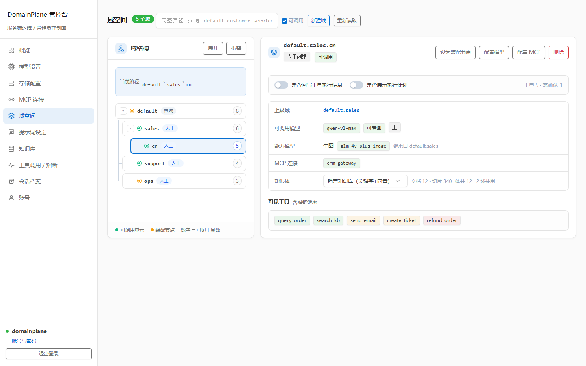
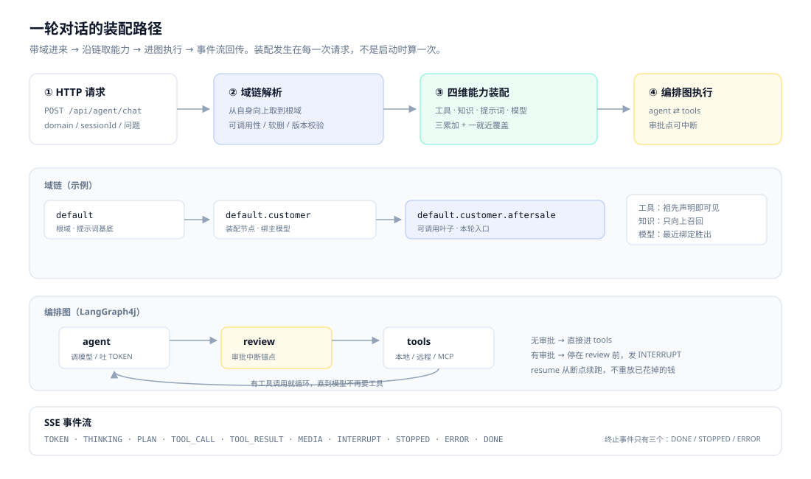
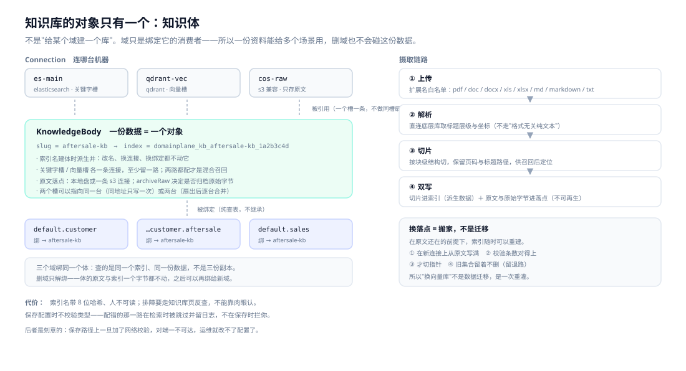
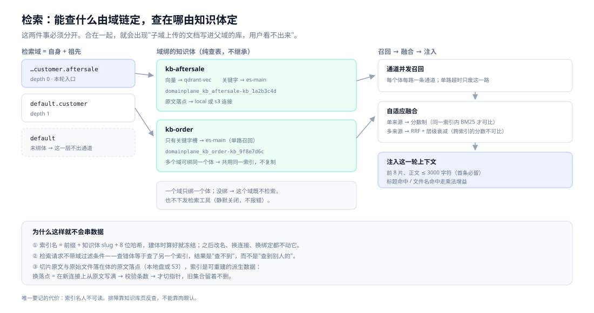
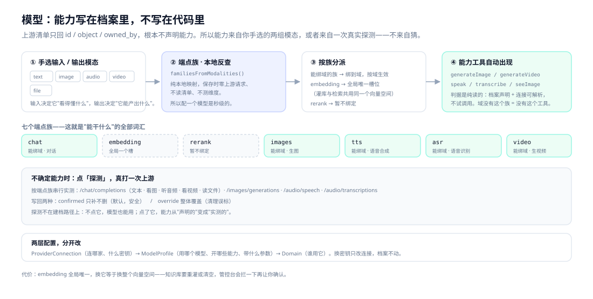
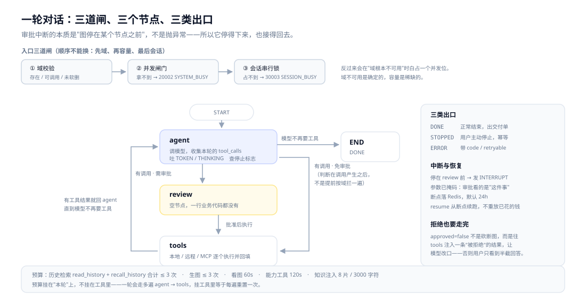
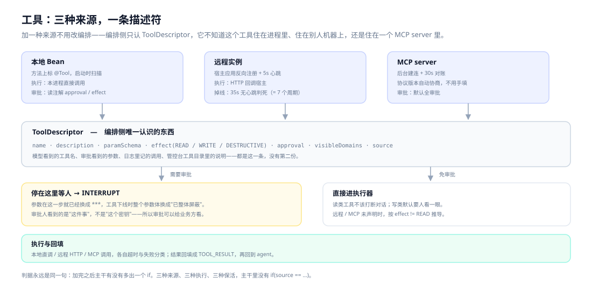
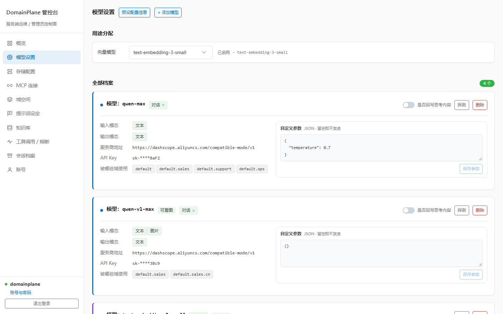
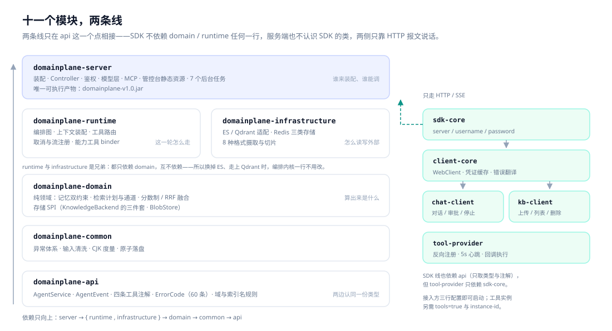
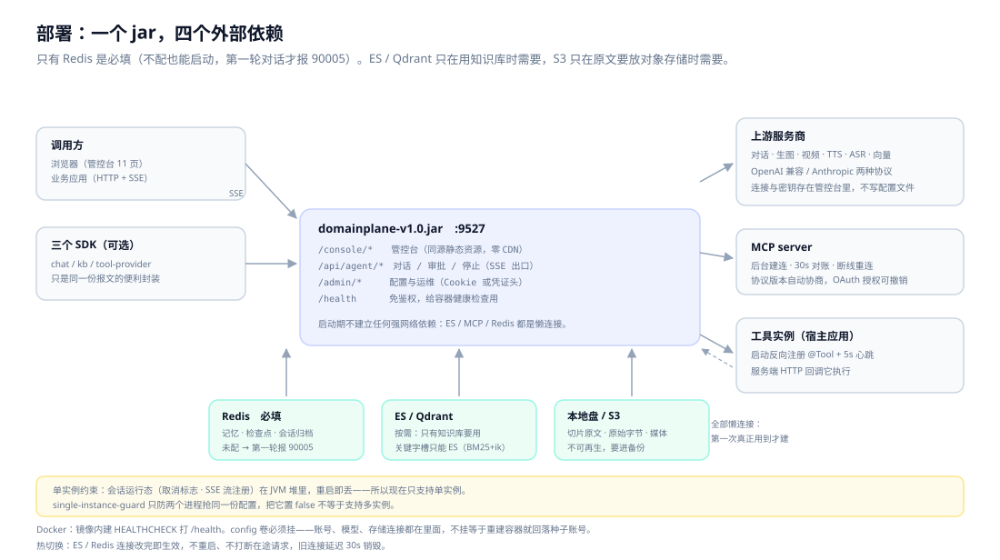

# DomainPlane

**One jar. Any number of business scenarios.**

A scenario is a dotted path — a *domain*, such as `default.customer.aftersale`. Every turn carries its domain; the server walks the chain and assembles four capability dimensions — **tools, knowledge, prompt, model** — for that turn. One process serves every domain at once.

No "one agent service per scenario", and no `tenant_id` leaking into every query.

> **For** teams that need LLMs across many business scenarios without running one agent service per scenario.
> **How**: configure domains and models in the console → call once over SSE, carrying the domain.


[](LICENSE)

[Why](#why-this-exists) · [Quick start](#three-minutes-to-run) · [Three first-class objects](#three-first-class-objects) · [One turn](#how-one-turn-flows) · [Architecture](#architecture-eleven-modules-two-lines) · [Comparison](#how-it-compares) · [Docs](#documentation) · [中文](README.md)

---



> Screenshot from the demo environment; data is synthetic. The other 10 pages are in the [illustrated console guide](docs/16-管控台使用图解.md) (Chinese).

---

## Why this exists

Add scenarios and the "one service per scenario" approach makes you re-implement the tool system, knowledge retrieval, conversation memory, model integration, multimodal handling and admin console several times over. Six months later you own a handful of incompatible agent services.

The other default — one big service plus a `tenant_id` column — leaks the tenant key into every query, every assembly step and every cleanup job. Miss one `WHERE` clause and you have a cross-tenant leak.

DomainPlane takes a third route: **isolation is neither deployment nor a filter condition.**

The domain decides how capabilities are assembled for the turn and which knowledge bodies it may read. Each body owns one index whose name is derived from its unique slug and frozen at creation — so "querying the wrong body" means *finding nothing*, not *reading someone else's data*.

---

## Three minutes to run

```bash
git clone https://github.com/zzKingcc/DomainPlane.git && cd DomainPlane

# 1. Build (output: domainplane-server/target/domainplane-v1.0.jar)
mvn clean package

# 2. Run (always override the config directory for local development,
#    otherwise files land on the system drive root)
java -DDOMAINPLANE_SETTINGS_PATH="$PWD/.dev/config" \
     -jar domainplane-server/target/domainplane-v1.0.jar

# 3. Verify
curl http://localhost:9527/health
# {"code":0,"status":"UP","service":"domainplane-server","version":"v1.0"}
```

Open `http://localhost:9527/console/login.html`, sign in with the seed account `domainplane` / `domainplane`, then four steps to a working conversation:

**Storage** (Redis required; ES / Qdrant optional) → **provider connection + model profile** (hand-pick input/output modalities; the endpoint family is inferred locally, zero upstream requests on save) → **bind to a domain** → **change the default password** (with the default password, all mutation writes are rejected).

For retrieval, create a knowledge body on the knowledge-base page, upload documents and bind the body to a domain.

Calling it is two steps — exchange a credential, then send a turn:

```bash
# Exchange credential
CRED=$(curl -s -X POST http://localhost:9527/api/agent/login \
  -H "Content-Type: application/json" \
  -d '{"username":"domainplane","password":"domainplane"}' \
  | sed -n 's/.*"credential":"\([^"]*\)".*/\1/p')

# One turn, streaming over SSE
curl -N -X POST http://localhost:9527/api/agent/chat \
  -H "Content-Type: application/json" \
  -H "X-DomainPlane-Credential: $CRED" \
  -d '{"sessionId":"demo-1","domain":"default.customer.aftersale","message":"Can this order be refunded?"}'
```

```java
DomainPlaneAgent agent = agentFactory.forDomain("default.customer.aftersale");
String answer = agent.ask("demo-1", "Can this order be refunded?");
```

> `-D` must come **before** `-jar`; after it, the flag is silently ignored — the most common cause of "I changed the config but nothing happened".
> If it won't start or won't configure, see the failure table in [Getting started §6](docs/01-快速上手.md). Docker: same document, §3.

---

## Three first-class objects

Only three things in this system deserve separate understanding: the **domain** (who may use it), the **knowledge body** (what is read), the **model profile** (which model, with which capabilities). Everything else is a combination.

### Domain: an assembly key, not just a tag

In most "multi-scenario" systems the scenario is a filter field. Here the domain is both the **assembly dimension** and the **storage boundary**.



Three additive dimensions and one override is not arbitrary. Tools, knowledge and prompt are *capability supply*: what a parent provides, a child should be able to use. A model is a *resource binding*: one domain uses exactly one profile, and merging endpoint families would produce the absurd "text from A, images from B" profile.

**The cost**: only leaf domains are callable entry points (a parent is an assembly node), otherwise you get the "half configured here, half configured there" hybrid assembly.

### Knowledge body: one dataset, one index

Not "build a library for a domain". The domain is only a consumer that binds a body — so one dataset serves many scenarios, and deleting a domain never touches the data.



Index name = `domainplane_kb_` + the body's unique slug + an 8-character hash, derived once at creation and frozen: renaming, changing connections or rebinding never moves it. Retrieval therefore carries **no domain filter** — isolation is already physical.

*What can be read* is decided by the domain chain (self + ancestors); *how results are ranked* is adaptive fusion:



A body has at most two retrieval slots (vector / keyword), each pointing at one connection: both configured = hybrid retrieval, one = single-path, a broken path skips only itself. The keyword slot expects Elasticsearch (BM25 + ik is a dialect); vectors live in Elasticsearch or Qdrant.

**The cost**: index names carry an 8-character hash and are unreadable by design — troubleshooting goes through the knowledge-base page, not your eyes. And saving does not validate types: a misconfigured path only surfaces at retrieval time.

### Model profile: capabilities live in the profile

Upstream model lists return only `id / object / owned_by` — they never declare capabilities. So capability comes from the modalities you hand-pick, or from a real probe — never from guessing.



Two layers, changed independently: `ProviderConnection` (which provider, which key) → `ModelProfile` (which model, which capabilities, which parameters) → `Domain` (who uses it). Rotating a key touches only the connection.

**The cost**: `embedding` is globally unique — switching it means switching the entire vector space, so the knowledge base must be re-ingested or cleared.

---

## How one turn flows

An approval interrupt is "the graph stops before a node", not an exception. That is why it can stop cleanly and resume exactly where it stopped.



Three nodes, two loops, three exits. `review` contains no business code at all — it exists only to give the graph a place where it *can* stop.

When approval is denied, the graph is not killed: a "user rejected" tool result is injected into `tools` so the model can adjust — otherwise the user sees half an answer.

---

## What it solves

| Your problem | How DomainPlane handles it |
| --- | --- |
| Many scenarios, one runtime | Domain tree assembles tools / knowledge / prompt / model per turn; declared on the parent, inherited by children |
| Scenarios must not leak into each other | One dataset, one index, frozen at creation; isolation at the physical layer, not in SQL conditions |
| One dataset, many scenarios | A body binds to many domains; vector + BM25 adaptive fusion |
| Tools from everywhere | Local `@Tool`, remote instances and MCP land in one catalog behind one `ToolDescriptor` |
| Writes you don't trust to a model | Approval interrupt + masked arguments + checkpoint resume; it continues from where it stopped |
| Vendor lock-in | OpenAI-style transports, endpoint families inferred locally, custom parameters passed through verbatim |
| Context drift over long chats | Append-only memory, 24k budget with a degradation order, rolling summaries, recall-by-turn |
| Documents that won't fit | `pdf` / `doc` / `docx` / `xls` / `xlsx` / `md` / `markdown` / `txt`, chunked by heading hierarchy and coordinates |
| Config changes that need a restart | 11-page console, hot-swappable connections, old pools disposed after 30s |
| SDK lock-in | HTTP + SSE is the entire protocol; three SDKs are conveniences over the same wire format, raw `curl` is equivalent |

---

## Design decisions

### Tools: three sources, one descriptor



The name the model sees, the arguments the approver sees, the call recorded in logs — all come from one `ToolDescriptor`. When an approval interrupts the turn, the arguments are **already masked**: the approver reviews the *action*, not the API key.

Within a turn, `read_history` + `recall_history` share a budget of 3 calls, so the model cannot turn retrieval into a ball game; knowledge retrieval and capability tools have their own limits (8 chunks / 3,000 characters injected, 60s for vision, 120s for generation).

### MCP: no protocol version to fill in

On connect the server probes `server/discover`. If the peer supports `2026-07-28`, requests are stateless (version and capabilities declared per request, no session); otherwise it falls back to the `initialize` handshake. The console shows the negotiated version and era; tools can be try-run in the page, and writes require explicit confirmation and are audited.

**The cost**: one extra probe round-trip; for servers implementing only the old protocol, the first request is slightly slower.

### Config changes take effect immediately, no restart

Elasticsearch and Redis connections are hot-swapped without touching in-flight requests; the old pool is disposed 30 seconds later.

**The cost**: hot-swapping means any save can introduce a broken connection, and saving **performs no checks** (no network request, no type validation). Whether a configuration works only surfaces when retrieval or ingestion actually runs — the broken path is skipped and logged. This is deliberate: put validation on the save path and the console refuses to save whenever the peer is unreachable, which means operators can no longer change configuration at all.

### One person can operate it



- **Domains**: callable models, the bound knowledge body and visible tools sit on one card; the parent domain is an assembly node, leaf domains are the callable units, and "visible tools (including inherited)" answers the only question that matters.
- **Models**: adding a profile means hand-picking input/output modalities; the endpoint family is inferred locally, and the **Probe** button measures real capability and writes findings back (add-only by default). The "Purpose assignment" bar at the top is the single platform-wide embedding slot.
- **Knowledge base**: a body card carries every action for one dataset — upload, documents, health, rebuild, change landing spot, bind domains, delete; an operations section handles diagnostics, adopting orphaned collections, cleanup and merging bodies.

---

## Architecture: eleven modules, two lines



The server line runs upward from `api`; the SDK line branches off `api`. **The two lines meet only at `api` — everything else is coupled over HTTP payloads.**

The important part: `infrastructure` and `runtime` are **siblings, not layers**. The kernel knows only the SPIs declared in `domain`; it has never seen an adapter implementation. That is why swapping Elasticsearch for Qdrant does not touch a single line of orchestration code.

| Layer | Answers only | Must not contain |
| --- | --- | --- |
| `server` | Who assembles, who may call | Orchestration state machine, retrieval scoring |
| `runtime` | How this turn flows | ES clients, HTTP details |
| `domain` | What the computation produces | Spring MVC, Redis sessions |
| `infrastructure` | How to read/write the outside | Domain chains, budgets, events |

---

## Extension: three seams

Every seam is judged by the same sentence: **did the trunk gain another `if`?**

| Seam | How to extend | What you touch |
| --- | --- | --- |
| Storage backend | Implement `KnowledgeBackend` (store / keyword / vector as three Optionals) | New adapter + one wiring branch; zero changes in `domain` / `runtime` |
| Tools | Annotate a method with `@Tool` | Local scan, remote registration, MCP bridge — orchestration only sees `ToolDescriptor` |
| Integrators | HTTP + SSE | The three SDKs are conveniences over the same wire format; raw `curl` is equivalent |

Adding a tool looks like this — no registry, no config file:

```java
@Component
public class OrderTools {

    @Tool(desc = "Track a shipment by order number", effect = Effect.READ,
          domains = {"default.customer.aftersale"})
    public String trackOrder(@ToolParam("Order number, e.g. SO2024110001") String orderNo) {
        return logisticsClient.track(orderNo);
    }

    @Tool(desc = "Issue a refund", effect = Effect.WRITE, approval = Approval.ALWAYS,
          approvalReason = "A refund moves real money; a human must confirm")
    public RefundResult refund(@ToolParam("Order number") String orderNo,
                               @ToolParam("Refund amount in cents") long amountFen) {
        return orderService.refund(orderNo, amountFen);
    }
}
```

`effect = WRITE` + `approval = ALWAYS` means: the model may request it, but **the money stops until a person approves** — and that person sees masked arguments.

---

## How it compares

The short version: **this is not a visual workflow builder.**

**Choose it if**: several business scenarios must share one agent runtime; you need self-hosting and embedding into existing systems; you don't want to copy a service for every new scenario.

**Skip it if**: you want drag-and-drop orchestration and a plugin marketplace (Dify / Coze fit better); your pain is complex document parsing (RAGFlow is the specialist); you need multi-instance horizontal scaling today.

| | DomainPlane | Dify | RAGFlow | FastGPT | Coze | Spring AI / LangChain4j |
| --- | --- | --- | --- | --- | --- | --- |
| Form | Self-hosted agent runtime (Java) | Visual LLM app platform | RAG / document engine | Knowledge-base Q&A platform | SaaS agent builder | Application framework (library) |
| Multi-scenario model | **Domain tree, assembled per turn** | Per app / workflow | Per knowledge base | Per app | Per bot | Design your own |
| Capability reuse | Declared on parent, inherited by children | Copy the app or share the workflow | Share a knowledge base | Copy the app | Copy the bot | Write it yourself |
| Tools | Annotations / remote instances / MCP | Plugins + custom tools | Limited | HTTP tools | Plugins | Implement yourself |
| Retrieval | One index per knowledge body, shared by domains, vector + BM25 adaptive fusion | Built-in RAG | **Strong (deep parsing)** | Strong | Built-in | Build your own |
| Multimodal | Image, video, TTS, transcription, vision | Partial | Limited | Limited | Partial | Depends on provider |
| Console | 11 pages, hot-swappable connections | Yes | Yes | Yes | SaaS console | None |
| Integration | HTTP/SSE + 3 SDKs | API | API | API | API | In-code |
| Deployment | Single jar + Redis | Docker / K8s | Docker | Docker | Cloud | Alongside your app |
| Best for | Many scenarios, self-hosted, embedded in existing systems | Fast app building | Document-heavy Q&A | Knowledge-base Q&A | Quick experiments | Building your own platform |

> Based on each product's publicly stated positioning as of 2026-11. Check their own docs for version-specific details.

**The shortcomings, plainly**: no visual workflow editor, no plugin marketplace, a young ecosystem, and multi-instance deployment is not supported yet.

---

## Deployment: one jar, four external dependencies



Only Redis is required (the server still starts without it; the first turn fails with `90005`). Elasticsearch / Qdrant is needed only for retrieval; S3 only when raw files should live in object storage — **startup establishes no hard network dependency at all**.

**The single-instance constraint, stated plainly**: session runtime state (cancellation flags, SSE stream registration) lives in the JVM heap and is lost on restart. `single-instance-guard` only prevents two processes from grabbing the same configuration; setting it to `false` does not enable multi-instance.

---

## Stack

Java 21 · Spring Boot 3.5.7 · LangChain4j 1.18.1 · LangGraph4j 1.8.17 · Elasticsearch 9.4.4 / Qdrant · Redis

About 61k lines of main code across 397 files, roughly 1,500 test methods in 214 test classes (measured 2026-11). These numbers drift; they are here for one reason only: this is a codebase you can read and change, not a black box you can only call.

---

## Documentation

One document per module: constraints, decisions, and the price paid — cross-references point, they do not repeat. The module docs are written in Chinese; start with 01 if you are new, 02 if you are taking over.

| # | Document | What it answers |
| --- | --- | --- |
| 01 | [快速上手](docs/01-快速上手.md) | Prerequisites, build and run, first four configuration steps, verification, failure table |
| 02 | [架构总览](docs/02-架构总览.md) | Module responsibilities and dependency direction, where a turn lands, where state lives |
| 03 | [域与能力装配](docs/03-域与能力装配.md) | Domain rules, four-dimension merge, callability, version history, three-stage deletion |
| 04 | [对话编排](docs/04-对话编排.md) | State graph, ten events, approval and resume, stop semantics, planning, timeouts, failure exits |
| 05 | [记忆与上下文](docs/05-记忆与上下文.md) | Append-only memory, the 24k budget and degradation order, summaries, history recall |
| 06 | [工具体系](docs/06-工具体系.md) | Four annotations, visibility algorithm, approval and masking, remote instances and heartbeats |
| 07 | [知识库](docs/07-知识库.md) | Bodies as data entities, landing spots and route changes, raw archives, operations, retrieval fusion, ingestion |
| 08 | [模型与多模态](docs/08-模型与多模态.md) | Profiles and endpoint families, hand-picked modalities, probe write-back, protocol dispatch, capability tools |
| 09 | [MCP 接入](docs/09-MCP接入.md) | Protocol-version detection, transports, tool bridging and naming, default approval, try-runs, OAuth |
| 10 | [管控台](docs/10-管控台.md) | Eleven pages, page-to-endpoint map, how to change the front end |
| 11 | [鉴权与错误码](docs/11-鉴权与错误码.md) | HMAC credentials, two carriers, 60 error codes with dual wording |
| 12 | [SDK 接入](docs/12-SDK接入.md) | Three SDKs: configuration, usage, approval flow, wire contract |
| 13 | [配置参考](docs/13-配置参考.md) | Every yaml key and default, on-disk files, settings that must change together |
| 14 | [运维与边界](docs/14-运维与边界.md) | Single-instance constraint, backup and restore, background jobs, upgrades, troubleshooting |
| 15 | [OpenAI 风格 API 全景](docs/15-OpenAI风格API全景.md) | Three transports, endpoint inventory, modality matrix, compatibility spectrum |
| 16 | [管控台使用图解](docs/16-管控台使用图解.md) | 11 pages: section-by-section screenshots, operation order and caveats |

---

## Contributing

```bash
mvn clean package   # full build
mvn -o test         # full test suite
```

Before opening a PR:

- [ ] `mvn clean package` passes and the affected module's tests pass
- [ ] New or changed behaviour has test coverage
- [ ] External contracts or error codes are reflected in [`docs/11-鉴权与错误码.md`](docs/11-鉴权与错误码.md)
- [ ] No "silent degradation": missing capability, denied access and unconfigured dependencies all fail loudly

Four conventions:

1. **One contract source**: cross-process types (requests, events, tool metadata, error codes) live only in `domainplane-api`. Never copy them into an SDK or the server. `AgentService` has two implementations pointing in opposite directions (runtime and chat-client) — adding a method means changing both.
2. **Error codes are registered centrally**: add new codes to `api.code.ErrorCode` in the right segment (10xxx auth / 20xxx capacity / 30xxx session / 40xxx input / 50xxx system / 60xxx knowledge / 70xxx memory / 80xxx tools / 90xxx external / 91xxx multimodal); each code carries `message` (operators) and `userMessage` (end users) — only the latter leaves the server.
3. **One document per module**: every file under `docs/` explains one module's mechanism, trade-offs and traps; cross-references point, they do not repeat. Update the matching document when behaviour changes.
4. **Commits**: branch off `master`, one topic per branch, and say *what changed and why* in the message.

---

## License

[Apache License 2.0](LICENSE)
