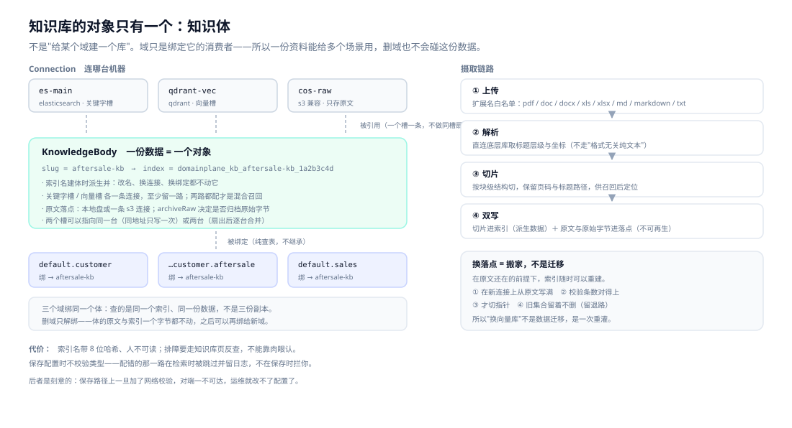
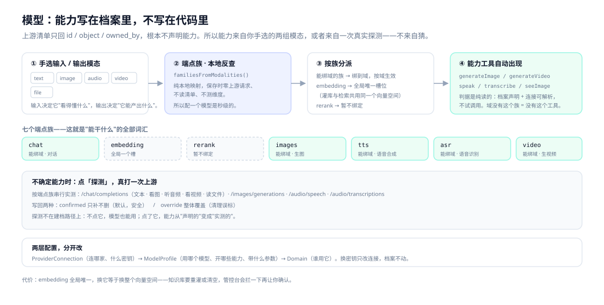
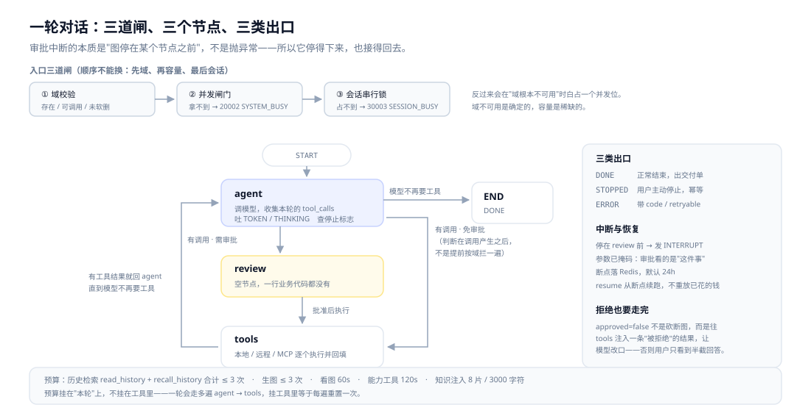
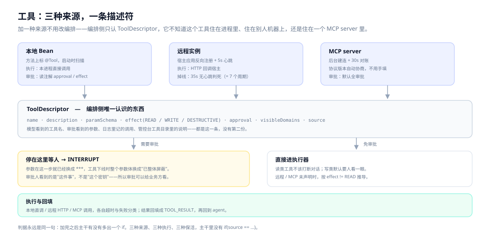
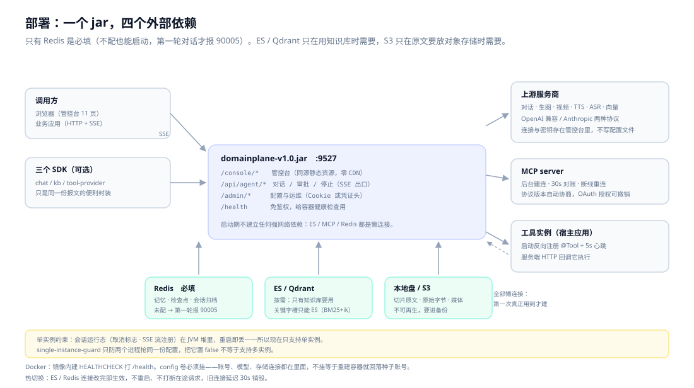

# DomainPlane

**一个 jar，服务任意多个业务场景。**

把"场景"做成一个点分路径——域（Domain），比如 `default.customer.aftersale`。每轮对话带域进来，服务端沿域链把**工具、知识、提示词、模型**四维能力实时装配到这一轮。同一个进程，同时服务任意多个域。

不需要"一个场景一套 Agent 服务"，也不需要让 `tenant_id` 渗透进每一次查询。

> **给谁用**：要在多个业务场景里同时用大模型，但不想"一场景一套 Agent 服务"的团队。
> **怎么用**：管控台配好域和模型 → 业务侧一次 SSE 调用，带域进来。


[](LICENSE)

[为什么](#为什么会有这个东西) · [快速开始](#三分钟跑起来) · [三个一等对象](#三个一等对象) · [一轮怎么走](#一轮对话怎么走) · [架构](#架构十一个模块两条线) · [对比](#和常见方案比站在哪个位置) · [文档](#文档索引) · [English](README.en.md)

---


> 演示环境截图，数据为构造的演示数据。其余 10 页见 [管控台使用图解](docs/16-管控台使用图解.md)。

---

## 为什么会有这个东西

场景一多，"一场景一服务"会逼你把工具体系、知识检索、会话记忆、模型接入、多模态、管控台重复实现好几遍，半年后手上是几个互不兼容的 Agent 服务。

反过来做"一个大服务 + 租户表"，租户键会渗透进每一次查询、每一次装配、每一条历史清理——漏写一个条件就是跨租户泄露。

DomainPlane 的答案是第三条路：**隔离既不靠部署，也不靠过滤条件。**

域决定这一轮怎么装配能力，也决定能读哪几个知识体。每份知识有自己的索引，索引名在建体时按唯一名派生并冻结——所以"查错"的结果是**查不到**，而不是**查到别人的**。

---

## 三分钟跑起来

```bash
git clone https://github.com/zzKingcc/DomainPlane.git && cd DomainPlane

# 1. 构建（产物：domainplane-server/target/domainplane-v1.0.jar）
mvn clean package

# 2. 启动（本机开发必须覆盖配置目录，否则会写到系统盘根路径）
java -DDOMAINPLANE_SETTINGS_PATH="$PWD/.dev/config" \
     -jar domainplane-server/target/domainplane-v1.0.jar

# 3. 验证
curl http://localhost:9527/health
# {"code":0,"status":"UP","service":"domainplane-server","version":"v1.0"}
```

打开 `http://localhost:9527/console/login.html`，种子账号 `domainplane` / `domainplane`，四步配到能对话：

**存储配置**（Redis 必填，ES / Qdrant 按需）→ **服务商连接 + 模型档案**（手选输入/输出模态，端点族本地反查，保存零上游请求）→ **域绑定** → **改默认口令**（默认口令下所有变更类写操作会被拒）。

要用知识库，再在「知识库」页建一个知识体、传文档、绑到域上。

调用侧就两步——先换凭证，再发一轮对话：

```bash
# 换凭证（响应里的 credential）
CRED=$(curl -s -X POST http://localhost:9527/api/agent/login \
  -H "Content-Type: application/json" \
  -d '{"username":"domainplane","password":"domainplane"}' \
  | sed -n 's/.*"credential":"\([^"]*\)".*/\1/p')

# 一轮对话，SSE 流式返回
curl -N -X POST http://localhost:9527/api/agent/chat \
  -H "Content-Type: application/json" \
  -H "X-DomainPlane-Credential: $CRED" \
  -d '{"sessionId":"demo-1","domain":"default.customer.aftersale","message":"这个订单能退吗"}'
```

```java
DomainPlaneAgent agent = agentFactory.forDomain("default.customer.aftersale");
String answer = agent.ask("demo-1", "这个订单能退吗");
```

> `-D` 必须写在 `-jar` 之前，写在后面会静默失效——这是"配置改了却没生效"最常见的原因。
> 起不来、配不通，对照 [快速上手 §6 故障表](docs/01-快速上手.md)。Docker 运行见同篇 §3。

---

## 三个一等对象

整个系统只有三种东西值得单独理解：**域**（谁能用）、**知识体**（读什么）、**模型档案**（用什么模型）。其余都是它们的组合。

### 域：装配键，不只是标签

大多数"多场景"实现里，场景只是一个过滤字段。这里的域同时是**装配维度**和**存储边界**。


三累加一覆盖不是随手定的：工具、知识、提示词是"能力供给"，父域给了子域就该能用；模型是"资源绑定"，一个域只能用一份档案，合并端点族只会造出"文本来自 A、图片来自 B"的怪档案。

**代价**：入口只能是叶子域（父域是装配节点），否则会出现"父域配一半、子域配一半"的混合装配。

### 知识体：一份数据一个索引

不是"给某个域建一个库"。域只是绑定知识体的消费者——所以一份资料能给多个场景用，删域也不会碰这份数据。



索引名 = `domainplane_kb_` + 知识体唯一名 + 8 位哈希，建体时算好就冻结：改名、换连接、换绑定都不动它。检索请求因此**不带域过滤条件**——隔离在物理层就完成了。

"能查到什么"由域链决定（自身 + 祖先），"怎么排序"则是自适应融合：


一个知识体最多两路检索（向量槽 / 关键字槽），每槽一条连接：两路都配 = 混合召回，只配一路 = 单路，一路坏只跳那路。关键字槽只认 ES（BM25 + ik 是方言），向量槽 ES 或 Qdrant 都行。

**代价**：索引名带 8 位哈希、人不可读，排障要靠知识库页反查；保存配置不校验类型，配错的那一路到检索时才暴露。

### 模型档案：能力写在档案里

上游清单只回 `id / object / owned_by`，根本不声明能力。所以能力来自你手选的两组模态，或者来自一次真实探测——不来自猜。



两层配置分开改：`ProviderConnection`（连哪家、什么密钥）→ `ModelProfile`（用哪个模型、开哪些能力、带什么参数）→ `Domain`（谁用它）。换密钥只改连接，档案不动。

**代价**：`embedding` 全局唯一——换它等于换整个向量空间，知识库要重灌或清空。

---

## 一轮对话怎么走

审批中断的本质是"图停在某个节点之前"，不是抛异常。所以它停得下来，也接得回去。



三个节点、两条环、三类出口。`review` 里没有一行业务代码——它的存在只是为了让图有一个"可以停"的位置。

拒绝审批时不砍断图，而是往 `tools` 注入一条"被拒绝"的工具结果，让模型改口——否则用户只看到半截回答。

---

## 能力一览

| 你要解决的问题 | DomainPlane 怎么做 |
| --- | --- |
| 多个场景共用一套运行时 | 域树按轮实时装配工具 / 知识 / 提示词 / 模型；父域声明，子域继承 |
| 场景之间不能串数据 | 一份数据一个索引，索引名建体时冻结；隔离在物理层，不在 SQL 条件里 |
| 一套资料给多个场景用 | 知识体可同时绑到多个域，向量 + BM25 自适应融合 |
| 工具来源杂 | 本地 `@Tool`、远程实例、MCP 进同一张目录，模型只看到一条 `ToolDescriptor` |
| 写操作不敢让模型直接干 | 审批挂起 + 参数掩码 + 断点续跑；批准后从原处继续，不重放整轮 |
| 不想被一个厂商锁死 | OpenAI 风格三种通道、端点族本地反查、自定义参数原样下发 |
| 上下文越聊越乱 | 只追加记忆、24k 预算与降级顺序、滚动摘要、按轮号检索历史 |
| 文档进不来 | `pdf` / `doc` / `docx` / `xls` / `xlsx` / `md` / `markdown` / `txt`，按标题层级与坐标切片 |
| 运维改配置要重启 | 11 页管控台，连接热切换，旧连接延迟 30s 销毁 |
| 不想被 SDK 绑架 | HTTP + SSE 就是全部协议；三个 SDK 只是同一份报文的便利封装，裸 `curl` 等价 |

---

## 几个设计决策

### 工具：三种来源，一条描述符



模型看到的工具名、审批看到的参数、日志里记的调用，都是同一条 `ToolDescriptor`。审批中断时参数**已经掩码**——审批看的是"这件事"，不是"这个密钥"。

同一轮里 `read_history` + `recall_history` 合计最多 3 次，防模型把检索当抛球游戏；知识检索与能力工具各有自己的约束（注入 8 片 / 3000 字符、看图 60s、能力 120s）。

### MCP：不让你填协议版本

建连时先探 `server/discover`：服务端支持 `2026-07-28` 就走无状态协议（逐请求声明版本与能力、无会话），探不到则退回 `initialize` 握手。页面状态条直接显示协商出的版本与时代；工具可在页面上试跑，写操作必须显式确认并留审计。

**代价**：多一次探测往返；对只实现旧协议的 server，首个请求的延迟会高一点。

### 配置改完即生效，不重启

ES / Redis 连接热切换，不打断在途请求，旧连接延迟 30s 销毁。

**代价**：热切换意味着任何一次保存都可能引入坏连接，而保存时**不做任何检测**（不发网络请求、不校验类型）。所以配置对不对，要等真正检索/灌库那一轮才暴露——不合格的那一路被跳过并留服务端日志。这是刻意的取舍：保存路径上一旦加了校验，管控台就会因为对端不可达而拒绝保存，运维改不了配置。

### 一个人也能运营


- **域空间**：可调用模型、绑定的知识体、可见工具摊在同一张卡上；父域是装配节点，叶子域才是可调用单元，"可见工具（含链路继承）"直接回答这个域到底能干什么。
- **模型设置**：添加时手选输入 / 输出模态，端点族由服务端本地反查；要实测真实能力再点「探测」，默认只补不删。顶部「用途分配」是全局唯一的向量模型槽位。
- **知识库**：知识体卡片承载一份数据的全部动作——上传、看文档、健康对照、重建索引、换落点、绑域、删除；底部运维区处理诊断、无主集合认领、遗留清理与合并。

---

## 架构：十一个模块，两条线


服务端线从 `api` 一路向上，SDK 线从 `api` 旁支出去，**两条线只在 `api` 这一个点相接，其余只通过 HTTP 报文耦合**。

关键是 `infrastructure` 与 `runtime` 是**并列兄弟**，不是上下级：内核只认识 `domain` 里的 SPI，不认识任何适配器实现。所以换掉 ES、走上 Qdrant 时，编排内核一行不用改。

| 层 | 只回答 | 不该出现的东西 |
| --- | --- | --- |
| `server` | 谁来装配、谁能调 | 编排状态机、检索打分 |
| `runtime` | 这一轮怎么走 | ES 客户端、HTTP 细节 |
| `domain` | 算出来是什么 | Spring MVC、Redis 会话 |
| `infrastructure` | 怎么读写外部 | 域链、预算、事件 |

---

## 扩展：三个接缝

判据都是同一句话：**加完之后主干有没有多出一个 if。**

| 接缝 | 怎么加 | 要动哪 |
| --- | --- | --- |
| 存储后端 | 实现 `KnowledgeBackend`（store / keyword / vector 三个 Optional） | 新增适配器 + 装配处一个分支；`domain` / `runtime` 零改动 |
| 工具 | 方法上标 `@Tool` | 本地扫描、远程注册、MCP 桥接，编排侧只认 `ToolDescriptor` |
| 接入方 | HTTP + SSE | 三个 SDK 只是同一份报文的三个便利封装，裸 `curl` 等价 |

加一个工具，就是这个形状——没有注册表、没有配置文件：

```java
@Component
public class OrderTools {

    @Tool(desc = "按订单号查询物流轨迹", effect = Effect.READ,
          domains = {"default.customer.aftersale"})
    public String trackOrder(@ToolParam("订单号，形如 SO2024110001") String orderNo) {
        return logisticsClient.track(orderNo);
    }

    @Tool(desc = "发起退款", effect = Effect.WRITE, approval = Approval.ALWAYS,
          approvalReason = "退款会真实出账，需人工确认")
    public RefundResult refund(@ToolParam("订单号") String orderNo,
                               @ToolParam("退款金额，单位分") long amountFen) {
        return orderService.refund(orderNo, amountFen);
    }
}
```

`effect = WRITE` + `approval = ALWAYS` 的意思是：模型可以请求，但**出账前一定会停下来等人**，而人看到的是掩码后的参数。

---

## 和常见方案比，站在哪个位置

先说结论：**这不是一个可视化工作流平台。**

**适合你，如果**：你有多个业务场景要共用一套 Agent 运行时；你要自托管、要嵌进既有系统；你不想为一个新场景复制一份服务。

**别选它，如果**：你要拖拽编排、要开箱即用的插件市场（Dify / Coze 更合适）；你的核心痛点是复杂文档解析（RAGFlow 更合适）；你现在就需要多实例横向扩容。

| | DomainPlane | Dify | RAGFlow | FastGPT | Coze（扣子） | Spring AI / LangChain4j |
| --- | --- | --- | --- | --- | --- | --- |
| 形态 | 自托管 Agent 运行时（Java） | 可视化 LLM 应用平台 | RAG / 文档解析引擎 | 知识库问答平台 | SaaS 智能体搭建 | 应用框架（库） |
| 多场景组织 | **域树，实时装配** | 应用 / 工作流为单位 | 知识库为单位 | 应用为单位 | Bot 为单位 | 自行设计 |
| 能力复用 | 父域声明、子域继承 | 复制应用或共享编排 | 共享知识库 | 复制应用 | 复制 Bot | 自己写 |
| 工具接入 | 注解 / 远程实例 / MCP | 插件 + 自定义工具 | 较少 | HTTP 工具 | 插件 | 自实现 |
| 知识检索 | 知识体一索引、多域共用，向量 + BM25 自适应融合 | 内置 RAG | **强（深度解析）** | 强 | 内置 | 需自建 |
| 多模态 | 生图 / 视频 / 语音 / 转写 / 看图 | 部分 | 少 | 少 | 部分 | 取决于上游 |
| 管控台 | 11 页，连接热切换 | 有 | 有 | 有 | SaaS 控制台 | 无 |
| 接入方式 | HTTP/SSE + 3 个 SDK | API | API | API | API | 代码内 |
| 部署 | 单 jar + Redis | Docker / K8s | Docker | Docker | 云端 | 随宿主 |
| 适合 | 多场景、要自托管、要嵌进既有系统 | 快速搭应用 | 文档密集型问答 | 知识库问答 | 快速试水 | 自己造平台 |

> 对比基于 2026-11 各产品的公开定位与形态，具体功能与版本差异请以各自文档为准。

**短板直说**：没有可视化工作流编排、没有插件市场、社区与生态刚起步、多实例部署还不支持。

---

## 部署：一个 jar，四个外部依赖



只有 Redis 是必填（不配也能启动，第一轮对话才报 `90005`）。ES / Qdrant 只在用知识库时需要，S3 只在原文要放对象存储时需要——**启动期不建立任何强网络依赖**。

**单实例约束写在明处**：会话运行态（取消标志、SSE 流注册）在 JVM 堆里，重启即丢。`single-instance-guard` 只是防止两个进程抢同一份配置，把它置 `false` 不等于支持多实例。

---

## 技术栈

Java 21 · Spring Boot 3.5.7 · LangChain4j 1.18.1 · LangGraph4j 1.8.17 · Elasticsearch 9.4.4 / Qdrant · Redis

主代码约 6.1 万行 / 397 个文件，测试约 1,500 个用例、214 个测试类（2026-11 实测）。数字会漂移，写在这里只为一件事：说明它是可以直接读、可以直接改的，不是只能调的黑盒。

---

## 文档索引

一篇说清一个模块的**约束、决策与代价**，跨篇只指路不复述。第一次接触从 01 读，接手维护从 02 读。

| # | 文档 | 回答什么 |
| --- | --- | --- |
| 01 | [快速上手](docs/01-快速上手.md) | 前置条件、构建启动、首次四步配置、验证链路、起不来对照表 |
| 02 | [架构总览](docs/02-架构总览.md) | 模块职责与依赖方向、一轮对话落在哪层、状态住在哪 |
| 03 | [域与能力装配](docs/03-域与能力装配.md) | 域规则、四维合并、可调用性、版本历史、删域三阶段 |
| 04 | [对话编排](docs/04-对话编排.md) | 状态图、十种事件、审批恢复、停止语义、规划前置、超时与失败出口 |
| 05 | [记忆与上下文](docs/05-记忆与上下文.md) | 只追加的记忆、24k 预算与降级顺序、摘要、历史检索 |
| 06 | [工具体系](docs/06-工具体系.md) | 四条注解、可见性算法、审批与掩码、远程实例与心跳 |
| 07 | [知识库](docs/07-知识库.md) | 知识体为数据实体、三路落点与换落点、原文归档、运维区、召回融合、摄取切片 |
| 08 | [模型与多模态](docs/08-模型与多模态.md) | 档案与端点族、手选输入/输出模态、探测写回、协议分派、参数下发、五类能力工具 |
| 09 | [MCP 接入](docs/09-MCP接入.md) | 协议版本自动判定、传输方式、工具桥接命名、默认审批、试跑与事件、OAuth |
| 10 | [管控台](docs/10-管控台.md) | 十一个页面、页面与端点对照、前端两套树的改法 |
| 11 | [鉴权与错误码](docs/11-鉴权与错误码.md) | HMAC 凭证、两种载体、60 条错误码与两套文案 |
| 12 | [SDK 接入](docs/12-SDK接入.md) | 三个 SDK 的配置、用法、审批流程、报文契约 |
| 13 | [配置参考](docs/13-配置参考.md) | 全部 yaml 键与默认值、落盘文件、必须成对改的配置 |
| 14 | [运维与边界](docs/14-运维与边界.md) | 单实例约束、备份恢复、后台任务、升级、故障手册 |
| 15 | [OpenAI 风格 API 全景](docs/15-OpenAI风格API全景.md) | 三种连接通道、端点族总表、模态矩阵、兼容性光谱、最小判定请求 |
| 16 | [管控台使用图解](docs/16-管控台使用图解.md) | 11 个页面的逐区块截图、操作顺序与注意事项 |

---

## 贡献

```bash
mvn clean package   # 全量构建
mvn -o test         # 全量测试
```

提 PR 前自查：

- [ ] `mvn clean package` 通过，相关模块测试通过
- [ ] 新增 / 改动的行为有测试覆盖
- [ ] 涉及对外契约或错误码时，[`docs/11-鉴权与错误码.md`](docs/11-鉴权与错误码.md) 对应章节已同步
- [ ] 没有引入"静默降级"：能力缺失、越权、依赖未配置，一律显式报错

四条约定：

1. **契约唯一**：跨进程类型（请求 / 事件 / 工具元数据 / 错误码）只放 `domainplane-api`，禁止在 SDK 或服务端各拷一份。`AgentService` 有 runtime 与 chat-client 两个方向相反的实现，加方法时两边都要改。
2. **错误码集中登记**：新码加到 `api.code.ErrorCode`，按段位落位（10xxx 鉴权 / 20xxx 容量 / 30xxx 会话 / 40xxx 入参 / 50xxx 系统 / 60xxx 知识库 / 70xxx 记忆 / 80xxx 工具 / 90xxx 外部依赖 / 91xxx 多模态）；`userMessage` 与 `message` 双文案，对外只出 `userMessage`。
3. **文档一篇一模块**：`docs/` 下每篇说清一个模块的机制、取舍与坑，跨模块只指路不复述；改动行为时同步对应篇。
4. **提交**：基于 `master` 开分支，一个分支一件事；提交信息说明"改了什么 + 为什么"。

---

## 许可

[Apache License 2.0](LICENSE)
