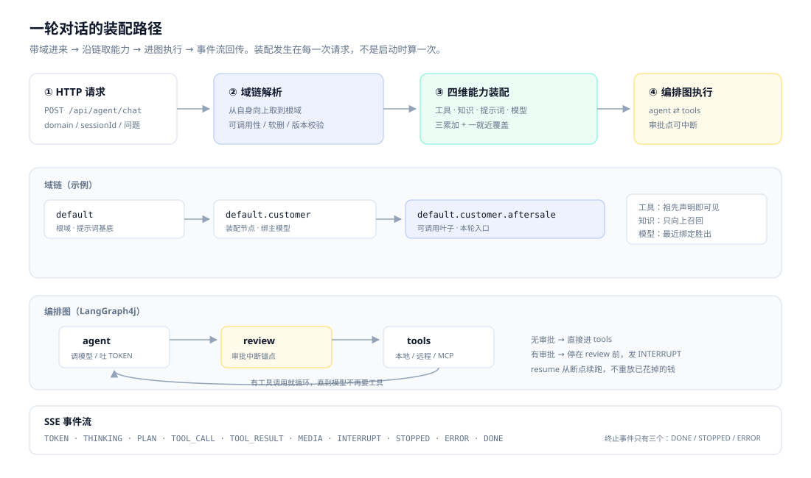
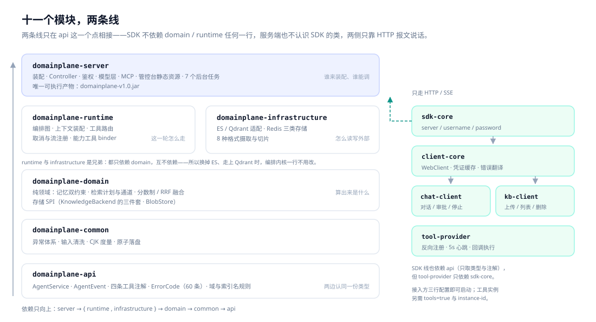
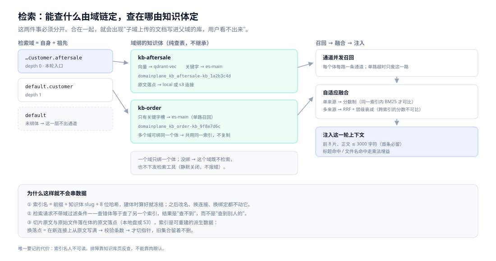
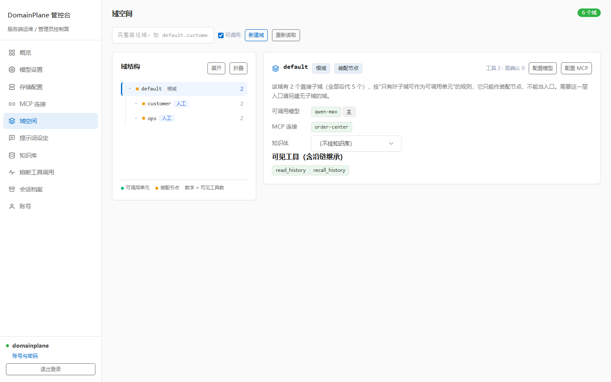
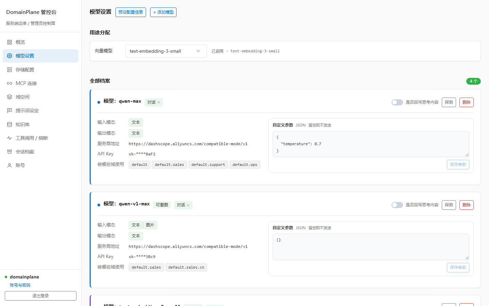
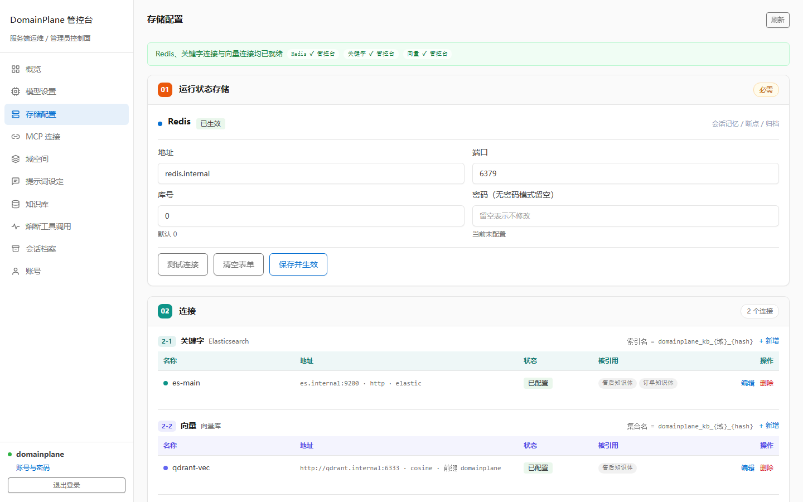
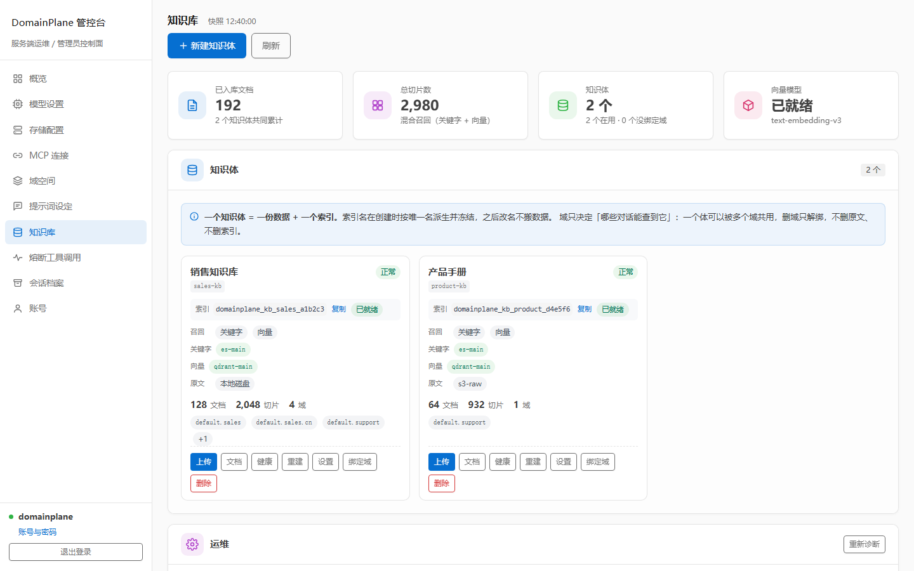

# DomainPlane

**一个服务端，服务任意多个业务场景。**

把"场景"做成一个点分全路径字符串——域（Domain），比如 `default.customer.aftersale`。每轮对话带域进来，服务端沿域链把**工具、知识、提示词、模型**四维能力实时装配到这一轮。同一个 jar，同时服务任意多个域。

> 给谁用：需要在多个业务场景里同时用大模型，但不想"一场景一套 Agent 服务"的团队。


[](LICENSE)

[中文](README.md) · [English](README.en.md)

---

## 为什么会有这个东西

场景一多，"一场景一服务"就会逼你把工具体系、知识检索、会话记忆、模型接入、多模态、管控台重复实现好几遍，半年后变成几个互不兼容的 Agent 服务。

反过来做"一个大服务 + 租户表"，租户键又会渗透进每一次查询、每一次装配、每一条历史数据的清理——漏写一个条件就是跨租户泄露。

DomainPlane 的答案：**隔离不靠部署，也不靠过滤条件**。域决定能力怎么装配，也决定这一轮读哪几个知识体；每份知识有自己的索引，名字在建体时按唯一名派生并冻结，所以"查错"的结果是查不到，而不是查到别人的。

---

## 亮点一：域是装配键，不只是标签

大多数"多场景"实现里，场景只是一个过滤字段。这里的域同时是**装配维度**和**存储边界**：一轮对话进入域 D 后，四维能力沿 `D → 父 → … → default` 取。



| 维度 | 沿域链的语义 | 反向不成立的地方 |
| --- | --- | --- |
| 工具 | 累加：声明在 D 或祖先 → D 可见 | 声明在子域的工具，父域看不见 |
| 知识 | 累加：检索域 = D + 祖先，各域绑定的知识体都查 | 召回不向下：子域文档父域查不到 |
| 提示词 | 累加：从根往叶子拼，根片段即基底 | 改一段只影响该域及其后代 |
| 模型 | 就近覆盖：链上第一个绑定的胜出 | 子域绑了就完全盖掉父域 |

三累加一覆盖不是随手定的：工具、知识、提示词是"能力供给"，父域给了子域就该能用；模型是"资源绑定"，一个域只能用一份档案，合并端点族只会造出"文本来自 A、图片来自 B"的怪档案。

**代价写在明处**：入口只能是叶子域（父域是装配节点），否则会出现"父域配一半、子域配一半"的混合装配；索引名带 8 位哈希、人不可读，排障要靠知识库页反查。

---

## 亮点二：十一个模块，两条不相交的线



服务端线从 `api` 一路向上，SDK 线从 `api` 旁支出去，**两侧只通过 HTTP 报文耦合**。

关键是 `infrastructure` 与 `runtime` 是**并列兄弟**，不是上下级：内核只认识 `domain` 里的 SPI，不认识任何适配器实现。所以换掉 ES、走上 Qdrant 时，编排内核一行不用改。

扩展只有三个接缝，判据都是"加完之后主干有没有多出一个 if"：

| 接缝 | 怎么加 | 要动哪 |
| --- | --- | --- |
| 存储后端 | 实现 `KnowledgeBackend`（store / keyword / vector 三个 Optional） | 新增适配器 + 装配处一个分支；`domain` / `runtime` 零改动 |
| 工具 | 方法上标 `@Tool` | 本地扫描、远程注册、MCP 桥接，编排侧只认 `ToolDescriptor` |
| 接入方 | HTTP + SSE | 三个 SDK 只是同一份报文的三个便利封装，裸 `curl` 等价 |

---

## 亮点三：知识检索，隔离在物理层



三件事分得很清：

- **能查到什么**由域链决定（自身 + 祖先）；
- **查在哪台机器**由"域绑的知识体"决定（不继承——否则子域文档会写进父域的库，用户看不出来）；
- **怎么排序**由自适应融合决定：单来源用分数制，多来源用 RRF，跨索引的分数不可比就只信排名。

一个知识体最多两路检索（向量槽 / 关键字槽），每槽一条连接：两路都配 = 混合召回，只配一路 = 单路，一路坏只跳那路。关键字槽只认 ES（BM25 + ik 是方言），向量槽 ES 或 Qdrant 都行；保存不做类型校验，配错的那一路在检索时被跳过并留日志。

**索引名 = `domainplane_kb_` + 知识体唯一名 + 8 位哈希**，建体时算好就冻结，之后改名、换连接、换绑定都不改。检索请求不带域过滤条件——隔离在物理层就完成了。切片原文与原始文件字节落在体的「原文落点」（本地盘或 s3 兼容连接），索引是可重建的派生数据：换落点时在新连接上从原文写满、校验条数、才切指针，旧集合留着不删。

---

## 亮点四：工具，三种来源进同一张目录

| | 本地 Bean | 远程实例 | MCP |
| --- | --- | --- | --- |
| 注册 | 启动扫描 `@Tool` | 实例主动注册 + 5s 心跳 | 后台建连 + 30s 对账 |
| 执行 | 本进程 | HTTP 回调宿主 | 外部 server |
| 审批默认 | 注解 `approval` | 未声明时按 `effect != READ` 推导 | **默认全审批** |
| 掉线判定 | — | 35s 无心跳 | 建连失败 / 对账失败 |
| 可见域 | 注解 / 动态 binder | manifest 声明 | 平台域绑定 |

模型看到的工具名、审批看到的参数、日志里记的调用，都是同一条 `ToolDescriptor`。审批中断时参数**已经掩码**——审批看的是"这件事"，不是"这个密钥"。

同一轮里 `read_history` + `recall_history` 合计最多 3 次，防模型把检索当抛球游戏；知识检索与能力工具各有自己的约束（注入 8 片 / 3000 字符、看图 60s、能力 120s）。

---

## 亮点五：一个能运营的管控台

配置全在浏览器里做，**改完即生效**：ES / Redis 连接热切换，不重启、不打断在途请求，旧连接延迟 30s 销毁。

### 域空间：一张卡看清一个域的全部能力



可调用模型、提示词字数、可见工具、绑定的 MCP 连接摊在同一张卡上。根域是**装配节点**（只把能力传给后代，自己不能当入口），叶子域才是**可调用单元**。右边"可见工具（含沿链继承）"直接告诉你这个域到底能干什么。

### 模型设置：向量模型与其余档案分开管



向量模型全局只能有一个（灌库与检索都依赖它），单独一栏；其余档案按类型排列，"被哪些域使用"直接标在卡上，改绑定不用跳页。上下文长度、是否回写思考过程都在卡片里就地改。

### 存储配置：连接池



Redis、关键字（ES）、向量（Qdrant）、原文（s3 兼容）四类连接各自成段，每行标出被哪些知识体引用；知识体本身在这里只读回显，新建 / 改落点 / 删体都在知识库页。保存只落盘并热替换，连通性要单独点「测试连接」。

### 知识库：以知识体为第一等对象



知识体卡片承载一份数据的全部动作：上传文档、看文档、健康对照、重建索引、换落点、绑域、删除。页面底部另有折叠运维区，处理诊断、无主集合认领、遗留清理与合并知识体。

> 截图为 `v1.0-beta.2` 空库初始状态，页面此后已按知识体重做，数据为演示数据。

其余页面：总览（运行质量与工具风险构成）、提示词设定（沿域链逐段编辑）、MCP 连接（凭据只回显 `hasHeaders`）、工具实例（在线清单 / 熔断 / 强制下线）、会话档案（记忆、归档、装配清单、副本导出）、账号（改密即全端失效）。

---

## 和常见方案比，它站在哪个位置

先说结论：**这不是一个可视化工作流平台**。要拖拽编排、要开箱即用的插件市场，Dify / Coze 更合适；如果核心痛点是复杂文档解析，RAGFlow 更合适。

DomainPlane 解决的是另一件事：**多个业务场景共用一个 Agent 运行时**，能力按场景装配，而不是每个场景复制一套。

| | DomainPlane | Dify | RAGFlow | FastGPT | Coze（扣子） | Spring AI / LangChain4j |
| --- | --- | --- | --- | --- | --- | --- |
| 形态 | 自托管 Agent 运行时（Java） | 可视化 LLM 应用平台 | RAG / 文档解析引擎 | 知识库问答平台 | SaaS 智能体搭建 | 应用框架（库） |
| 多场景组织 | **域树，实时装配** | 应用 / 工作流为单位 | 知识库为单位 | 应用为单位 | Bot 为单位 | 自行设计 |
| 能力复用 | 父域声明、子域继承 | 复制应用或共享编排 | 共享知识库 | 复制应用 | 复制 Bot | 自己写 |
| 工具接入 | 注解 / 远程实例 / MCP | 插件 + 自定义工具 | 较少 | HTTP 工具 | 插件 | 自实现 |
| 知识检索 | 知识体一索引、多域共用，向量 + BM25 自适应融合 | 内置 RAG | **强（深度解析）** | 强 | 内置 | 需自建 |
| 多模态 | 生图 / 视频 / 语音 / 转写 / 看图 | 部分 | 少 | 少 | 部分 | 取决于上游 |
| 管控台 | 11 页，连接热切换 | 有 | 有 | 有 | SaaS 控制台 | 无 |
| 接入方式 | HTTP/SSE + 3 个 SDK | API | API | API | API | 代码内 |
| 部署 | 单 jar + Redis | Docker / K8s | Docker | Docker | 云端 | 随宿主 |
| 适合 | 多场景、要自托管、要嵌进既有系统 | 快速搭应用 | 文档密集型问答 | 知识库问答 | 快速试水 | 自己造平台 |

> 对比基于 2026-11 各产品的公开定位与形态，具体功能与版本差异请以各自文档为准。

**它的短板也直说**：没有可视化工作流编排、没有插件市场、社区与生态刚起步、多实例部署还不支持（会话运行态在 JVM 堆里）。

---

## 跑起来要几步

```bash
# 1. 构建（产物：domainplane-server/target/domainplane-v1.0-beta.2.jar）
mvn clean package

# 2. 启动（本机开发务必覆盖配置目录）
java -DDOMAINPLANE_SETTINGS_PATH="$PWD/.dev/config" \
     -jar domainplane-server/target/domainplane-v1.0-beta.2.jar

# 3. 验证
curl http://localhost:9527/health
```

浏览器打开 `http://localhost:9527/console/login.html`，种子账号 `domainplane` / `domainplane`，然后四步：存储配置（Redis 必填）→ 服务商连接 → 模型档案 + 能力探测 → 域绑定。要用知识库，再在「知识库」页建一个知识体、传文档、把它绑到域上。做完就能对话。

调用侧就是一次 SSE：

```bash
curl -N -X POST http://localhost:9527/api/agent/chat \
  -H "Content-Type: application/json" \
  -H "X-DomainPlane-Credential: $CRED" \
  -d '{"sessionId":"demo-1","domain":"default.customer.aftersale","message":"这个订单能退吗"}'
```

```java
DomainPlaneAgent agent = agentFactory.forDomain("default.customer.aftersale");
String answer = agent.ask("demo-1", "这个订单能退吗");
```

---

## 技术栈

Java 21 · Spring Boot 3.5.7 · LangChain4j 1.18.1 · LangGraph4j 1.8.17 · Elasticsearch 9.x / Qdrant · Redis

---

## 贡献

```bash
mvn clean package   # 全量构建
mvn -o test         # 全量测试（1348 例 / 2 skip，2026-11-04 实测）
```

提 PR 前自查：

- [ ] `mvn clean package` 通过，相关模块测试通过
- [ ] 新增 / 改动的行为有测试覆盖
- [ ] 涉及对外契约或错误码时，[`docs/11-鉴权与错误码.md`](docs/11-鉴权与错误码.md) 对应章节已同步
- [ ] 没有引入"静默降级"：能力缺失、越权、依赖未配置，一律显式报错

四条约定：

1. **契约唯一**：跨进程类型（请求 / 事件 / 工具元数据 / 错误码）只放 `domainplane-api`，禁止在 SDK 或服务端各拷一份。`AgentService` 有 runtime 与 chat-client 两个方向相反的实现，加方法时两边都要改。
2. **错误码集中登记**：新码加到 `api.code.ErrorCode`，按段位落位（10xxx 鉴权 / 20xxx 容量 / 30xxx 会话 / 40xxx 入参 / 50xxx 系统 / 60xxx 知识库 / 70xxx 记忆 / 80xxx 工具 / 90xxx 外部依赖 / 91xxx 多模态）；`userMessage` 与 `message` 双文案，对外只出 `userMessage`。
3. **文档一篇一模块**：`docs/` 下每篇说清一个模块的机制、取舍与坑，跨模块只指路不复述；改动行为时同步对应篇。
4. **提交**：基于 `master` 开分支，一个分支一件事；提交信息说明"改了什么 + 为什么"。

---

## 许可

[Apache License 2.0](LICENSE)

---

## 文档索引

按模块分篇，一篇说清一个模块的约束、决策与代价，跨篇只指路不复述。第一次接触从 01 读，接手维护从 02 读。英文说明见 [README.en.md](README.en.md)。

| # | 文档 | 回答什么 |
| --- | --- | --- |
| 01 | [快速上手](docs/01-快速上手.md) | 前置条件、构建启动、首次四步配置、验证链路、起不来对照表 |
| 02 | [架构总览](docs/02-架构总览.md) | 模块职责与依赖方向、一轮对话落在哪层、状态住在哪 |
| 03 | [域与能力装配](docs/03-域与能力装配.md) | 域规则、四维合并、可调用性、版本历史、删域三阶段 |
| 04 | [对话编排](docs/04-对话编排.md) | 状态图、九种事件、审批恢复、停止语义、规划前置、超时与失败出口 |
| 05 | [记忆与上下文](docs/05-记忆与上下文.md) | 只追加的记忆、24k 预算与降级顺序、摘要、历史检索 |
| 06 | [工具体系](docs/06-工具体系.md) | 四条注解、可见性算法、审批与掩码、远程实例与心跳 |
| 07 | [知识库](docs/07-知识库.md) | 知识体为数据实体、三路落点与换落点、原文归档、运维区、召回融合、摄取切片 |
| 08 | [模型与多模态](docs/08-模型与多模态.md) | 档案与端点族、能力探测、协议分派、参数下发、五类能力工具 |
| 09 | [MCP 接入](docs/09-MCP接入.md) | 传输方式、工具桥接命名、默认审批、OAuth |
| 10 | [管控台](docs/10-管控台.md) | 十一个页面、页面与端点对照、前端两套树的改法 |
| 11 | [鉴权与错误码](docs/11-鉴权与错误码.md) | HMAC 凭证、两种载体、60 条错误码与两套文案 |
| 12 | [SDK 接入](docs/12-SDK接入.md) | 三个 SDK 的配置、用法、审批流程、报文契约 |
| 13 | [配置参考](docs/13-配置参考.md) | 全部 yaml 键与默认值、落盘文件、必须成对改的配置 |
| 14 | [运维与边界](docs/14-运维与边界.md) | 单实例约束、备份恢复、后台任务、升级、故障手册 |

重构前的长文档（设计文档 / 架构评审 / L1–L4 计划 / 深度分析）已不再纳入版本库，仅本地留存，不作为现状依据；知识库 v2 设计稿在 P0–P5 全部落地后也已移除，现状以 01–14 与代码为准。
