# 管控台使用图解

**给谁用**：部署完之后，要把服务配到能对话、并在出问题时定位到具体一轮的管理员 / 运维。
**解决什么**：十一个页面分别管什么，每页每个区块点下去会发生什么，哪些操作会写档案、花 token 或影响在途请求。
**怎么用**：第一次按第 1 节的顺序从登录走到概览；之后按页面查对应章节，照着图上的区块操作。

全部截图取自构造的演示环境，数据均为演示数据；页面外观与当前代码一致，接口与页面改法见 [10-管控台](10-管控台.md)。

---

## 0. 十一页共用的几条约定

| 约定 | 表现 |
| --- | --- |
| 同源打开 | 必须从服务端自己的地址打开管控台。用 `file://` 或别的站点托管页面，会「登录成功但每个接口 401」 |
| 凭证 | 登录后由 HttpOnly Cookie 携带，页面 JS 不存凭证；接口报错码 `10002` 时才跳登录页 |
| 保存即生效 | 连接、模型、域绑定、提示词、工具文案的保存都是热生效，不重启、不打断在途请求；旧连接延迟 30s 销毁 |
| 二次确认 | 删除、清空、重建、换落点、合并、撤销授权、试跑写操作、断开实例都弹确认框；高危警示只在确认框里，不常驻页面 |
| 凭据回显 | API Key / 请求头 / OAuth secret 只回掩码或 `hasApiKey` / `hasHeaders`，明文只在选中的那一刻取一次 |
| 反馈 | 顶部进度条覆盖所有请求，按钮级 loading 用于探测 / 测试 / 保存，结果用短提示；探测结果单独弹一个分区框 |

左侧导航固定十项：概览、模型设置、存储配置、MCP 连接、域空间、提示词设定、知识库、工具调用 / 熔断、会话档案、账号。登录页是独立入口，不在这十项里。

---

## 1. 第一次：从零配到能对话

| 步 | 页面 | 做什么 | 完成判据 |
| --- | --- | --- | --- |
| 1 | 登录 | 无账号时「完成初始化」设管理员；已有账号直接登录 | 进入概览 |
| 2 | 账号 | 看「密码状态」，仍是初始密码就改掉 | 用新密码重新登录成功 |
| 3 | 模型设置 | 「+ 添加模型」填服务商地址 / API Key / 模型名，手选输入 / 输出模态后保存 | 「全部档案」里出现这张卡 |
| 4 | 模型设置 | 需要可信能力就点卡片「探测」；在「用途分配」把一份向量档案设为全局向量模型 | 卡片端点族不再带问号，向量模型显示「已启用」 |
| 5 | 存储配置 | 填 Redis 并「保存并生效」；2-1 加 Elasticsearch、2-2 加 Qdrant / ES，逐个「测试连接」 | 状态行三类连接都打勾 |
| 6 | 知识库 | 「新建知识体」→「上传」文档 →「绑定域」 | 卡片出现文档数、切片数、绑定域 |
| 7 | 域空间 | 新建叶子域（勾可调用）→「配置模型」选主模型 →「配置 MCP」→ 选知识体 | 详情卡显示可调用模型、知识体、可见工具 |
| 8 | 提示词设定 | 左选该域 → 写片段 → 看「生效提示词预览」→「保存并生效」 | 预览里是根域到该域拼好的文本 |
| 9 | 概览 | 看「待配置项」有没有清掉 | 对话模型「已就绪」 |

外部工具是可选的，接 MCP 时插在 7 与 8 之间：新增连接 → 需要就发起授权 → 测试连接 → 工具页设白名单 → 绑定页勾域 → 试跑一个只读工具。配完之后日常排障从「会话档案」和「工具调用 / 熔断」进。

---

## 2. 登录

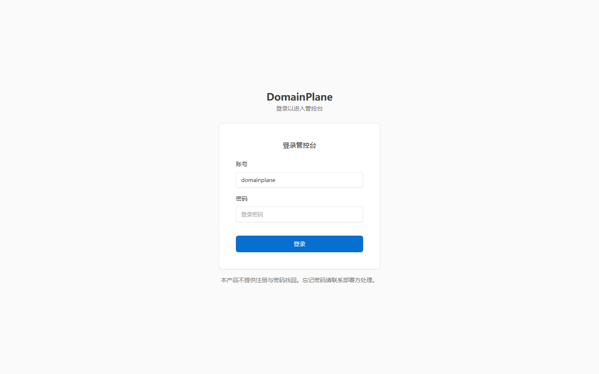

| 区块 | 内容 | 说明 |
| --- | --- | --- |
| 顶部状态 | 「登录以进入管控台」/「首次初始化：设置管理员账号」/「账号文件损坏」 | 由 `/admin/session` 判定，页面不自猜 |
| 登录卡片 | 账号、密码、首次初始化时多一个确认密码 | 账号名来自服务端配置；初始密码不显示在页面上 |
| 底部说明 | 无注册、无找回 | 忘了密码只能由部署方处理账号文件 |

- 首次初始化成功后该入口永久关闭；之后只有登录。
- 账号文件损坏时按钮变成「不可用」，要部署方修复并重启服务。

---

## 3. 概览

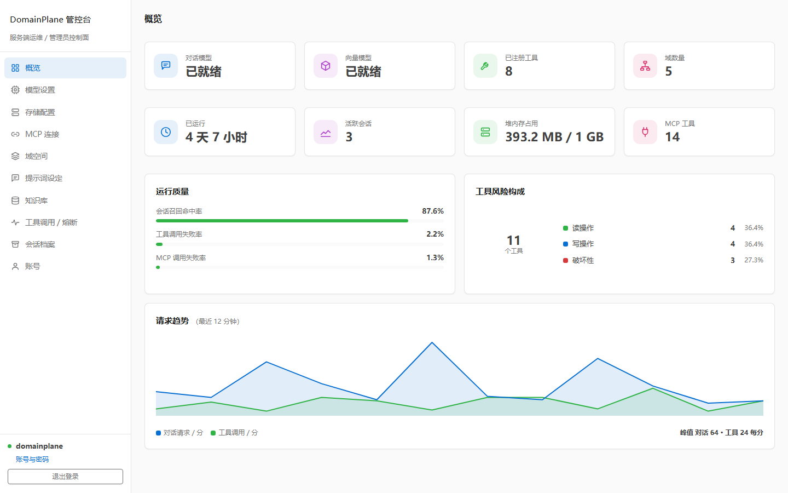

| 区块 | 看什么 | 说明 |
| --- | --- | --- |
| 八张统计卡 | 对话 / 向量模型是否就绪、已注册工具数、域数量、已运行、活跃会话、堆内存、MCP 工具数 | 全是进程内快照，重启清零 |
| 运行质量 | 会话召回命中率、工具调用失败率、MCP 调用失败率 | 三条占比条，数值来自累计计数 |
| 工具风险构成 | 读 / 写 / 破坏性三类占比 | 工具按名字去重计数 |
| 请求趋势 | 对话请求 / 分、工具调用 / 分、峰值 | 相邻采样点差分算速率，采样点不足两个时整卡隐藏 |
| 待配置项 | 对话模型未配、向量模型未配、没扫到工具 | 每条带「去配置 / 去域空间」跳转；配置齐后整卡消失 |

这一页只读，没有任何写按钮。刚部署完先来这里看「待配置项」，再回来看运行质量有没有异常；趋势只回答「刚才十几分钟发生了什么」，不回答「这个月的容量」。

---

## 4. 模型设置

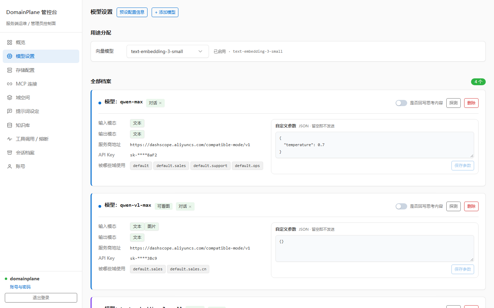

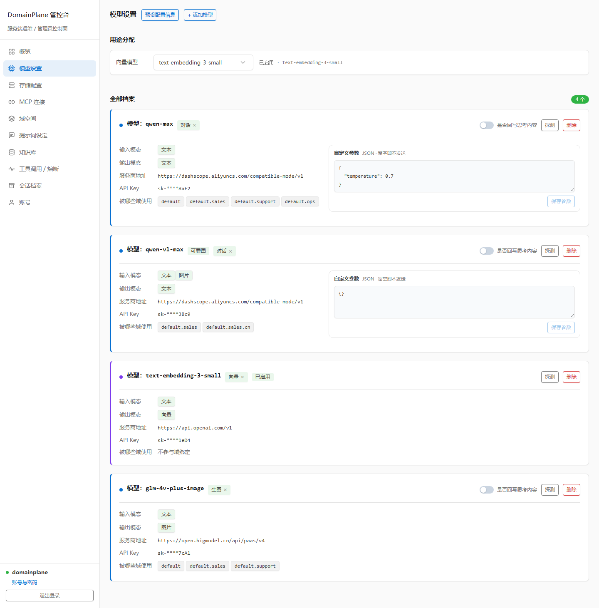

### 区块

| 区块 | 能做什么 | 注意 |
| --- | --- | --- |
| 页头 | 「预设配置信息」管理自定义服务商配置；「+ 添加模型」新建档案 | 自定义配置只是快捷填充，删掉不影响已存档案 |
| 用途分配 | 「向量模型」下拉指定全局唯一的一份向量档案 | 灌库与检索都走它；知识库已有内容时切换会要求重灌或清空 |
| 全部档案 | 一张表列出所有档案，右上角显示数量 | 不按用途拆表；端点族小签说明这份档案能干什么 |
| 档案卡片 | 输入 / 输出模态、服务商地址、掩码 Key、被哪些域使用；端点族小签可点「×」移除 | 模态不在卡片上改；移除族后要重新手选模态或再探测 |
| 卡片操作 | 是否回写思考内容开关、「探测」、「删除」、自定义参数 JSON + 「保存参数」 | 温度 / 单次最大输出 / 上下文长度的输入框已取消，前两者写进 JSON 框；向量维度由模型实测决定，不能配 |

### 添加一份档案

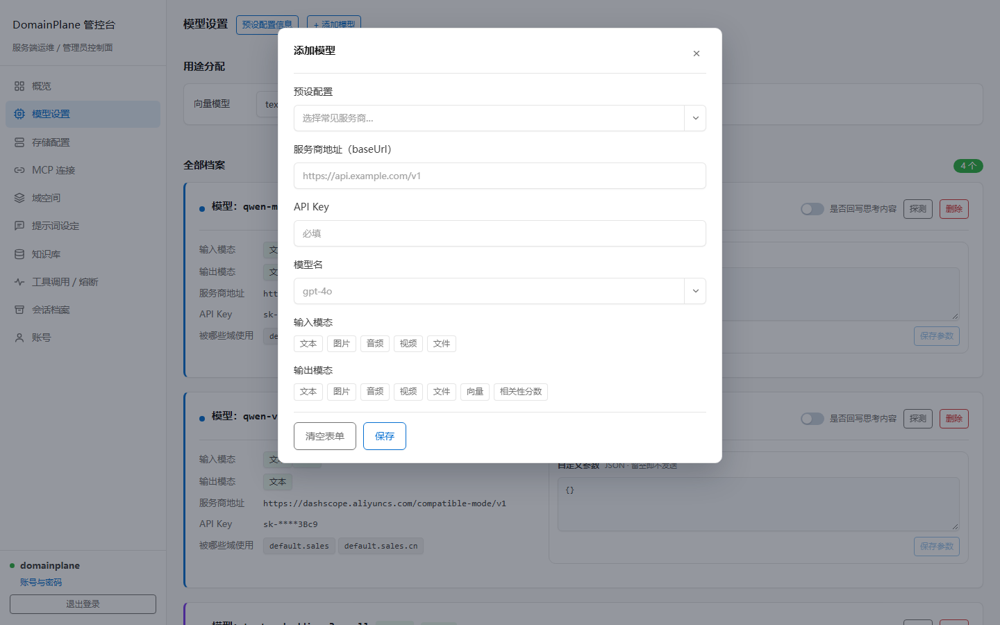

1. 选预设配置或自填服务商地址；填 API Key（必填）、模型名（可下拉拉候选）。
2. 手选「输入模态」与「输出模态」（文本 / 图片 / 音频 / 视频 / 文件 / 向量 / 相关性分数）。
3. 输出勾了文本时出现「自定义参数」JSON 框；填不填都行。
4. 「保存」即登记：**零上游请求**，不猜类型、不发探测。端点族由服务端从模态本地反查。

一个模态都不选也能存，但卡片会标「不可用」且绑不了域。端点族来自手选模态的反查，可信能力来自下面这次实测。

### 探测：唯一会花 token 的动作

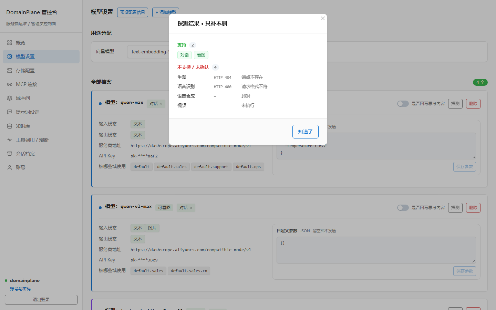

1. 点卡片「探测」→ 第一次确认列出会真发的请求（对话 16 token、生图会真出一张图、TTS 按极短音频计费）。
2. 第二次确认选写回方式：「只补不删」（默认，把确认到的能力并进档案）或「覆盖写回」（以实测为准，没确认到的族与模态清掉）。
3. 结果弹框分两区：**支持**（绿色小签）/ **不支持 / 未确认**（名称 · HTTP 状态码 · 短原因三列），标题标出这次的写回方式。

失败原因只给短词，`-1`（连不上）/ `-2`（超时）/ 未执行都显示 `—`，不伪造 HTTP 状态码；回执原文、尝试次数、协议长说明不进弹框，要追细节去服务端日志。只有端点确实不存在（404 / 405 / 415 / 501）才写「不支持」，400 / 5xx / 超时 / 网络抖动一律「未确认」——拿一次失败去删能力是错的。

---

## 5. 存储配置

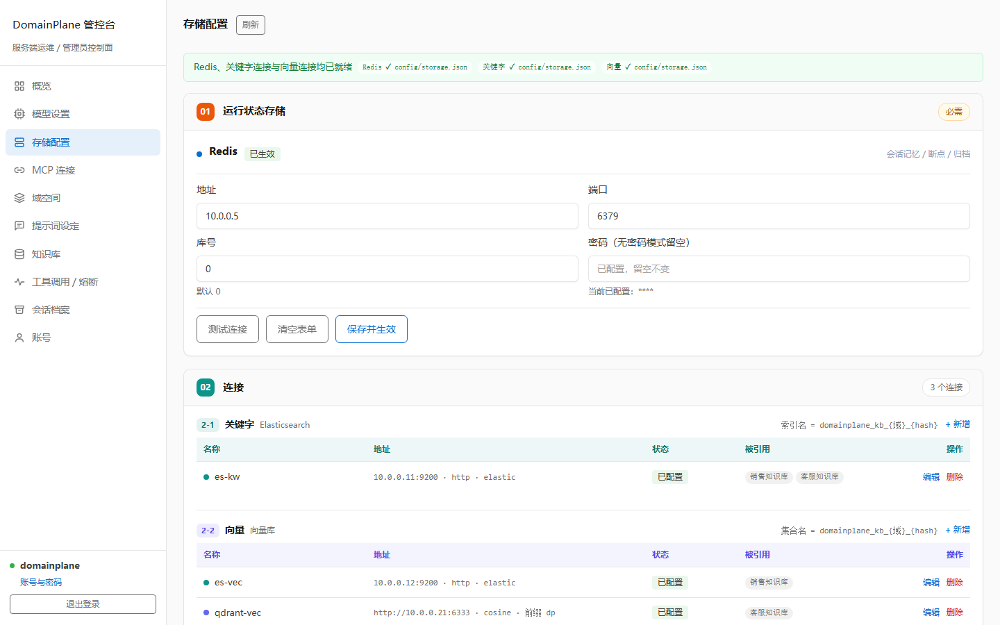

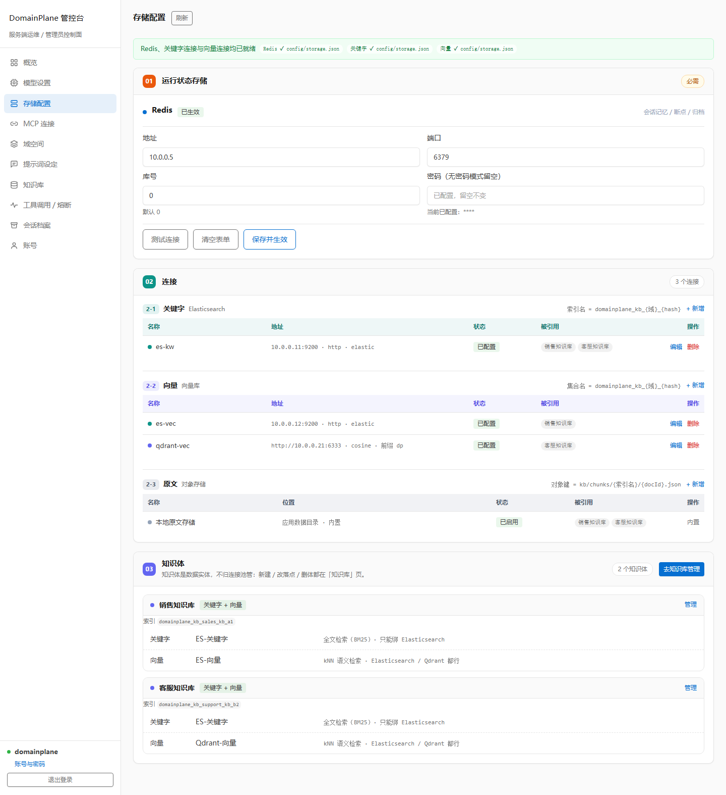

| 区块 | 内容 | 说明 |
| --- | --- | --- |
| 状态行 | Redis / 关键字 / 向量三类是否就绪 + 配置来源 | 缺哪一项直接给结论，不用逐段翻 |
| 01 运行状态存储 | Redis 地址、端口、库号、密码 | 标「必需」；密码留空表示不修改；「测试连接」单独点，不落盘 |
| 02 连接 · 2-1 | 关键字 Elasticsearch 表（名称 / 地址 / 状态 / 被引用 / 编辑 · 删除） | 关键字槽只认 ES，BM25 + IK 是方言 |
| 02 连接 · 2-2 | 向量库表（Qdrant 或 ES） | 同一台 ES 可以在 2-1 和 2-2 各出现一次，这两段是「用途」不是「产品」 |
| 02 连接 · 2-3 | 原文对象存储（S3 兼容）+ 内置的「本地原文存储」 | 本地原文那行只读，不可删改 |
| 03 知识体 | 只读回显每个体的召回路数、槽位、索引 | 新建 / 改落点 / 删体都在知识库页；本页提交不带上知识体，避免冲掉冻结的 slug 与索引名 |

### 新增一条连接

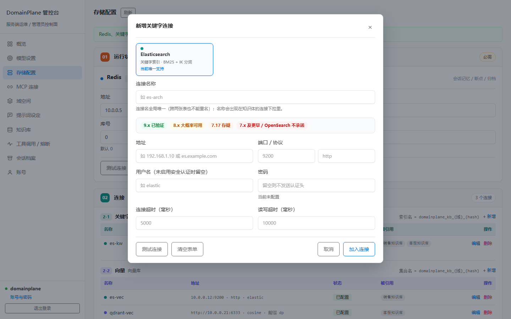

1. 点对应表格的「+ 新增」→ 选预设卡片（关键字当前只有 Elasticsearch）。
2. 填连接名称、地址 / 端口 / 协议、账号密码、连接与读写超时。
3. 「测试连接」回报版本 / 集群 / 索引兼容性；「加入连接」落盘并热替换。

换 Redis 数据源要二次确认：旧库里的历史记忆与断点不会迁移。删除连接时若正被知识体引用会拒绝，先去知识库页换落点。

---

## 6. 知识库

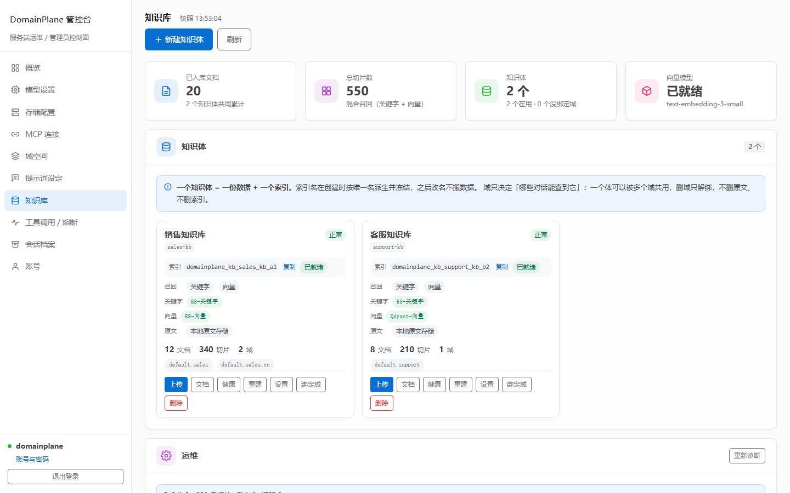

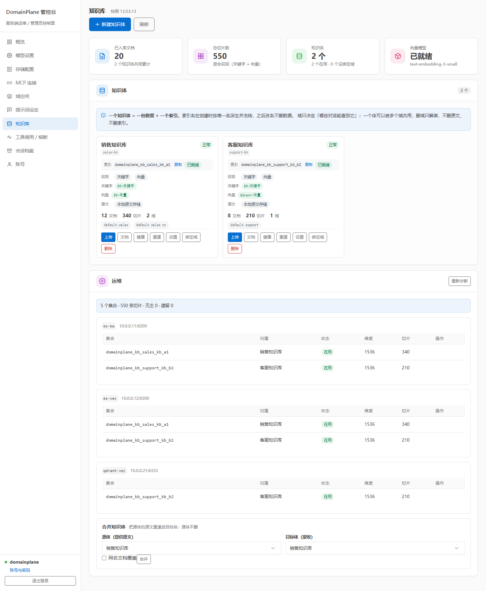

### 区块

| 区块 | 内容 | 说明 |
| --- | --- | --- |
| 页头 + 四统计卡 | 新建知识体、刷新、快照时间；已入库文档 / 总切片 / 知识体 / 向量模型 | 数字来自 60s 快照，存储读取失败时标「显示的是旧数据」 |
| 知识体卡片 | 名称、唯一名 slug、冻结索引（可复制）、召回路数、关键字 / 向量槽、原文落点、文档 / 切片 / 域数、绑定域 | 一个知识体 = 一份数据 + 一个索引；**唯一名建体即冻结**，改名不换索引 |
| 卡片按钮 | 上传、文档、健康、重建、设置、绑定域、删除 | 上传前会预检落点，不可写时按钮禁用并指向模型设置 / 存储配置 |
| 无主索引 | 有才显示 | 不提供一键删除，去运维区认领或清理 |
| 运维（常开） | 「重新诊断」逐台列集合的归属 / 状态 / 维度 / 切片；认领、清理、合并知识体 | 进页面即诊断，不需要展开 |

### 传文档与看切片

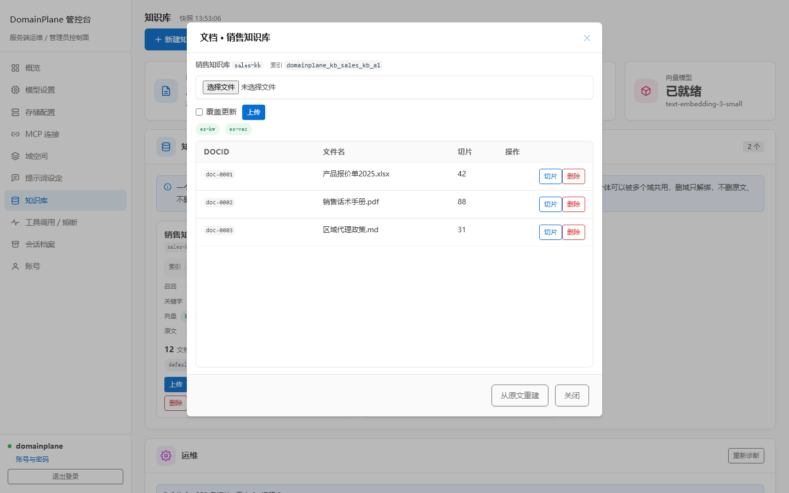

「文档」弹窗里选文件 → 上传（勾选「覆盖更新」则按同名更新）→ 表格按 docId / 文件名 / 切片数列出 → 每行可「切片」预览或「删除」，底部「从原文重建」用于原文还在、索引丢了的情况。「健康」是三方维度对照（关键字 mapping / 向量集合 / 当前模型），「重建」可选从原文重建或重建成空索引。

### 运维区

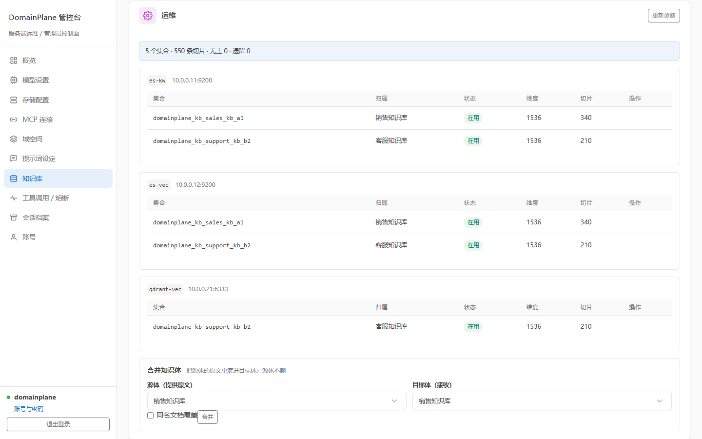

「诊断」把每台连接上的集合列清楚：在用 / 遗留 / 无主、维度、切片数。无主集合用「认领」变成知识体（索引名原样冻结），遗留集合用「清理」删除（活体当前落点上的拒删），「合并知识体」把源体原文重灌进目标体、源体不删。换落点必须先 `dryRun` 预演，正式调用先在新连接写满、校验条数、才切指针，旧集合留着不删。

删体会要求输入名称确认，默认保留原文档案；删域只解绑知识体，不删数据。

---

## 7. 域空间

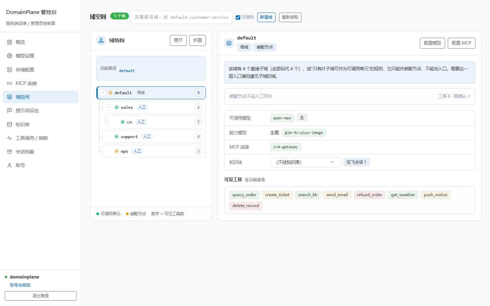

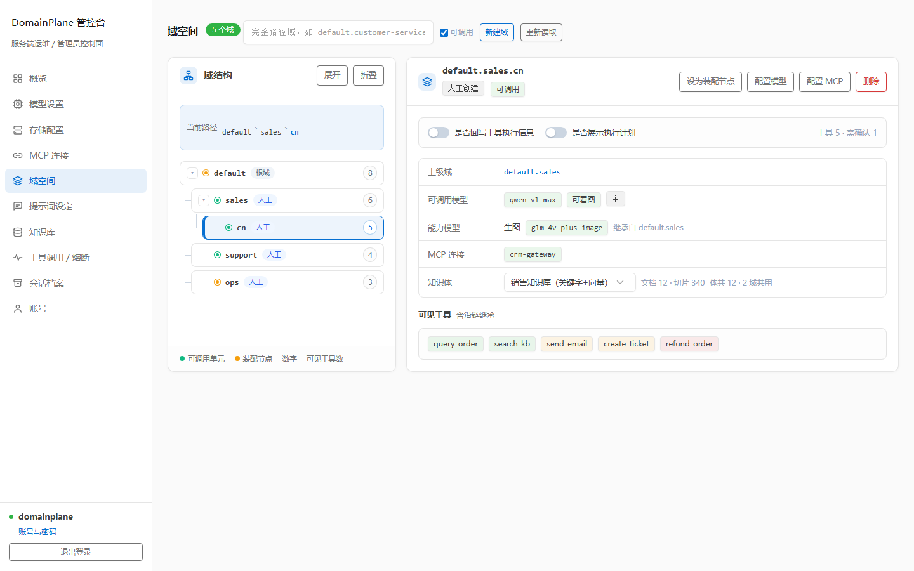

### 区块

| 区块 | 内容 | 说明 |
| --- | --- | --- |
| 页头 | 完整路径域输入框、「可调用」复选、「新建域」、「重新读取」 | 输入的是点分全路径，如 `default.customer-service` |
| 域结构 | 树、当前路径、展开 / 折叠、每节点的工具数 | 图例：绿点 = 可调用单元，橙点 = 装配节点，数字 = 可见工具数 |
| 详情卡 · 操作 | 设为装配节点 / 设为可调用、配置模型、配置 MCP、删除 | 只有叶子域能当入口；有子域的只能是装配节点 |
| 详情卡 · 开关 | 是否回写工具执行信息、是否展示执行计划 | 改动即存 |
| 详情卡 · 能力 | 可调用模型、能力模型（主 / 生图 / 语音 / 视频）、MCP 连接、知识体下拉、可见工具（含沿链继承） | 工具 / 知识 / 提示词沿域链累加，模型就近覆盖；**知识体绑定不继承** |

### 绑定模型

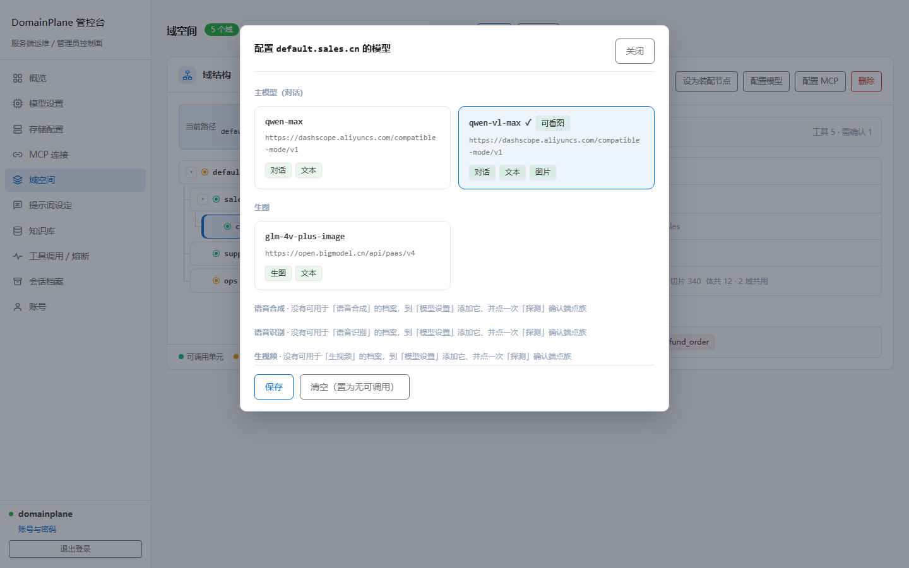

「配置模型」按用途分组列出可用档案（主模型、生图、语音合成、语音识别、视频），多选后「保存」；「清空（置为无可调用）」把这个域的模型绑定整组清掉。「配置 MCP」形状相同，勾连接后保存。选中的是叶子域时，详情页顶部才出现「设为装配节点」这类入口开关。

删域是软删：确认框写明宽限期，期间可「撤销删除」，也能「立即彻底删除」（不等在飞会话、不可撤销）；到期自动递归清子域，知识体只解绑、数据保留。知识库数字是异步补的，树先渲染——ES 不可达不会拖住整页。

---

## 8. 提示词设定

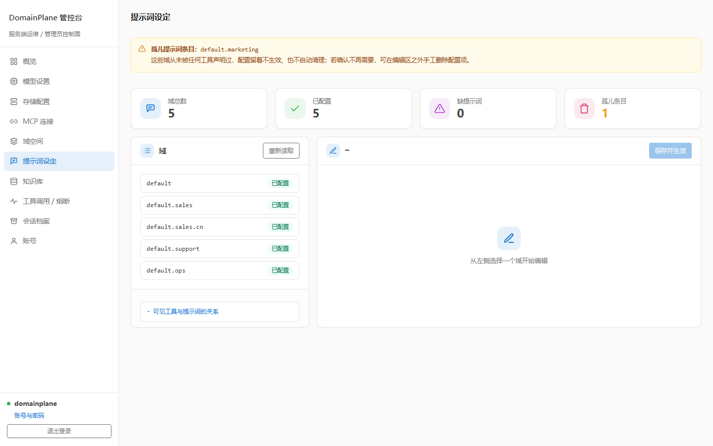

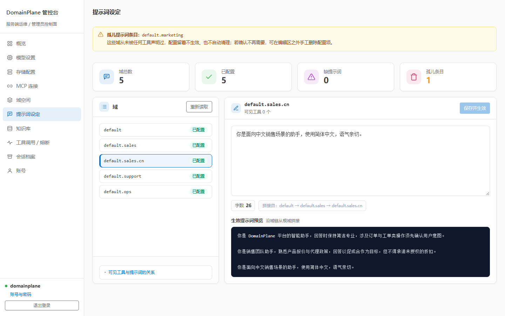

| 区块 | 内容 | 说明 |
| --- | --- | --- |
| 孤儿条目 | 提示词里配了、但没有任何工具声明过的域 | 留着不生效也不自动清理，要手工删配置项 |
| 四统计卡 | 域总数 / 已配置 / 缺提示词 / 孤儿条目 | 由 `/admin/prompts` 一次算出 |
| 域列表 | 逐域一行，「已配置」「缺提示词」徽标 | 「重新读取」在有未保存修改时先确认放弃 |
| 编辑器 | 域标题、可见工具数、未保存标记、textarea、字数、「保存并生效」 | 相对基线有改动才能保存 |
| 生效提示词预览 | 沿域链从根域拼到当前域，标出拼接路径 | 留空 = 只用祖先链；一次提交整份 prompts |

提示词不决定工具可见性，缺提示词只是体验降级。改完保存即热生效，不用重启，也没有二次确认——所以预览区值得在保存前看一眼。

---

## 9. MCP 连接

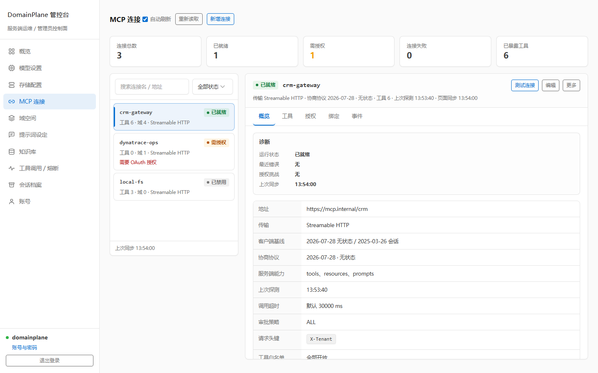

### 区块

| 区块 | 内容 | 说明 |
| --- | --- | --- |
| 页头 + 五统计卡 | 自动刷新、重新读取、新增连接；连接总数 / 已就绪 / 需授权 / 连接失败 / 已暴露工具 | 自动刷新 15s 只更新状态区，编辑中跳过，不冲掉抽屉与勾选 |
| 左连接列表 | 搜索、状态筛选、每条的状态 + 工具数 / 域数 / 传输 + 错误行 | 状态：已就绪 / 需授权 / 连接失败 / 未连接 / 已禁用 |
| 右状态条 | 协商协议（如 `2026-07-28 · 无状态` / `2025-03-26 · 会话`）、传输、工具数、上次探测 | 协议版本不用配：建连先探 `server/discover`，探不到退回 `initialize` 握手 |
| 状态条操作 | 测试连接、编辑、更多（启用 / 停用、发起授权、删除） | 失败时给「去授权」「重试测试」 |
| 五个 Tab | 概览 / 工具 / 授权 / 绑定 / 事件 | 概览里有诊断卡，可展开最近错误原文 |

### 工具、试跑与治理

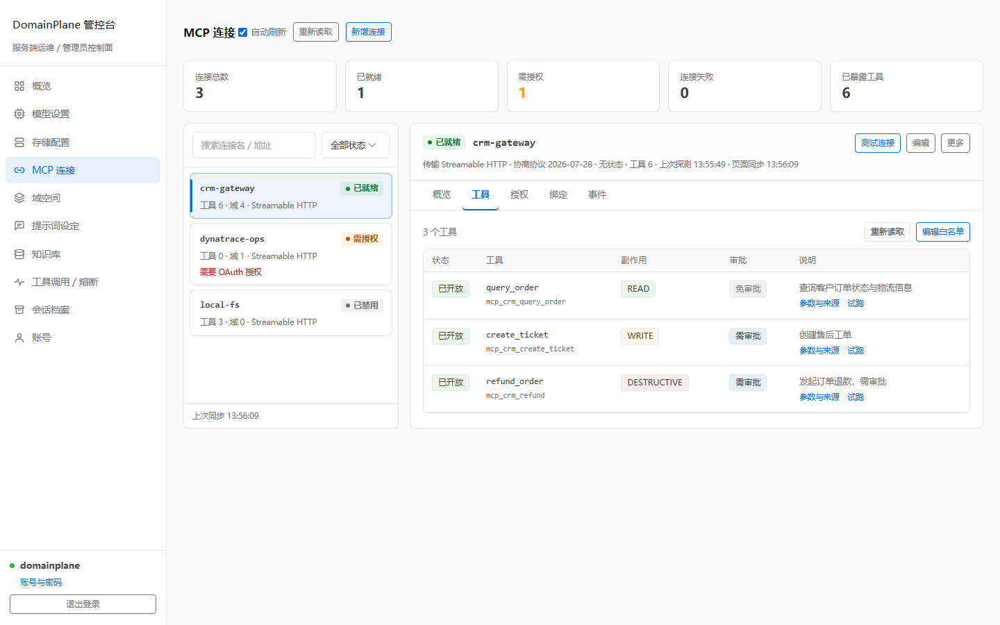

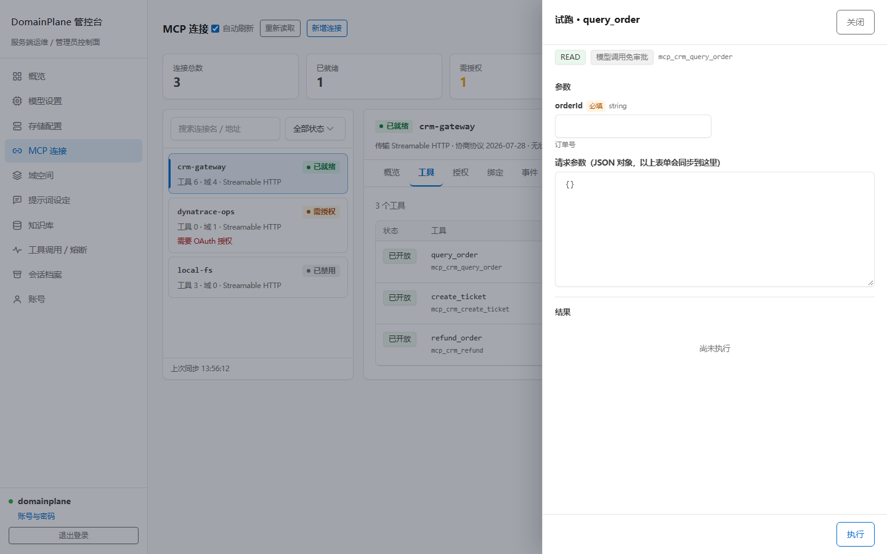

「工具」Tab 逐行列出工具的状态（已开放 / 已裁剪）、副作用（READ / WRITE / DESTRUCTIVE）、审批、说明，可展开「参数与来源」看 inputSchema、生效域、幂等性。「编辑白名单」控制哪些工具对外开放，留空 = 全部开放。

「试跑」抽屉按 inputSchema 生成参数表单，也能直接写 JSON 对象；「执行」后显示成功 / 失败、耗时、请求参数与响应原文。副作用不是 READ 的工具要显式确认，每连接 60 秒限 10 次——**试跑会真的作用到外部系统**，不是模拟调用。

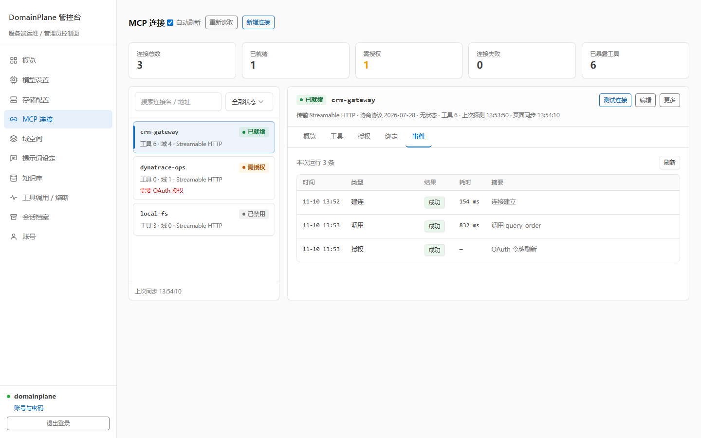

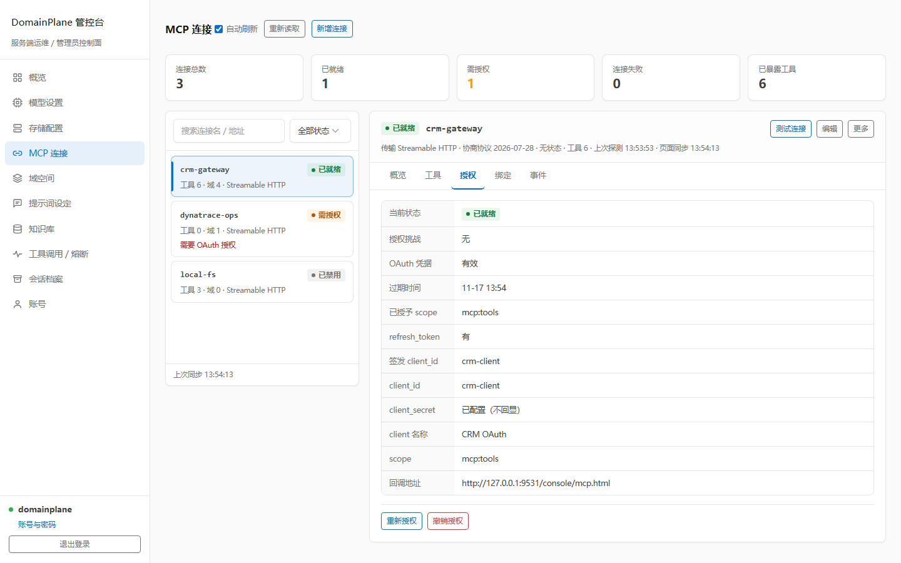

「事件」是本次运行的内存记录（建连、调用、授权），重启即清空，排障时配合概览的诊断卡看。「授权」显示当前状态、授权挑战、OAuth 凭据是否配置、过期时间、scope、回调地址，提供「发起授权 / 重新授权」与「撤销授权」；撤销只删本地凭据并重连，不回话授权服务器。请求头与 `client_secret` 只回显「已配置（不回显）」。

「绑定」Tab 勾域后「保存绑定」或「全部解绑」；保存连接即热连，返回「已保存并连接就绪 / 需要授权 / 连接未就绪」。连接名不允许连续双下划线，传输只支持 Streamable HTTP 与 Legacy SSE。

---

## 10. 工具调用 / 熔断

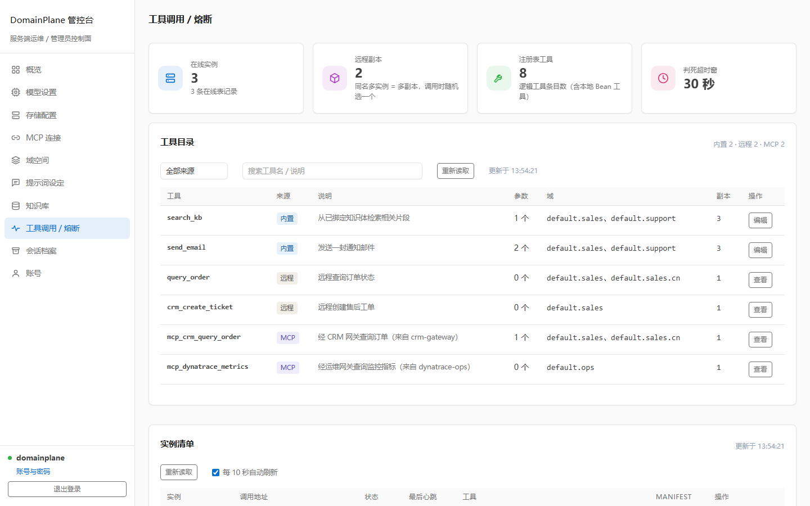

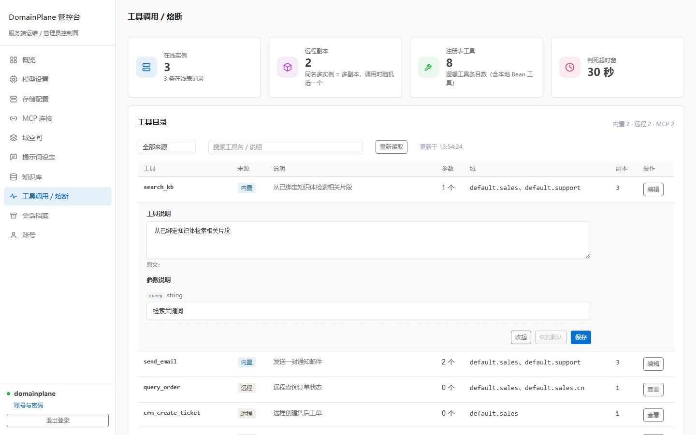

| 区块 | 内容 | 说明 |
| --- | --- | --- |
| 四统计卡 | 在线实例 / 远程副本 / 注册表工具 / 判死超时窗 | 小字给出已熔断、清理中、强制下线的数量 |
| 工具目录 | 来源筛选（内置 / 远程实例 / MCP）、搜索、重新读取、表格（说明 / 参数 / 域 / 副本 / 编辑或查看） | 只有**内置（LOCAL）**能改；远程与 MCP 只读，因为心跳 manifest 会按 digest 覆盖 |
| 编辑展开区 | 工具说明 textarea + 参数说明逐项输入框、原文、已改徽标、恢复默认 / 保存 | 保存时 `ToolDescriptor` 与发给模型的 JSON schema 一起重建，避免「页面变了、模型没变」 |
| 实例清单 | 实例 / 调用地址 / 状态 / 最后心跳 / 工具 / manifest / 断开或恢复 | 每 10 秒自动刷新，只重绘实例表，不碰正在编辑的工具目录 |

「断开工具调用」只摘掉工具副本，心跳照常受理、进程不杀；若某个域只由它声明工具，该域会暂时消失并报 `10004`，恢复后等下一次心跳重建副本。心跳已停的实例恢复不了。服务端重启后在线表清空，SDK 自动重连期间报 `10004` 属预期。

工具文案覆盖存在 `config/tool-text.json`，只存改过的文字与注解基线快照；启动时先采基线再重放，否则第二次保存会把第一次的编辑当成原文。

---

## 11. 会话档案

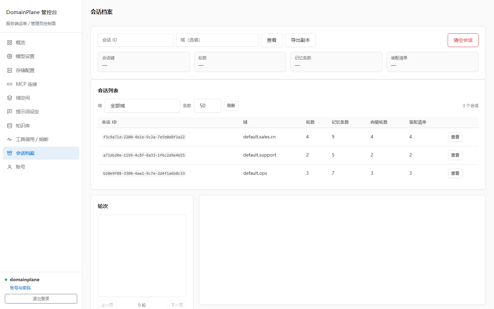

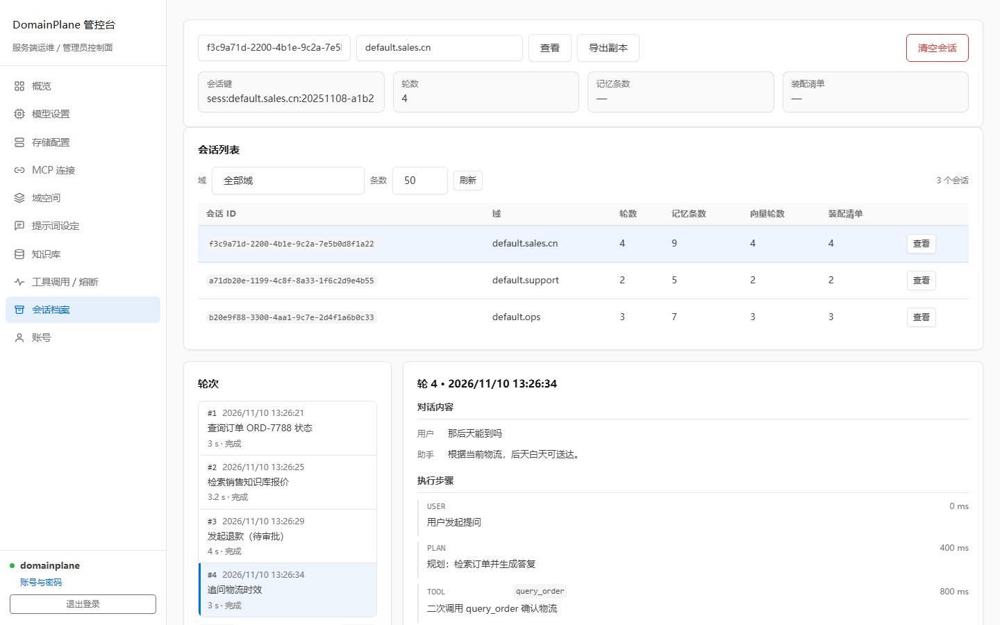

| 区块 | 内容 | 说明 |
| --- | --- | --- |
| 查询条 | 会话 ID、域（选填）、查看、导出副本、清空会话；会话键 / 轮数 / 记忆条数 / 装配清单 facts | 带域可直接拼键，省一次 SCAN 反查 |
| 会话列表 | 域下拉（全部域）、条数（20 / 50 / 100）、刷新、会话 ID / 域 / 轮数 / 记忆条数 / 向量轮数 / 装配清单 / 查看 | 按域精确筛选，不含子域 |
| 轮次 | 左列表按轮号分页（每页 20），默认选中最新一轮 | 上一页 / 下一页只改 from |
| 轮次详情 | 对话内容（用户含附件 / 助手）、执行步骤（flow 事件，ERROR 标红）、执行情况（耗时 / 状态 / token / 标记 / 装配预算与实际 / 窗口消息 / 丢弃） | 超过 500 字折「展开全文」 |

全页只读，唯一的写操作是「清空会话」：确认框写明会一并删除记忆、检查点、归档轮次、检索索引、滚动摘要、装配清单，**不可恢复**，且只清当前这一个 sessionId。排障看「执行步骤」里的 ERROR、flags（中断 / 审批拒绝 / 截断）和装配丢弃情况。

---

## 12. 账号

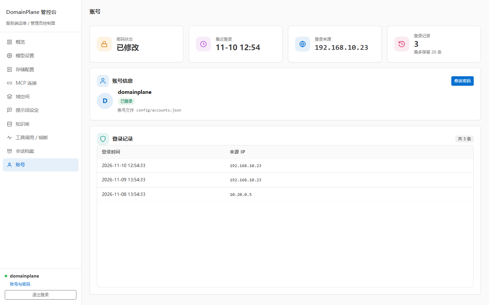

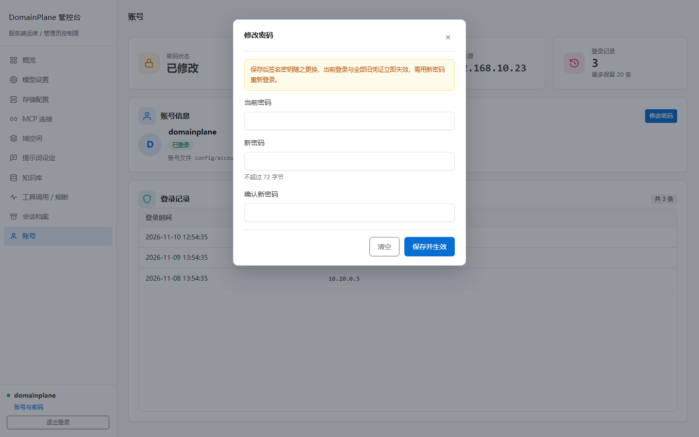

| 区块 | 内容 | 说明 |
| --- | --- | --- |
| 四统计卡 | 密码状态（初始密码 / 已修改）、最近登录、登录来源、登录记录数 | 记录最多保留 20 条 |
| 账号信息 | 账号名、登录态 chip、账号文件路径、修改密码 | 账号文件损坏 / 未初始化会在 chip 上直接显示 |
| 登录记录 | 登录时间、来源 IP | 定高表，空态写「暂无登录记录」 |
| 修改密码弹窗 | 当前密码、新密码（不超过 72 字节）、确认新密码、清空 / 保存并生效 | 顶部黄条写明「保存后签名密钥更换，当前登录与全部旧凭证立即失效」 |

改密码会踢掉包括自己在内的全部登录态，保存成功后自动跳登录页，用新密码重新登录。侧栏「退出登录」只清当前 Cookie。本产品没有注册，也没有找回密码。

---

## 13. 页面上的文字从哪来、改前端要注意什么

工具目录里的内置工具说明、参数说明可以在页面上覆盖，远程与 MCP 的由上游声明、只读；模型与 MCP 的凭据一律不回显明文；所有指标都是进程内快照，重启清零，也不跨实例聚合。

要改页面本身（HTML / JS、两套源码树、产物重建、静态资源版本号）看 [10-管控台](10-管控台.md) 第 4 节；要改鉴权与错误码看 [11-鉴权与错误码](11-鉴权与错误码.md)。
