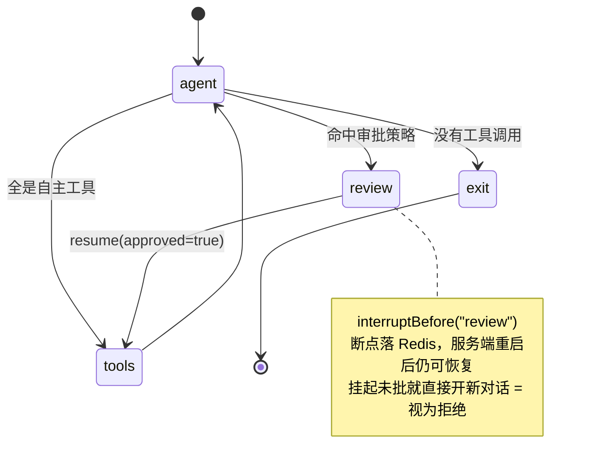

# DomainPlane 用例文档

本文从"使用者视角"描述 DomainPlane 解决什么问题、适合谁、能做什么、一次对话会发生什么，以及明确不支持的能力。技术实现细节见 `架构设计文档.md`、`详细设计文档.md`、`接口文档.md`。

---

## 1 产品定位

DomainPlane 是 **Java 生态的 AI Agent 中间件**。编排、工具治理、知识库、管控台都在一个独立服务进程里，而工具留在你自己的代码里。

一句话定位：

> **DomainPlane 不是身份中台，是"能力层的请求级装配与执行期强制"。**
> 业务后端持身份、组织、数据范围 → 映射到域 → DomainPlane 在每一轮对话上实时裁剪工具/提示词/模型/知识，并在越权时显式拒绝而不是静默降级。

形态：一个服务端 + 三个按需引入的 SDK。
- 对话 SDK（`domainplane-chat-client`）：`forDomain(域)` 取得对话入口，每轮按该域实时装配工具/提示词/模型/知识。
- 工具 SDK（`domainplane-tool-provider`）：`@Tool(domains=…)` 让 AI 在你自己的进程里调业务方法。
- 知识库 SDK（`domainplane-kb-client`）：传文档，按域落索引。

核心差异（与"直接调模型 API"或"可视化平台"相比）：

- **工具不用搬家**：给方法加个 `@Tool`，参数 schema 由签名推出，工具留在业务进程里，能直接摸本地事务和内网数据。
- **越权不是"藏起来"**：域外工具显式拒绝并把原因回灌给模型，让它换条路自己走完（`10001` 域外 / `10004` 域不存在 / `10010` 域不可调用 / `80001` 工具已下线）。任何一种都不回退成全量工具。
- **配置改完下一轮就生效**：工具集每轮实时读注册表，不缓存快照。工具实例熔断、下线、新增域都不需重启、不需发版。
- **"没回复"就是"拒绝"**：审批挂起后用户直接开新对话，视为拒绝、补一条占位回答并删断点——待授权动作永久作废，事后任何 resume 都执行不到。断点落 Redis，服务端重启后仍可恢复。
- **记忆满了明说，不静默截断**：双约束（100 条 / 30k token）只增不淘汰，到上限直接拒新轮 `30004` 且零副作用。
- **多库检索不犯数学错**：单来源走分数制、多来源自动切 RRF 排名制（只看名次，天然免疫跨索引不可比）。中文 `minimum_should_match` 定 50% 是按真实 ES 量出来的。
- **错误可编程**：统一 `ErrorCode` 五元组带 `retryable`，客户端据此决定退避重试还是直接提示，不用解析文案猜。流式出错 HTTP 已 200，`code` 是唯一真相。

---

## 2 适用场景

**适合**：
- Java 团队（新项目或已有项目）不想为 AI 另起一套技术栈；
- 工具无论集中在一个进程、还是分散在多个服务中，都需要统一注册与治理；
- 需要域维度的能力隔离（多租户、多业务线共用一套 Agent）；
- 有 on-prem、数据不出域或信创要求；
- 需要人工审批介入高风险操作（退款、改单、群发）；
- 需要知道"现在有哪些工具、哪些实例在线"。

**不适合**：
- 以可视化拖拽为主的低代码搭建；
- 纯 Python 技术栈；
- 单机脚本级的一次性调用。

---

## 3 核心能力

| 能力 | 具体到能做什么 |
| --- | --- |
| 图编排状态机 | 每一步显式可控（`agent → 条件路由 → tools/review → agent`），状态透明、可中断、可恢复 |
| 人工审批（HITL） | 工具声明审批策略后，调用前自动中断等待确认；中断点落 Redis，服务端重启后仍可恢复 |
| 域与装配 | 一次对话必须声明所处的域，模型只能看到该域的工具、只能拿到该域的提示词。域是一棵树，父域把工具/提示词/模型/知识四样东西配给后代 |
| 远程工具注册表 | 工具实例周期整包上报声明，服务端按实例维护副本；实例掉线自动摘除、重连自动恢复，同名工具多实例可同时在线 |
| 实例可用性管控 | 对单个实例静音（熔断）/恢复/强制下线，不改动工具方任何代码 |
| 混合检索（双轨融合） | 向量与关键词两路并行召回后融合重排；单索引走分数制，沿父域链取到多索引时自动切 RRF 排名制 |
| 一域一索引的知识库 | 每个域一个独立 ES 索引（按需创建），检索域 D 只查「D + 全部祖先」链上的索引；删域即删索引 |
| 双约束会话记忆 | 同时约束消息条数与 Token 估算，按 `(域, sessionId)` 隔离存在 Redis；只增不淘汰，到上限显式拒绝 |
| 流式输出与中断 | 事件流逐帧下发；任务可随时停止 |
| 内置管控台 | 8 页：概览、模型设置、存储配置、域空间、熔断工具调用、提示词设定、知识库、账号 |
| 运行指标快照 | `GET /admin/metrics` 返回注册工具数、运行中会话数、堆内存与内核指标快照 |
| 零配置可启动 | 未填 ES/Redis/模型也能启动，缺配置只在调用时报明确错误并指向该去哪一页填 |

---

## 4 能力对比

只列有差异的维度；共性能力（对话、流式、多模型接入）不再赘述。

| 能力 | 用 LangChain4j / Spring AI 自己搭 | 用平台（Dify / FastGPT） | DomainPlane |
| --- | --- | --- | --- |
| 工具怎么来 | 写代码注册，参数 schema 自己定义 | 平台侧：导入 OpenAPI / 装插件 / 连 MCP | 给方法加 `@Tool`，参数 schema 由方法签名推导 |
| 工具跑在哪 | 你的进程 | 你的服务，或平台自带插件 | 你的进程（SDK 注册 + 反向调用）或服务端进程（本地 Bean，进程内直调） |
| 域与装配 | 无此概念，权限维度自己设计 | 隔离粒度是「应用 / 工作流」 | 域树 + 两种角色 + 四维度沿链累加：父域把工具/提示词/模型/知识配给后代 |
| 人工审批 | 自己实现中断、持久化与恢复 | 编排层自行安排 | `@Tool(approval=...)` 声明即生效；断点落 Redis，服务端重启后可恢复 |
| 多实例工具治理 | 无 | 无（平台侧是插件市场） | 工具注册表：整包上报、掉线自动摘除、重连自动恢复、单实例静音/强制下线 |
| 知识库检索 | 自己接向量库、自己写召回与融合 | 平台内置 | 一域一索引 + 域链检索；单索引走分数制、多索引自动切 RRF |
| 会话记忆 | 自己实现 | 平台内置 | 双约束（条数 + token 估算）按 `(域, sessionId)` 隔离；到上限显式拒绝，不静默丢历史 |
| 管控与运维 | 无，自己写 | 平台自带界面 | 8 页管控台 + 运行指标快照 |
| 技术栈 | Java（库，随业务进程） | 独立平台（Python 为主） | Java 21 / Spring Boot，与业务同栈 |

- **新项目**：直接用 DomainPlane 当底座——编排、审批、工具注册表、知识库、管控台第一天就有。
- **已有项目**：加依赖、注入 `DomainPlaneAgent`、给现成的 `@Service` 方法加个 `@Tool` 注解即可，不必为 AI 重构现有代码。

---

## 5 一次对话的生命周期



1. `agentNode` 注入系统提示词 + 本轮域可见的工具集，调流式模型，逐帧下发 `TOKEN`。
2. 无工具调用 → 结束；全是自主工具 → 直连 `tools` 执行；命中审批策略 → 路由到 `review` 并中断。
3. 中断时下发 `INTERRUPT` 事件（带待审批工具清单），断点写入 Redis。
4. 调用方 `resume(sessionId, true)` → 继续执行工具 → 回到 `agent` 汇总。

SSE 事件类型：`TOKEN` / `TOOL_CALL` / `TOOL_RESULT` / `INTERRUPT` / `STOPPED` / `ERROR` / `DONE`。

**域是入口的关键**：一次对话必须声明所处域（SDK 在取门面时绑定，裸 HTTP 传 `domain`）。域决定四件事——模型能看到哪些工具、用哪份系统提示词、能检索到哪些知识、走哪个模型。域是一棵树，标识是从根域 `default` 出发的完整路径（如 `default.sales.order`）；只有叶子域（没有子域）能作为可调用单元，有子域的装配节点不能当入口（报 `10010` 而非静默降级）。

**会话状态按 `(域, sessionId)` 隔离**：同一个 `sessionId` 可以在不同域各用一份，记忆/断点/停止/事件流互不影响；`stop` 与 `resume` 必须带与 `chat` 相同的域。

---

## 6 差异化痛点（DomainPlane vs 平台）

每条格式：他们怎么解决不了 → 我们怎么解决。

### 6.1 工具接入与治理

- **工具住在平台里，就永远隔着网络**：平台侧工具是平台资产，接进来要被翻译成 HTTP 端点 / OpenAPI / MCP，参数 schema 与真实方法签名分离、网络跳数 +1、工具逻辑不在业务事务边界内。我们：工具就是业务进程里的一个方法，参数 schema 由签名+注解推导，可直接读本地事务、复用 `@Transactional` 边界、访问内网库而无需开通网络策略。
- **工具进程挂掉，平台侧往往没有"治理"概念**：平台把工具当插件，进程生死不在视野里。我们：工具实例是一等公民，有完整生命周期——5s 心跳整包上报、35s 未收到心跳 → `DRAINING`、同名工具多副本路由轮选、管控台对单个实例熔断/恢复/强制下线（410 + 1h 保留窗），且实例下线不截断会话（会话属于域，不属于实例）。

### 6.2 执行期强制：权限与审批

- **越权不是"少给一个工具"，而是必须让模型知道边界在哪**：平台常静默剔除工具，模型不知道它存在，于是改口或编一个。我们：越权是显式拒绝 + 文本回灌（`10001`/`10004`/`10010`/`80001`），流不结束，模型可换路径；工具集每轮实时读注册表，不缓存快照。
- **"点了批准"和"其实没批准"必须能区分**：平台 HITL 多依赖工作流节点+外部状态，用户没回复和用户拒绝在系统里常是同一件事。我们：把"视为拒绝"写成显式不变式——挂起未批直接开新对话 = 视为拒绝，补占位回答并删断点；`resume` 必须带相同域，跨域报 `30001`；敏感参数 `@ToolAdvanced(sensitive={"phone"})` 在事件与审批 payload 里掩码，执行仍用原值。
- **提示词里点了工具，工具却不可见——这是配置错误，不是运行期惊喜**：平台不校验二者一致性，写错运行期才发现。我们：启动期自检，提示词点名的工具必须在对应域可见，否则 WARN；域字符串收口，manifest/注解 `domains` 格式非法整包拒绝/启动失败。

### 6.3 知识库：入库与检索

- **"支持 PDF/Word"和"能切出可用结构"是两件事**：通用解析（Tika）输出格式无关纯文本，对 docx 丢标题层级、对 pdf 丢字号——而这两样恰好是切片唯一要用的。我们：两层结构，格式适配层读结构（docx 靠大纲级别、pdf 按行坐标与页码分节、excel 靠工作表）+ 通用切片层复用；文本类探测一次编码（BOM→UTF-8→GB18030），判不出即拒不猜，二进制类绝不解码。
- **跨域检索：多路结果混在一起"看起来成功"，其实召回塌了**：平台常混池后过滤，把本域结果挤掉。我们：域边界在召回通道层确定（查哪些索引），不是召回后过滤；一域一索引，检索域 D → 通道 = `chainOf(D)` 上每个索引 × 两路模态，索引不存在时安静返回空。
- **多索引融合：分池化 BM25 是静默的错误答案**：BM25 的 idf 用本索引文档频率计算，跨索引量纲不同，加权求和会把小索引稀有词抬高。我们：按实际有命中的来源数自适应切换——≤1 来源走分数制，≥2 来源走 RRF 排名制（`score = Σ w_L/(k+rank_L)`，k=10，只看名次免疫跨索引不可比）；RRF 权重均摊且空表不占份额，再乘祖先衰减。
- **中文关键词检索阈值不能凭直觉调**：默认 `minimum_should_match` 对中文长问句常零命中。我们：在真实 ES 上量出 50%（有效区间 40%~50%）；字段权重 `text^1.0` / `text.standard^0.8` / `section_path^1.5` / `section_title^2.0`；空结果与服务不可用两态分离（前者"未检索到"，后者"服务不可用"）。

### 6.4 会话与记忆

- **记忆满了就静默截断 = 用户永远不知道自己丢了什么**：平台多按 token 预算截断或摘要。我们：双约束（100 条 / 30k token）只增不淘汰；到上限入口拒绝该轮（`30004`），不写记忆、不清断点、不调模型，且判定粘性；平台不代为换 `sessionId`；上限只约束入口，最终回答永远可写。
- **会话隔离的键放在哪，决定权限撤销时会发生什么**：平台 `user_id`/`conversation_id` 隔离是会话面的，权限变化不联动。我们：状态键 = `(域, sessionId)`（分隔符 `|`），不同域可用同一 sessionId 互不影响；删域时级联清理 7 处（注册表、ES 索引、切片预览、提示词、模型绑定、工具声明记录、Redis 记忆与检查点）。
- **停机与停会话：不能只把 HTTP 断了**：平台"停止"常只是客户端断开订阅。我们：`stop` 置取消标志，由 `agentNode` 与 `toolsNode` 在工具执行前检查后抛出，工具不会执行到一半被打断；随后回滚本轮记忆、清检查点、推 `STOPPED`、结束流；同一 sessionId 不允许并发，已在执行时直接 `30003` 拒绝不排队。

### 6.5 模型选择

- **"给不同用户配不同模型"在平台侧是配置问题，不是代码问题**：平台模型可见性绑在工作空间角色上。我们：域 → 有序别名列表（`domainBindings`），取首个可用；沿域链回落；整体覆盖语义，空 = 解绑 → 抛 `NotConfiguredException`，不回落默认（悄悄用便宜模型是最难查的一类问题）；删档案 = 级联清绑。

### 6.6 可编程的错误契约

- **"HTTP 200 + 一句中文提示"是集成噩梦**：平台流式响应出错时 HTTP 已发 200，错误只混在事件流里。我们：`ErrorCode` 五元组（code/message/httpStatus/retryable/action），三条出口同源（SSE 事件码、非流式响应体、SDK 异常）；`retryable` 是关键，客户端据此决定退避重试还是直接提示；已定义但未实现的三码（`20000`/`20001`/`20003`）在文档里明写"服务端不会发出"。
- **长回答被容器 30 秒腰斩，客户端把半截答案当成功**：MVC 默认 30s 是整轮总时限，且 `DONE` 静默吞掉 → 半截答案当成功。修法：`spring.mvc.async.request-timeout: -1` + 客户端校验终止事件。

### 6.7 交付形态

- **平台是 Python 栈，Java 团队要跨进程、跨语言、跨发布节奏**：我们 Java 21 / Spring Boot 3.x，与业务同栈；三个 SDK 按需引入、互不依赖，都不引 Web 容器（把容器写进 SDK 会让纯 WebFlux 宿主被误判成 SERVLET）。
- **`forDomain(...)` 绑定域，写不出"忘记传域"的代码**：域在取得门面时绑死，方法签名里没有 domain 参数，所以忘传域写不出来；裸 HTTP 入口接受 `domain`（必填），但 SDK 侧把这个易错点从 API 上消掉了。

### 6.8 运维与可观测

| 项 | 我们 |
| --- | --- |
| 管控台 | 8 页，零依赖不引 CDN |
| 运行指标 | `GET /admin/metrics`：累计请求数、运行中会话、注册工具数、堆内存、实例维度副本数，可接进已有监控 |
| 存储探测 | ES 缺 IK 分词器在「测试连接」里判读（可用/确认未安装/未探测三态） |
| 存储自检 | `RedisPersistenceAudit` 启动自检 `appendonly`/`appendfsync`/`noeviction`，只告警不阻断 |
| 启动自检 | 提示词点名的工具必须在该域可见，否则 WARN |
| 配置热替换 | ES/Redis 连接热替换，口令不回显，无需重启 |
| 停机 | 优雅停机（等上限 30s）：先停收新请求，在途含 SSE 长连接收尾后再退出 |
| 审计 | 独立 AUDIT logger，`action/operator/result/ip` 固定 key 形式 |
| 零配置启动 | 未填 ES/Redis/模型也能启动，缺配置只在调用时报明确错误（`90005`）并指向该去哪一页填 |

---

## 7 明确不支持的能力（不能碰）

以下四条在对外材料里必须主动排除，否则会被懂行的人一问就穿：

| 项 | 真实状态 |
| --- | --- |
| 按终端用户身份鉴权 | 唯一授权维度是域。`tenantId`/`userId` 只透传给远程工具执行与日志，不参与任何判定。用户→域的映射仍要业务后端做 |
| 部门/岗位/项目/数据范围/临时授权 | 无主体、无属性、无策略引擎。域是工具可见性的唯一维度，不叠加第二个权限维度 |
| 记忆策略体系 | 无按部门/角色/敏感级别的保留周期、聚合范围、脱敏规则；键含 sessionId → 跨会话共享天然做不到；ttl 是全局永久 |
| 对话与工具调用的统一审计 | `AuditLog` 只记 `/admin` 变更类 + 工具实例注册，不记对话与工具调用；账号体系是"单一账号，无角色、无权限分级" |
| 集群 / 多实例 | 明确不支持。`SingleInstanceGuard` 启动时抢 Redis 运行权租约，抢不到即拒绝启动。纵向扩容（加 CPU/内存/提高线程池）是当前唯一受支持的扩容方式 |
| MCP | 未实施 |
| 入口限流 / 并发上限 | 码已定义（`20000`/`20001`/`20003`）但代码不发出 |

---

## 8 典型接入路径

1. 起服务端（默认 9527），打开管控台 `http://localhost:9527/admin.html`，用种子账号 `domainplane`/`domainplane` 登录，在「模型设置」与「存储配置」填好模型、ES、Redis。
2. 在「域空间」建一个可调用单元（叶子域），如 `default.customer`。
3. 接入方应用引 `domainplane-chat-client`，配 `domainplane.server`/`username`/`password`，注入 `DomainPlaneAgentFactory` 取该域门面，`ask(sessionId, question)` 即可发起一轮对话。
4. 同一应用再引 `domainplane-tool-provider`、打开 `domainplane.tools=true`，用 `@Tool` 声明几个方法；启动后到管控台「在线实例」确认实例在线、工具已进注册表。
5. 管控台「知识库」上传文档并选归属域，再用该域的对话去检索。

> 服务端必须先启动（与 Redis/Nacos 接入习惯一致）：引入 starter 的应用在启动完成前会换取签名凭证并探测健康，连不上即中断启动。
> 工具回流地址 `endpoint` 留空即按本进程端口推导，只在服务端与工具实例同机时成立；跨机部署必须显式填写。


---

## 9 代码怎么写：从简单到复杂

下面按"接入代价"从低到高给出可直接照抄的示例。所有示例假设你已按 §8 起好服务端、建好叶子域（如 `default.customer`）。

> 配置（三件套，对话 / 工具 / 知识库 SDK 共用同一份前缀，只写一次）：
> ```yaml
> domainplane:
>   server: http://localhost:9527
>   username: domainplane
>   password: domainplane
>   tools: false            # 只有要当工具提供方时才开 true
> ```

### 9.1 最简对话：注入门面 + 一句话问答

门面由 `DomainPlaneAgentFactory.forDomain(域)` 取得，**域在取门面时绑死**，之后 `ask` 不再出现 domain 参数——"忘传域"在编译期就写不出来。

```java
@Service
public class CustomerAssistant {

    private final DomainPlaneAgent agent;

    // 注入工厂，取 default.customer 域的门面（无状态、线程安全，可复用）
    public CustomerAssistant(DomainPlaneAgentFactory factory) {
        this.agent = factory.forDomain("default.customer");
    }

    public String chat(String sessionId, String userMessage) {
        // ask 内部消费完整事件流并拼出最终回答；同一 sessionId 复用同一份记忆
        return agent.ask(sessionId, userMessage);
    }
}
```

`ask` 返回 `String`（整轮最终答案）。需要逐字输出用 `stream`，需要看工具调用 / 审批 / 错误码用 `events`（见后）。

### 9.2 流式输出：逐字拿增量

`stream` 返回 `Flux<String>`，每个元素是一段模型文本增量；客户端自己拼，SDK 不替你攒。

```java
public String streamChat(String sessionId, String userMessage) {
    StringBuilder answer = new StringBuilder();
    agent.stream(sessionId, userMessage)
         .doOnNext(answer::append)   // 边收边拼，也可直接推给前端
         .blockLast();               // 阻塞到 DONE；WebFlux 环境用 subscribe 而非 block
    return answer.toString();
}
```

`agent.domainId()` 随时可取回这个门面绑定的域（此处恒为 `default.customer`）。

### 9.3 事件流：看清每一帧

`events` 返回 `Flux<AgentEvent>`，是"需要可编程处理"时的入口：工具调用、审批中断、错误码都在事件里，不埋进文本。

```java
agent.events(sessionId, question)
     .doOnNext(evt -> {
         switch (evt.getType()) {
             case TOKEN       -> System.out.print(evt.getContent());        // 模型文本增量
             case TOOL_CALL   -> log.info("调工具 {} 参数 {}", evt.getContent(), evt.getPayload());
             case TOOL_RESULT -> log.info("工具结果 {}", evt.getPayload());
             case INTERRUPT   -> log.info("挂起待审批 {}", evt.getPayload());
             case ERROR       -> log.error("错误码 {} : {}", evt.getCode(), evt.getContent());
             case DONE        -> log.info("本轮结束");
         }
     })
     .blockLast();
```

`AgentEvent` 提供 `getType() / getContent() / getPayload() / getCode() / getCodeName() / getTraceId()`。`ERROR` 帧的 `code` 是程序解读的唯一真相（HTTP 可能已是 200）。

### 9.4 声明一个工具：给方法加 @Tool

工具就是业务进程里的一个方法，参数 schema 由签名 + `@ToolParam` 推导，直接复用你的 `@Transactional` 边界与内网数据。

```java
@ToolDomains("default.customer")   // 类级默认域：本类所有 @Tool 默认挂在这个域
@Service
public class OrderTools {

    @Tool(desc = "按订单号查询订单详情、状态与金额")   // desc 必填，是给模型的用途说明
    public OrderDetail queryOrder(
            @ToolParam("订单号，如 FR2024001") String orderNo) {
        return orderRepository.findByOrderNo(orderNo);
    }
}
```

`@ToolDomains` 是类级注解统一填域；单方法也可以 `@Tool(domains = {"default.customer.order"})` 覆盖。把 `domainplane.tools=true` 打开后，这个实例会自动注册到服务端（心跳 + 暴露反向调用端点），到管控台「在线实例」能看到。

### 9.5 带副作用的工具：挂审批 + 脱敏敏感参数

退款这类出金动作，用 `approval = ALWAYS` 声明即生效——调用前自动中断，前端用 `ApprovalRequiredException` 拿到待授权清单。敏感参数用 `@ToolAdvanced(sensitive=...)` 在事件 / 审批 payload 里掩码，执行仍用原值。

```java
@Tool(
    desc = "发起退款",
    domains = {"default.customer.refund"},
    effect = Tool.Effect.DESTRUCTIVE,          // 破坏性操作，建议配审批
    approval = Tool.Approval.ALWAYS,            // 每次调用前都要人工确认
    approvalReason = "退款会真实出金，需人工确认"
)
@ToolAdvanced(sensitive = {"phone"})           // phone 在日志/事件/审批展示中掩码
public RefundResult refund(
        @ToolParam("订单号") String orderNo,
        @ToolParam("退款手机号（脱敏展示）") String phone,
        @ToolParam(value = "退款原因", required = false) String reason) {
    return refundService.apply(orderNo, phone, reason);
}
```

`@ToolParam` 的 `required = false` 表示该参数模型可不传；`@ToolAdvanced` 还有 `example`（示例值）、`allowValues`（取值约束）可补强 schema。

### 9.6 知识库上传：把文档落到某个域的索引

知识库 SDK 只管"放进去"，检索由模型自动取用。域决定哪些对话能检索到这份文档（与 `@Tool(domains=...)` 同构：挂该域即其后代域都能查到）。

```java
@Service
public class KbSync {

    private final KnowledgeBaseClient kb;

    public KbSync(KnowledgeBaseClient kb) { this.kb = kb; }   // 自动装配的 Bean

    public void uploadPolicy(byte[] pdfBytes) {
        // 挂到 default.customer 域；replace=true 同名覆盖
        var r = kb.upload(pdfBytes, "退换货政策.pdf", true, "default.customer");
        log.info("已入库 {}，切片 {} 块", r.fileName(), r.chunks());
    }

    public void listDocs() {
        kb.list().forEach(d -> log.info("{} 共 {} 块", d.fileName(), d.chunks()));
    }

    public void remove(String docId) {
        boolean hit = kb.delete(docId);   // 删除并释放文件名，同名可再传
    }
}
```

`upload` 不带 domain 的重载默认挂根域 `default`（全域可见）；返回 `UploadResult(docId, fileName, size, chunks)`，列表项 `DocumentItem(docId, fileName, chunks)`。

### 9.7 审批中断的完整闭环：catch 挂起 → resume

当某轮命中审批策略，`ask` / `events` 会抛出 `ApprovalRequiredException`（继承自 `RuntimeException`），携带 `sessionId / domainId / tools / traceId`。挂起未批就直接开新对话 = 视为拒绝——所以中断要在同一会话内处理。

```java
public void handle(String sessionId, String question) {
    try {
        agent.events(sessionId, question).blockLast();
    } catch (ApprovalRequiredException ex) {
        // 展示待授权工具清单给人工确认
        ex.getTools().forEach(t -> log.info("待审批：{} 参数 {}", t.getName(), t.getArguments()));
        // 用户点"批准" -> 恢复执行；点"拒绝" -> resume(sessionId, false) 让模型重决策
        agent.resume(sessionId, true).blockLast();
    }
}
```

注意 `resume` 必须带与 `chat` 相同的会话 id；跨域会被拒（`30001`）。想中途停掉用 `agent.stop(sessionId)`（幂等，不可恢复）。

### 9.8 裸 HTTP / SSE 调用：不引 SDK 也能接

不想引 Java SDK 时，直接用 HTTP 调服务端。`domain` 在 chat 请求体里（必填），在 resume / stop 里是 query 参数。

```bash
# 发起一轮对话（domain 在请求体，必填；响应是 SSE 事件流）
curl -N -X POST 'http://localhost:9527/api/agent/chat' \
  -H 'Content-Type: application/json' \
  -d '{"sessionId":"s-001","message":"我的订单 FR2024001 到哪了","domain":"default.customer"}'

# 恢复被审批挂起的会话（domain 必填 query）
curl -N -X POST 'http://localhost:9527/api/agent/resume?sessionId=s-001&approved=true&domain=default.customer'

# 主动停止（domain 可选 query）
curl -X POST 'http://localhost:9527/api/agent/stop/s-001?domain=default.customer'
```

SSE 事件以 `data:` 行下发，`type` 取值 `TOKEN / TOOL_CALL / TOOL_RESULT / INTERRUPT / STOPPED / ERROR / DONE`（`THINKING` 思考增量视模型而定）。接入账号先 `POST /api/agent/login` 换取凭证，再带凭证头调用，详见 `接口文档.md`。
