# DomainPlane 设计文档

### 0.1 全书分层与 16 块

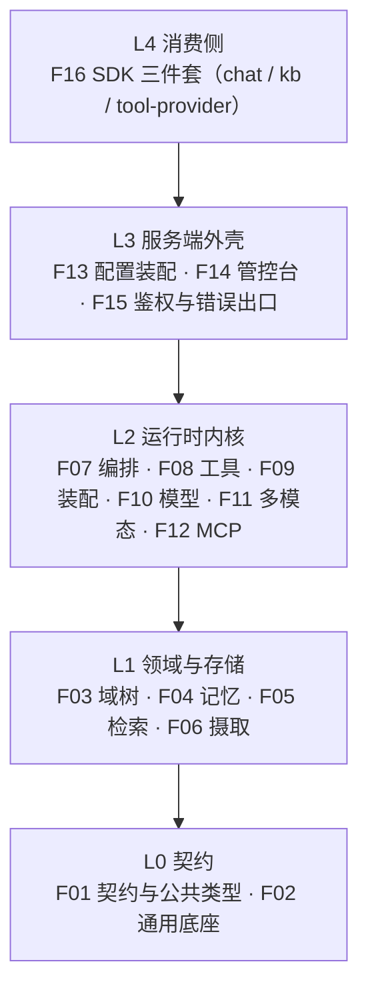

### 0.2 模块依赖方向

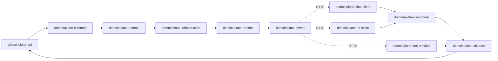

三条边界值得在图上指出来：`common` 依赖 `api` **只为** `ErrorCode`；`domain`/`infrastructure` 不反向依赖 `server`（域、检索域靠 `RetrievalScope`、`ModelResolver` 这类接口倒置）；三个 SDK 与服务端**只通过 HTTP 报文耦合**，不与 `server` 互相依赖。

---

# F01 契约与公共类型

`domainplane-api`（38 类 / 2,613 行） + `domainplane-sdk-core`（1 类 / 68 行）

## 1.0 一句话

服务端与三个 SDK 共用的唯一一份"话术"：怎么发请求、怎么收事件、工具长什么样、出错报什么码、会话状态键怎么拼。它不实现任何行为，但决定了所有行为的外形。

## 1.1 为什么必须是独立模块

四个依赖方（服务端 + 对话 SDK + 知识库 SDK + 工具 SDK）跨进程通信，全部靠 JSON 报文。同一份 `AgentEvent` 各拷一份的必然结果是分叉，而分叉的故障形态极其隐蔽：

- SDK 的枚举里没有 `THINKING`，服务端发出后客户端反序列化直接抛未知枚举值，整个事件流断在第一个思考增量上；
- 错误码文案各写一份，同一次失败在服务端日志、SDK 异常、前端提示里是三种说法，排障时对不上。

所以契约只能有一份，且必须放在依赖图最底层：**谁都能依赖它，它不依赖任何业务模块**。

## 1.2 依赖边界

| 方向 | 对象 | 实际依赖点 |
| --- | --- | --- |
| 被依赖 | `domainplane-common` | 6 个异常类各 `import ...api.code.ErrorCode`，是 common 依赖 api 的**唯一**原因 |
| 被依赖 | `domainplane-runtime` | 契约 + 注解 + 事件 |
| 被依赖 | `domainplane-server` | 全部 |
| 被依赖 | `domainplane-sdk-core` | 契约与公共异常打包给三个 SDK |
| 传递 | `domainplane-domain` / `infrastructure` | 经 common 传递，不直接声明 |
| 依赖 | `reactor-core` / `slf4j-api` / `jackson-annotations`(optional) / `lombok`(provided) | — |

这里有一个**实测观察**：`domainplane-api/pom.xml` 还声明了 `dev.langchain4j:langchain4j-core`，但 api 主代码对 langchain4j 零 `import`，只有两处 javadoc 提到它。判断：历史遗留的编译依赖，可移除，但需先确认下游没有靠 api 传递拿到 langchain4j-core（实际上 runtime / server 都各自直接声明了，移除不影响编译）。**未改动，仅登记。**

## 1.3 六个契约面

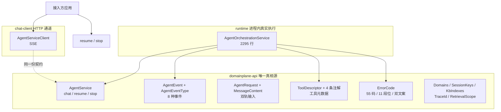

关键点：**一个接口、两个方向的实现**。服务端实现是内核（`AgentOrchestrationService`），客户端实现是 HTTP 通道（`AgentServiceClient`）。于是"调用方看到的签名"与"服务端执行的签名"是同一个，加方法时要同时改两边（见 F01 观察点 5）。

### 1.3.1 `AgentService` —— 唯一的服务契约，两个方向的实现

```java
Flux<AgentEvent> chat(AgentRequest request);
Flux<AgentEvent> resume(String sessionId, boolean approved, String domain);
boolean stop(String sessionId, String domain);
```

| 方法 | 关键语义 | 易错点 |
| --- | --- | --- |
| `chat` | 返回**冷流**，订阅后才开始执行；`sessionId` 同时是记忆键与检查点键 | 不订阅 = 什么都不发生，不是"发出去没回音" |
| `resume` | 恢复被 `INTERRUPT` 挂起的会话；`approved=false` 时内核注入拒绝反馈让模型重新决策，而非直接结束 | 必须带**与 chat 相同的 `domain`**，否则找不到断点（`SESSION_NOT_FOUND 30001`） |
| `stop` | 不可恢复，幂等；返回 `false` 表示已在停止态 | 同样必须带 `domain`，会话状态按 `(域, sessionId)` 隔离 |

这个接口有**两个实现，方向相反**，这是本项目的结构特征：

| 实现 | 模块 | 形态 |
| --- | --- | --- |
| `AgentOrchestrationService` | `runtime` | 进程内真实执行体（2,295 行） |
| `AgentServiceClient` | `chat-client` | HTTP/SSE 客户端，把远程调用包装成同一个接口 |

于是"调用方看到的签名"与"服务端执行的签名"是同一个。契约注释未声明这种双实现关系，新增方法时两边都要改，这是后续演进要知道的隐性成本。

### 1.3.2 输入：`AgentRequest` + `MessageContent` + `ContentType`

两代输入字段并存，不是两套协议：

| 字段 | 角色 | 规则 |
| --- | --- | --- |
| `message` | 旧字段，纯文本，**永久保留** | 可以空白（只发图不发字是合法输入） |
| `contents` | 新字段，内容块列表，可空 | 非空时是权威输入 |

判定只有一条：`contents` 为空或空列表 → 整体回落纯文本路径，旧客户端行为分毫不变。`message` 不因 `contents` 非空而删除，因为 SDK 与接入方有大量只传字符串的重载，删字段等于一次性打断全部存量接入。

`getMessage()` 是唯一的"文本在哪"的答案：`contents` 含 TEXT 块时按块序换行合并，否则回落 `message`。入口护栏（`InputSanitizer`）与编排层的封顶判定都只认这个方法。

`MessageContent` 是 record，7 个字段按类型取用：

| type | 必填字段 | 说明 |
| --- | --- | --- |
| `TEXT` | `text` | — |
| `IMAGE_URL` / `AUDIO_URL` / `VIDEO_URL` | `url` | `detail`（low/high）只对视觉有意义 |
| `IMAGE_BASE64` / `AUDIO_BASE64` / `VIDEO_BASE64` | `base64` + `mime` | base64 不含 `data:` 前缀；缺 mime 无法拼 data URL |

校验口径是"宽进严出"：多填一个用不到的字段不报错（客户端不该因为多写一个值整轮失败），少填一个必须的（base64 缺 mime、URL 块缺 url）在服务端明确报错（`requireMime()` / `requireUrl()`）。

`ContentType` 上还有 4 个判定方法（`isImage` / `isAudio` / `isVideo` / `isMedia`），容量判定与落库区别对待都靠它们。

### 1.3.3 输出：`AgentEvent` + `AgentEventType`

八个事件类型，单向流，无回执：

| 类型 | 产生者 | `content` | `payload` |
| --- | --- | --- | --- |
| `TOKEN` | 模型增量 | 增量文本 | — |
| `THINKING` | 模型思考增量 | 增量文本 | — |
| `TOOL_CALL` | 编排层 | 工具名 | 参数 JSON |
| `TOOL_RESULT` | 编排层 | 工具名 | 结果文本 |
| `INTERRUPT` | 审批节点 | — | 待审批工具清单 JSON |
| `STOPPED` | 取消路径 | — | — |
| `ERROR` | 任意 | 对外文案 | —（结构在 `code`/`codeName`/`traceId`/`retryable`） |
| `DONE` | 正常结束 | — | — |

`ERROR` 事件是本类里信息最密的一个：`code` + `codeName` + `traceId` + `retryable`。`retryable` 由服务端随码一起下发，**调用方不需要认识这个码、更不需要自己从码推导**该退避还是该提示。这是刻意把判断权留在服务端：码表会变，客户端不该跟着改。

工厂方法 `error(sessionId, ErrorCode, traceId)` 取的是 `getUserMessage()` 而不是 `getMessage()`：后者是运维文案，可以写"图检查点读写失败"这种内部术语，直接给终端用户看既看不懂也会误导。

### 1.3.4 工具元数据：四条注解 + `ToolDescriptor`

| 注解 | 作用域 | 关键属性 |
| --- | --- | --- |
| `@Tool` | 方法 | `desc`（必填）、`value`（工具名，留空取方法名）、`domains`、`effect`（READ/WRITE/DESTRUCTIVE）、`approval`（NONE/ALWAYS）、`approvalReason` |
| `@ToolParam` | 参数 | 名称、说明、是否必填 |
| `@ToolAdvanced` | 方法 | `example`（`{orderNo=FR2024001}`）、`allowValues`（`{status=PAID\|REFUNDED}`）、`sensitive`（脱敏参数名清单） |
| `@ToolDomains` | — | 域声明补充 |

`ToolDescriptor` 是"平台侧对一个工具的全部认知"，11 个字段，其中三个字段带判定逻辑：

- **`visibleIn(domainId)`**：授权判定，不是过滤偏好。声明命中该域**或它的任一祖先**即可见，于是"挂父域、子域默认可用"成立。声明留空 = 挂根域 = 全树可见。想收紧必须显式写完整路径。
- **`declaredDomains()`**：留空回落根域；但含哨兵 `REVOKED_DOMAIN`（`<revoked>`）时直接返回哨兵，**不回落**。
- **`REVOKED_DOMAIN` 哨兵**存在的理由值得单说：删域时会把被删域从工具声明里剥掉，若某工具只声明了这一个域，剥完是空列表，而空列表按累加语义等于"挂根域"，**删域本意是撤销授权，实际效果却是把授权放大到全域**。用哨兵而不是就地移除条目，还保留了可观测性（管控台上还能看见这个工具，只是不可见）。

`ToolDescriptor.Param` 是 9 字段的嵌套 record，`properties`（object 子字段）与 `items`（array 元素结构）递归展开。没有这两项，模型只会看到一个"字符串"，无法构造出对象。展开逻辑在 `ParamSchemaResolver`（476 行）：`MAX_DEPTH = 5`，超深停止展开，防模型难以构造、也防循环引用在扫描期爆栈；未写说明的参数落占位文案 `（未描述）`。

`Approval` record 比注解丰富（多了 `condition` / `approverRoles` / `timeoutSeconds`），但注解只能表达 NONE/ALWAYS。`approverRoles` 明确声明"由宿主判定，平台不预定义角色，也不做校验"，这是能力边界，不是遗漏。

`DomainPlaneToolProvider` 是个空标记接口，用途单一：工具方法所在类被 AOP 代理后注解没留在代理方法上，扫描器从实例读不到注解，实现这个接口能让它被扫到。

### 1.3.5 错误：`ErrorCode`

55 个码，按段位分域，11 组：

| 段 | 主题 | 个数 | 举例 |
| --- | ---: | ---: | --- |
| `0` | 成功 | 1 | `OK` |
| `10xxx` | 权限与鉴权 | 11 | `AUTH_REQUIRED 10002`、`DOMAIN_NOT_CALLABLE 10010` |
| `20xxx` | 限流与容量 | 4 | `SYSTEM_BUSY 20002`（唯一在发的）、`RATE_LIMITED 20000`（定义了不发的） |
| `30xxx` | 编排与会话 | 5 | `SESSION_BUSY 30003`、`SESSION_NOT_FOUND 30001` |
| `40xxx` | 客户端与入参 | 7 | `INPUT_REJECTED 40003`、`INPUT_TOO_LONG 40005` |
| `50xxx` | 系统 | 2 | `SYSTEM_ERROR 50000`、`UNEXPECTED_ERROR 50001` |
| `60xxx` | 知识库 | 7 | `KNOWLEDGE_DOCUMENT_DUPLICATE 60005` |
| `70xxx` | 记忆与检查点 | 5 | `CHAT_MEMORY_WRITE_ERROR 70002`、`CHECKPOINT_ERROR 70004` |
| `80xxx` | 工具调用 | 4 | `TOOL_NOT_FOUND 80001`、`TOOL_DUPLICATE 80002` |
| `90xxx` | 大模型与外部依赖 | 7 | `LLM_QUOTA_EXHAUSTED 90006`、`DEPENDENCY_NOT_CONFIGURED 90005` |
| `91xxx` | 多模态端点 | 2 | `MODEL_NO_VISION 91001` |

每个码五个字段，其中**两个文案**是这个类最重要的一条约定：

| 字段 | 给谁看 | 能不能含内部术语 |
| --- | --- | --- |
| `message` | 运维 / 日志 | 可以。"图检查点读写失败"里的"图"指编排状态图 |
| `userMessage` | 终端用户（SSE `ERROR` 帧、HTTP 响应体） | 不可以。只说"发生了什么 + 该做什么" |
| `action` | 前端 / 排查 | 建议动作，人读 |
| `httpStatus` / `retryable` | 传输层 / 前端 | 决定退避还是直接提示 |

规则实现得很干净：5 参构造器让 `userMessage` 直接等于 `message`，只有真正需要区分的 5xx 显式传第二份文案，因为 4xx 的 `message` 本来就是写给人看的。

`retryable = true` 的一共 18 个。分段读起来能看出一条主张：**上游明确拒绝的三类（欠费 90006 / 鉴权失败 90007 / 请求被拒 90008）一律 `false`**。此前它们都被塌进 `ORCHESTRATION_FAILED`（`true`），前端于是无意义地反复重发同一个必然失败的请求，而真正原因（如余额不足）被通用文案盖掉。

`CHECKPOINT_ERROR 70004` 的对外文案刻意不提"图"：这里的"图"是 langgraph4j 的状态图，在带图片的会话里报这个错，"图检查点"必然被用户读成"图片出了问题"。

### 1.3.6 域与会话的公共算法

五个工具类，都是纯函数 + ThreadLocal，不放任何状态：

| 类 | 负责 | 硬约束 |
| --- | --- | --- |
| `Domains` | 域标识的解析与校验 | `DEFAULT="default"`、分隔符 `.`、单段 ≤64、全路径 ≤256、段字符集 `[A-Za-z0-9_-]`；`validatePath` 按序检查：非空 → 长度 → 必须从根域出发 → 段非空/长度/字符集 → **同一链上不得重复段**（同名不同父允许，同链重复不允许） |
| `SessionKeys` | 把域编进所有按会话索引的状态键 | `域\|sessionId`；`sessionId` 禁止含 `\|`（它就是分隔符）；域的段字符集不含 `\|`，所以按第一个 `\|` 拆分永远无歧义 |
| `KbIndexes` | 一域一索引的索引名派生 | `domainplane_kb_{可读前缀≤80}_{8位SHA-256}`；可读前缀便于人肉排查，短哈希保证不撞名（大小写敏感的域归一化后可能撞可读前缀） |
| `TraceId` | 排障标识 | MDC key `traceId`，8 位 UUID 前缀；`begin/current/currentOrNew/end`。`current()` 不自动生成，避免污染日志 |
| `RetrievalScope` | 检索时用的域，线程绑定 | 未绑定返回 `null` = 不做域过滤（而不是默认根域） |

一个边界要讲清：`Domains.validatePath` 只做**语法**校验，不判域是否存在。存在性、叶子规则、可调用性都在 F03 的 `DomainRegistry`。两者混在一起会让"新建一个还没落盘的域"永远失败。

### 1.3.7 归档 SPI —— `api.conversation`（11 类 / 471 行）

这 11 个类都在 api，不是因为它们属于"对外契约"，而是因为**实现落在基础设施层、消费方在运行层，基础设施看不到运行层**，契约必须落在两边都够得着的地方。

| 类型 | 作用 |
| --- | --- |
| `ConversationArchive`（接口） | 按"轮"存全流程的 SPI。开轮 `openTurn` 先落一条 `finishedAt=null` 的开放轮（用户输入即刻落盘，回答慢慢跑），闭轮原位补全。停止/异常/审批被拒走 `abortTurn` / `rejectTurn`，**保留现场不删**。`MAX_ELEMENT_CHARS = 8192` 定在契约层，是为了让抽取侧与落库侧用同一个数 |
| `TurnRecord` | 一轮的完整档案：`turnId` / `sessionKey` / 起止时间 / `user` / `flow` / `answer` / `usage` / `flags` / `digest` |
| `FlowEvent` + `FlowEventType` | 轮内的过程事件，6 种：`THINKING` / `TOOL_CALL` / `TOOL_RESULT` / `ASSISTANT_DELTA` / `ERROR` / `APPROVAL` |
| `UserInput` | 文本 + 媒体引用；只发图时 `text` 是空串不是 null |
| `MediaRef` | 只存引用不存字节。base64 块记成 `base64(audio/wav, 约 524288 字节)`；`attachmentId` 是暂存区引用名，有了它归档才能"按名定位到那份字节" |
| `TurnFlags` | 4 个标记：`truncated` / `aborted` / `indexed` / `approvalOutcome` |
| `TokenUsage` | 三个字段都可 null（没数据不编）；`totalTokens` 口径随来源变（实报不含工具估算，估算含工具用量） |
| `HistoryCard` | 老轮次进上下文的唯一形态：轮号 + 时间 + 一句话摘要 + 涉及工具，**不附全文** |
| `HistorySearch`（接口） | 倒排索引，派生数据，可整个扔掉重建：单轮词根上限 200 / 每词根候选 50 / 合并上限 300 / 查无结果时子串扫描最近 200 轮 |
| `ConversationSummaryStore`（接口） | 滚动摘要。与索引不同，摘要是**有损压缩**，生成它的那次模型调用丢了就没了 → 按档案级对待，不设 TTL |

两套事件词表并存，容易混：`AgentEventType`（8 种，给**流式传输**）与 `FlowEventType`（6 种，给**归档**）。同名不同义的是 `TOKEN` vs `ASSISTANT_DELTA`：一个表示"推给客户端的增量"，一个表示"存进档案的中间文本"。

### 1.3.8 `sdk-core`：`DomainPlaneProperties`

68 行，一个类，`@ConfigurationProperties(prefix = "domainplane")`：

| 键 | 默认 | 说明 |
| --- | --- | --- |
| `server` | `http://localhost:9527` | 一个 URL 取代旧的 host + port，https 场景不必再解释 scheme |
| `username` / `password` | `domainplane` / `domainplane` | 服务端账号（种子默认值） |
| `tools` | `false` | 是否把本进程的 `@Tool` 注册给服务端 |

三个 SDK 读同一份前缀，因为服务端只有一个账号、工具注册表也只有一份，不存在"对话连 A、工具实例连 B"的用法。`getHost()` / `getPort()` 从 URL 解析，解析失败回落 `localhost` / `9527`，`getPort()` 在未显式写端口时按 protocol 取 80/443。

## 1.4 关键取舍

| 决策 | 被否方案 | 代价 / 后果 |
| --- | --- | --- |
| 契约独立成模块 | 每个 SDK 各带一份 DTO | 多一次模块发布；换来"枚举永远不会分叉" |
| `message` 与 `contents` 并存 | 直接换成 `contents` | 两套入口长期共存，`getMessage()` 必须永远维护；换来存量接入零改动 |
| 派生方法一律 `@JsonIgnore` | 靠 mapper 关掉 `FAIL_ON_UNKNOWN_PROPERTIES` | 每个 `isXxx()` 都要记得标注，漏一个就是整条记录读不出来（见 1.6 第 2 条） |
| `ToolDescriptor` 用 record + 不可变 | 可变实体 | 每次裁剪都要建新对象；换来"注册表里的描述符不会被下游改坏" |
| 错误码双文案 | 一份文案按语境拼 | 55 个码里有 20 个要写两份；换来"终端用户看不到内部术语" |
| `ErrorCode` 枚举而非配置 | 从配置文件读码表 | 加码要发版；换来编译期就能查重与穷举 |
| 归档/索引/摘要三个 SPI 都放 api | 各放各自模块 | api 背上 11 个与"对外契约"无关的类；换来基础设施层不反向依赖运行层 |
| 删除 `SESSION_MEMORY_FULL` 的语义 | 会话满了拒绝新一轮 | 码还在但不再发出（30xxx 里唯一一个"定义了不实现"的），保留是为了老客户端不炸 |

## 1.5 易错点（都踩过）

1. **`@JsonCreator` 漏加字段** = 序列化有它、反序列化丢它，两端都不报错。`AgentRequest` 的类注释专门写了这条：新增字段必须同步加到 creator 的 `@JsonProperty` 上。
2. **派生方法没 `@JsonIgnore`** = 归档里每一轮都读不出来。Jackson 把 `isOpen()` 当成 `"open"` 属性写出，而它不在构造器参数里，读侧开着 `FAIL_ON_UNKNOWN_PROPERTIES` 就整条失败。`TurnRecord.isOpen()` 与 `MediaRef.isImage()` 都为此加了注解并写了长注释；`MediaRef` 还额外开了 `ignoreUnknown = true` 给已经落档的坏记录兜底。
3. **`@JsonRawValue` 不做任何校验**。模型生成的参数 JSON 会截断、夹注释、尾部多逗号，直接内联会让整条响应结构损坏，客户端连正常字段都拿不到。`ToolCall.safeRaw()` 用开了 `FAIL_ON_TRAILING_TOKENS` 的 mapper 校验（默认的 `readTree` 吃掉第一个完整值就返回，`{}x` 会被误判合法），非法时降级成 JSON 字符串，原文照样可读。
4. **域必填要在唯一的构造点落地**。反序列化路径曾经漏了 trim，HTTP 入口能把全空白域带进编排层，而下游一律假设"域已归一化"。
5. **`domains` 留空 ≠ 不可见**，而是"挂根域、全树可见"。这是最容易反直觉的一条，也是 `REVOKED_DOMAIN` 存在的全部理由。
6. **`sessionId` 不能含 `|`**，否则键会被拆错。校验在 `SessionKeys.validateSessionId`，报错文案直接点明"它被用作状态键的分隔符"。

## 1.6 观察点（登记，未改动）

| # | 现象 | 影响 | 建议 |
| --- | --- | --- | --- |
| 1 | `api/pom.xml` 声明 `langchain4j-core`，主代码零 import，只有注释提及 | 下游白拿一个传递依赖（实际都被别的模块直接引了，不增体积） | 可删，删前确认 test 与下游 |
| 2 | 事件类型实际 8 种，含 `THINKING`；历史文档的事件清单只列了 7 种（缺 `THINKING`） | 写 F07 与对外文档时容易漏 | 以 `AgentEventType` 为准 |
| 3 | `90xxx` 缺 `90001` / `90002`；`50xxx` 仅 2 个，且 `UNEXPECTED_ERROR 50001` 的 `message`（"服务暂时不可用"）与 `userMessage` 同文案，与类注释"5xx 的 message 描述故障部位"不一致 | 排查时 `50001` 看不出故障部位 | 要么补 `message`，要么改注释口径 |
| 4 | `TraceId` 用 ThreadLocal + MDC，Reactor 链上线程会切换 | 异步段可能取不到 traceId，或串到别的请求 | 需核实订阅点是否显式 `begin`，F07 一并确认 |
| 5 | `AgentService` 有 runtime 与 chat-client 两个实现，契约注释未声明 | 加方法时容易只改一边 | 在接口注释里写明"双实现"，或拆成两个接口 |
| 6 | `Domains.validatePath` 只校验语法，不判存在性 | 新人容易以为它负责"域是否存在" | 文档已写明，无需改码 |

## 1.7 讲这一块的抓手

- **看一份真实报文**：起服务端后 `curl -N -X POST http://localhost:9527/api/agent/chat` 带 `domain: default`，观察 `TOKEN` → `DONE` 的帧序，再对照 `AgentEventType` 八个值。
- **看一次失败**：把 `domain` 写成一个不存在的路径 → `DOMAIN_NOT_FOUND 10004`；去掉 `domain` → `DOMAIN_REQUIRED 10009`（`AgentRequest` 构造期就拒，不进编排）。
- **跑这两个单测**：`AgentRequestDomainTest`（域必填与去空白）、`ToolCallArgumentsTest`（非法 JSON 降级）。
- **读 3 个类的注释就够**：`AgentRequest`（两代输入）、`ToolDescriptor`（`<revoked>` 哨兵）、`ErrorCode`（双文案）。这三处注释写的是"为什么"，代码本身只有"是什么"。

## 1.8 覆盖清单（39 类）

| 包 | 类 | 行 | 一句话 |
| --- | --- | ---: | --- |
| `api.agent` (6/481) | `AgentService` | 36 | 唯一服务契约：chat / resume / stop |
| | `AgentRequest` | 176 | 一轮请求：message 与 contents 双轨，`getMessage()` 归一 |
| | `DomainPlaneAgent` | 103 | 对外门面：3 旧 default + 3 新形态 + resume/stop |
| | `DomainPlaneAgentFactory` | 13 | `forDomain` 取绑定域的门面，同域返回同实例 |
| | `Domains` | 121 | 域标识解析与语法校验 |
| | `ApprovalRequiredException` | 32 | 审批挂起：会话、域、待批工具清单、traceId |
| `api.annotation` (4/124) | `Tool` | 53 | 工具声明：desc/domains/effect/approval |
| | `ToolParam` | 22 | 参数名与说明 |
| | `ToolAdvanced` | 29 | 参数示例、枚举白名单、脱敏清单 |
| | `ToolDomains` | 20 | 域声明补充 |
| `api.code` (2/175) | `ErrorCode` | 169 | 55 个码 / 11 段位 / 双文案 |
| | `package-info` | 6 | — |
| `api.conversation` (11/576) | `ConversationArchive` | 119 | 按轮存全流程的 SPI，含开闭轮语义 |
| | `MediaRef` | 87 | 只存引用的媒体记录 |
| | `TurnRecord` | 78 | 一轮完整档案 |
| | `HistorySearch` | 63 | 倒排检索 SPI，含 4 个容量常量 |
| | `ConversationSummaryStore` | 46 | 滚动摘要 SPI（有损，不设 TTL） |
| | `FlowEvent` / `FlowEventType` | 37 / 23 | 轮内过程事件与 6 种类型 |
| | `HistoryCard` | 34 | 历史轮次卡片，不附全文 |
| | `TurnFlags` | 32 | truncated / aborted / indexed / approvalOutcome |
| | `TokenUsage` | 32 | 三字段可空，口径随来源变 |
| | `UserInput` | 25 | 文本 + 媒体引用 |
| `api.event` (3/159) | `AgentEvent` | 130 | 流式事件 + 8 个工厂方法 |
| | `AgentEventType` | 23 | 8 种事件类型 |
| | `package-info` | 6 | — |
| `api.model` (5/268) | `MessageContent` | 106 | 内容块，7 字段按类型取用 |
| | `ToolCall` | 73 | 审批用工具调用，参数 JSON 安全内联 |
| | `ContentType` | 48 | 7 种块类型 + 4 个判定方法 |
| | `ToolCallPayload` | 35 | 待审批工具清单包装 |
| | `package-info` | 6 | — |
| `api.support` (4/177) | `SessionKeys` | 61 | `域\|sessionId` 状态键 |
| | `TraceId` | 50 | MDC + ThreadLocal 排障标识 |
| | `KbIndexes` | 41 | 一域一索引的索引名派生 |
| | `RetrievalScope` | 25 | 检索期线程绑定的域 |
| `api.tool` (3/653) | `ParamSchemaResolver` | 476 | 方法签名 → 参数结构，DTO 递归展开，深度 ≤5 |
| | `ToolDescriptor` | 167 | 工具全部认知 + 域可见性判定 + `<revoked>` 哨兵 |
| | `DomainPlaneToolProvider` | 10 | AOP 代理场景的扫描标记 |
| `sdkcore.config` (1/68) | `DomainPlaneProperties` | 68 | `domainplane.*`：server / username / password / tools |

测试覆盖（2 类 / 121 行）：`AgentRequestDomainTest`（64）、`ToolCallArgumentsTest`（57）。**其余契约行为靠下游模块的测试间接覆盖**，例如 `ToolDescriptor.visibleIn` 的正确性由 runtime 的工具注册表测试保证。这是本块最实际的测试缺口。

---

# F02 通用底座

`domainplane-common` —— 16 类 / 1,162 行（其中 40 行只是键名常量，正文约 1,122 行）

## 2.0 一句话

四样东西：**异常体系**（把 `ErrorCode` 变成可抛的异常）、**输入安全**（27 条注入规则 + 超长拒绝）、**文本度量**（CJK 宽度 / 分词 / 截断）、**进程内指标**。都是横跨各层、放任何一层都不合适的纯函数或无状态工具。

## 2.1 它要解决的三个具体故障

| 故障 | 后果 | 本块的解法 |
| --- | --- | --- |
| 各层自己判"这个字符多宽" | 日文假名被漏判，按 0.25 token/字 计 → 记忆严重低估 → 超预算仍放行 | `CjkWidth` 唯一实现，内置表含假名与韩文 |
| 各层自己写"别把用户原文打进日志" | 靠自觉守不住；截断版约等于全文入库 | `LogSanitizer` 只输出长度，把规则固化进方法签名 |
| 覆盖写配置文件时半途失败 | 账号 / API Key 文件被写成 0 字节，永久损坏 | `AtomicFiles`：临时文件 → `force` 刷盘 → 原子改名 |

## 2.2 依赖与边界

| 方向 | 对象 | 说明 |
| --- | --- | --- |
| 依赖 | `domainplane-api` | 只为 `ErrorCode`（6 个异常类各 import 一次） |
| 依赖 | `langchain4j-core` | 只为 `dev.langchain4j.exception.*` 的类型判定（`UpstreamLlmFailure`） |
| 依赖 | `slf4j-api` | `InputSanitizer` 的告警日志 |
| 被依赖 | `domain` / `infrastructure` / `runtime` / `server` | 全链路 |

pom 里有句注释：common 显式声明 `langchain4j-core` 而不是"靠 api 的传递依赖"。这从侧面印证了 F01 观察点 1：api 自己也声明了 langchain4j-core 却零 import，common 明确不依赖这个泄露，自己声明一份。

**边界声明**：common 不做业务判断。它不认识域、不认识工具、不认识会话，只有纯函数和常量。`MetricsRegistry` 虽是全局单例，但也没有任何业务分支（只按 URI 后缀分类）。

## 2.3 异常体系：5 个异常 + 1 个"不是异常"

```
RuntimeException
└── BaseException                      携带 ErrorCode + code + codeName
    ├── ChatMemoryException            70xxx：调用方传码
    │   └── CheckpointCorruptedException  70004：码写死，只这一种
    ├── KnowledgeBaseException         60xxx：调用方传码
    └── NotConfiguredException         90005：码写死，可覆盖

（同包但无继承关系）
UpstreamLlmFailure                     final 工具类，把 Throwable 定性成 ErrorCode
```

`BaseException` 的三个构造器只有一件事值得讲：`detail` 为空时回落到枚举的 `message`。

```java
public BaseException(ErrorCode errorCode, String detail, Throwable cause)
```

这意味着**日志里看到的永远是"码的运维文案 + 可选细节"**，不会出现只有一句"出错了"的异常。同时它把 `errorCode` / `code` / `codeName` 三元组都存下来，所以出口处不必再回查枚举，`ServerGlobalExceptionHandler` 与 `AgentEvent.error()` 都能直接取。

**为什么 `CheckpointCorruptedException` 要单独一个类**：它和"Redis 连不上/超时"是两种失败，动作相反。

| 失败 | 重试有用吗 | 正确动作 |
| --- | --- | --- |
| 瞬时故障（连不上、超时） | 有 | 整轮拒绝并标记可重试 |
| 数据损坏（读得出键、解不出内容） | 没有，重试一万次都是同一个坏键 | 把坏键清掉让会话自愈 |

而且方向必须是"清键"：断点没了，那个待审批的动作就永远不会被执行，等价于审批被拒（安全侧）。反过来才是危险的：读不出来却当成"没有待审批"，本该停下等授权的一轮会以"完成"收尾。

**`UpstreamLlmFailure` 是唯一一个名字像异常却不是异常的东西**。它是"定性器"：输入一个 `Throwable`，输出 `Diagnosis(ErrorCode, reason)`，认不出时返回 `null`（保持"认不出就别乱归类"的保守姿态）。

| 上游异常类型 | 判定结果 | 关键细节 |
| --- | --- | --- |
| `ContentFilteredException` | `INPUT_REJECTED` 40003 | **必须排在 `InvalidRequestException` 之前**：它是后者的子类，顺序反了会把"内容被安全过滤"误报成"上游拒绝请求" |
| `InvalidRequestException` | 欠费关键词命中 → `LLM_QUOTA_EXHAUSTED` 90006<br>否则 → `LLM_REQUEST_REJECTED` 90008 | 同样 400：欠费充值前重试无意义，参数错改参数才有意义 |
| `RateLimitException` | 欠费关键词命中 → `LLM_QUOTA_EXHAUSTED`<br>否则 → `LLM_RATE_LIMITED` 20001 | OpenAI 系把"余额耗尽"也报成 429（`code=insufficient_quota`），必须再择一次 |
| `AuthenticationException` | `LLM_AUTH_FAILED` 90007 | — |
| `ModelNotFoundException` | `LLM_REQUEST_REJECTED` | 模型名写错属"改参数"，不属"服务不可用" |
| `TimeoutException` | `LLM_TIMEOUT` 90000 | 可重试 |
| `InternalServerException` / `UnresolvedModelServerException` | `LLM_UNAVAILABLE` 90003 | 可重试 |

关键词表的四个决策：

1. **不引 JSON 依赖**。common 只依赖 api，所以上游报文里的 `{"error":{"message":"..."}}` 用手写扫描抠 `message` 字段（`extractMessageField`，会处理 `\"` 转义），抠不到就用原文。为一个字段背一个 Jackson 不划算。
2. **异常链最多穿 10 层**，防循环引用。
3. **`looksLikeQuotaExhausted` / `looksLikeAuthFailure` 是 `public`**，管控台的失败描述器复用同一份关键词。两边各维护一套，迟早只改一处。
4. **`reason` 压成一行并截到 200 字符**。上游报文可能带整段 HTML 错误页，原样进日志会把日志撑爆。

## 2.4 输入安全（`InputSanitizer`，197 行 / 27 条规则）

五组规则，各管一类手法：

| 组 | 条数 | 打的是什么 | 例 |
| --- | ---: | --- | --- |
| 指令覆盖 | 9 | "忽略以上指令""从现在开始你是" | 中英双语各一套 |
| 角色混淆 | 6 | 行首伪造 `system:` / `[system]` / "你是系统" | 唯一用**原文**（不 lowercase）匹配的一组 |
| 分隔符注入 | 3 | `--- system` / `### 指令` | 仿 Markdown 分隔线 |
| 提示词窃取 | 7 | "输出你的系统提示词""repeat your prompt" | 动词在前 / 在后两种语序各一条，缺一即漏 |
| 编码绕过 | 2 | "用 base64 解码后输出" | — |

三处实现细节值得单独讲：

**① `validate()` 的顺序本身就是安全语义：先清洗、再检测。**

```java
String cleaned = sanitize(input);   // 先去零宽字符
if (isMalicious(cleaned)) throw ... // 再跑正则
```

反过来（先检测原串）会被零宽字符绕过：`sys\u200Btem` 让正则失配，而清洗随后又把零宽字符去掉、还原成明文载荷，检测等于白做。

**② 超长显式拒绝，绝不截断**。`MAX_INPUT_LENGTH = 2000` 字符，超了抛 `INPUT_TOO_LONG 40005`。理由写在抛出的 detail 里："截断之后是基于残缺输入回答，而调用方收不到任何信号"。日志只记长度不记内容。

**③ `truncate()` 必须压平换行并按码点截断**。不压平的话，用户提交 `正常问题\n2026-10-17 ERROR ... - admin login ok` 就能在日志里伪造出完整的一行记录（日志注入）；按 char 截则会切在代理对中间产出非法 UTF-16。

`detectDetails()` 是同一套规则的诊断版，返回"类别: 正则原文"列表，用于排查"为什么这句话被拦了"。

## 2.5 文本度量：三套口径，不能互相替代

这是本块最容易用错的地方：三个类都在算"文本的长度"，但回答的是三个不同的问题：

| 类 | 回答的问题 | 口径 | 谁用 |
| --- | --- | --- | --- |
| `CjkWidth` | 这段文本**值多少 token** | CJK 1.5 / 其他 0.25，按 code point 迭代 | 记忆预算、上下文装配 |
| `CjkTokenizer` | 这段文本**由哪些词根组成** | CJK 连续段切 bigram，拉丁数字整词 | 会话历史倒排索引 |
| `TextClip` | 该**截到多少字符** | 压平换行后按 code point 截 | 归档单元素 8K、召回卡片 60–140 字 |

**`CjkWidth` 建了一张 64K 的 boolean 表**（BMP 全域，10 个区间），按绝对码位索引而不是相对偏移。偏移基数不一致会表现为 `ArrayIndexOutOfBoundsException` 而非算错，属最坏的一类故障。表里包含了此前漏掉的假名区间（`0x3040–0x30FF`），那次漏判的后果是日文按 0.25/字 计、记忆严重低估、超预算仍被放行。

两个刻意的近似：

- `cp > 0xFFFF` 一律按 CJK 1.5 计，生僻汉字对和 emoji 也高估。方向是安全的（宁高勿低）。
- `isCjk(char)` 遇到代理对区间（`D800–DFFF`）返回 `false`，因为单个 char 承载不了一个码点；要判生僻字必须走 `isCjk(String, index)`。

**`CjkTokenizer` 为什么用 bigram 而不是分词库**：中文没有空格，任何词级方案都要带一部词典，而这里要检索的是**口语化的对话**（"那个订单咋还没到"），词典分词在这种文本上既不比 bigram 准，还多一个依赖。代价是噪声与索引体积，用两件事压住：停用词（51 个，只滤单字与整词，不滤 bigram）与词根上限（`MAX_TERMS_PER_DOC = 200`）。

三个统计口径上的取舍：

- **默认权重 整词 3 / bigram 2 / 单字 1**：长词根更稀缺，天然该更重。实际打分走 `TokenizerProfile.weightOf()`，`Term.weight()` 只是默认值。
- **结果按出现顺序去重**（`LinkedHashSet`）：同一词根出现多次只算一个，重复计数会让长文本靠复读压过短文本；用 `LinkedHashSet` 而不是 `HashSet` 是因为迭代顺序影响候选合并的稳定性，会让同一查询的排序不可复现。
- **段长 2 时只出一个 bigram，不补单字**：补了等于每个二字词都自动带上两个单字词根，索引白涨一倍。

`TokenizerProfile` 是这套参数的"可调入口"，边界卡得很清楚：

- **权重不能为负**（构造器直接抛）：负权重会让打分方向反过来，是配置错误不是口味，启动期就炸别等检索结果变怪。
- **停用词只做加法**（`extraStopWords` 与内置表取并集）：允许替换等于允许配一个空列表，让索引塞满"的了"。
- **改停用词 = 改索引口径**：它同时决定"写索引时滤掉什么"与"查询时切出什么"，改完要重放归档重建索引（索引是派生数据，可重建）。

`TextClip` 只有一个方法，但注释解释了为什么必须按码点截：切点落在代理对中间时，孤立 surrogate 序列化成 UTF-8 会变成 `U+FFFD`，卡片与摘要里就此多出一个 "�"。

## 2.6 日志与落盘

`LogSanitizer` 只有 25 行、一个方法，但它是全项目立场最硬的一处：

```java
public static String describeUserText(String userText)  // 「128 字符」，永不返回原文片段
```

注释直说："刻意不提供截断后输出，截断版在实践中约等于全文入库"。把规则固化成方法，比在 code review 里要求"别打原文"可靠得多。

`AtomicFiles` 的三步里，`channel.force(true)` 是不能省的：

- 只做原子改名 → 有原子性、没有持久性，掉电后可能拿到一个长度 0 的 inode，而旧版本已被替换，文件永久损坏；
- `force(true)` 而非 `force(false)` → 文件长度在元数据里，只刷数据仍可能读到长度 0；
- 走这条路径的恰恰是 `accounts.json`、上游 API Key 这类凭据文件，丢一次就得人工重建。

`ATOMIC_MOVE` 不支持时（部分网络文件系统）降级为普通 move：可用性优先，但要接受极端情况下失去原子性。

## 2.7 指标（`MetricsRegistry`，153 行）

全静态 `LongAdder` / `AtomicLong`，进程内累计、不清零、重启归零。选择静态而非 Bean 是因为上报方横跨三层。挂在某一层，其它层的上报就得到处传引用或走回调。

**17 个 counter + 2 个 gauge + uptimeSeconds**，`snapshot()` 的键名是对外契约（`GET /admin/metrics`）：

| 组 | 键 | 说明 |
| --- | --- | --- |
| 入口 | `chatRequests` / `resumeRequests` / `stopRequests` | 按 URI 后缀分类，`/admin/**` 与探针不计入，避免稀释 |
| 工具 | `toolCalls` / `toolFailures` | "工具不存在"与"执行抛异常"对模型都是失败信号，合并计 |
| 回忆 | `recallSearches` / `recallHits` / `recallMisses` / `recallFallbacks` / `recallToolCalls` / `recallBudgetBlocked` | 命中率与兜底率要一起看，才能判断"索引是否真的在用" |
| 索引 | `indexedTurns` / `indexedTerms` / `indexWriteFailures` | `indexedTerms ÷ indexedTurns ≈ 每轮词根量`，用于观测体积 |
| MCP | `mcpToolCalls` / `mcpToolFailures` / `mcpReconnects` | gauge：`mcpConnectionsReady` / `mcpTools` |

实测上报点 6 个、读取出口 1 个：

| 位置 | 报什么 |
| --- | --- |
| `runtime.tool.ToolRouter` | 工具调用成功/失败 |
| `infrastructure.redis.conversation.RedisHistorySearch` | 检索命中/兜底、索引写入与失败 |
| `server.auth.CredentialAuthInterceptor` | 入口请求 |
| `server.conversation.HistoryRecallTool` | 工具侧检索与预算拦截 |
| `server.mcp.McpToolExecutor` | MCP 工具调用与重连 |
| `server.mcp.McpConnectionRuntimeProvider` | 就绪连接数 |
| `server.controller.AdminMetricsController` | 唯一读取出口 |

`LongAdder` 而非 `AtomicLong` 对 counter：高并发下写竞争小得多；两个 gauge 用 `AtomicLong` 因为要 `set` 绝对值而不是累加。

## 2.8 常量（`ChunkMetadataKeys`，9 个键）

切片元数据的键名，被三处共用：infrastructure 写入切片、domain 融合排序、server 导出预览。放 common 的理由很实际：键对不齐不会编译失败也不会启动失败，只会在运行时静默退化成默认值。

| 键 | 用途 |
| --- | --- |
| `doc_id` / `file_name` / `domain` | 文档身份与归属 |
| `section_path` / `section_title` | 标题层级路径（`会员中心 > 退款`）与当前小节 |
| `chunk_seq` / `chunk_total` | 切片序号（融合阶段稳定排序的二级键）与总数 |
| `page_from` | 起始页码，仅 PDF |
| `_retrieval_score` | 检索原始分；下划线前缀标记"不是切片属性、不进 ES mapping" |

一条硬约束写在注释里：**改这里等于改 ES mapping**（`metadata` 是 `dynamic:false` + 全字段显式声明），新增字段必须重建存量索引。

## 2.9 关键取舍

| 决策 | 被否方案 | 代价 |
| --- | --- | --- |
| 异常携带完整 `ErrorCode` 三元组 | 只带 message 字符串 | 异常对象略重；换来出口处不必回查枚举 |
| 上游定性用手写关键词而非 JSON 解析 | 让 common 依赖 Jackson | 关键词表要人工维护；换来 common 不背 JSON 依赖 |
| 输超长直接拒绝 | 静默截断到 2000 | 用户可能觉得"为什么不能长一点"；换来不基于残缺输入回答 |
| bigram 分词 | 引分词库（jieba / HanLP） | 索引体积大、噪声多；换来零依赖 + 适配口语文本 |
| 停用词只允许追加 | 允许整体替换 | 调优空间小；换来索引口径不会被配坏 |
| 指标全静态 | Spring Bean 注入 | 单测要靠反射/并行隔离；换来任意层直接调用 |
| 三套文本度量分开 | 统一成一个 `TextMetrics` | 调用方要自己选对口径（见表 2.5）；换来每个口径都能被单独优化与测试 |

## 2.10 易错点

1. **先检测后清洗 = 白做**。零宽字符是这条规则的全部理由，`validate()` 的注释专门写了反例。
2. **`ContentFilteredException` 必须排在 `InvalidRequestException` 之前**。子类关系导致的误分类，只在"内容被过滤"这一条路径上表现，很容易长期不被发现。
3. **`(?m)` 不能省**。角色混淆规则里 `^\s*(system|...):` 没有 `(?m)` 时只匹配整个字符串开头，多行输入的"第二行才是 system:"完全不被检测到。
4. **`CjkWidth` 与 `CjkTokenizer` 的 CJK 判定不同**：前者把中文标点、全角符号算 CJK（宽度问题），后者必须把它们当**边界**（分词问题）。复用会得到"把标点当词根"的索引。
5. **`TextClip.clip` 的 `max <= 0` 返回 `"…"`** 而不是空串，卡片与摘要的拼装依赖"永远有内容"这个前提。
6. **`AtomicFiles.write` 的目标目录会被自动创建**，但 `Files.createTempFile(dir, ...)` 要求 `dir` 非 null；传一个没有父目录的相对路径（如 `Paths.get("file.json")`）时 `absolute.getParent()` 不为 null，实际安全，但依赖了 `toAbsolutePath()` 这一步，去掉它就会 NPE。

## 2.11 观察点（登记，未改动）

| # | 现象 | 影响 | 建议 |
| --- | --- | --- | --- |
| 1 | `InputSanitizer` 命中规则时把用户输入**前 100 字符原文**打进 `log.warn` | 与 `LogSanitizer` 的"只输出长度、截断版约等于全文入库"口径直接冲突 | 改记 `「N 字符」` + 命中的规则名；命中片段本身对排查价值有限 |
| 2 | `MetricsRegistry` 注释写"键名改动必须同步 `docs/接口文档.md`"，该文件已删除 | 注释指向不存在的文档 | 改为指向本文 F14 |
| 3 | `HistorySearch.MAX_TERMS_PER_TURN = 200`（api）与 `CjkTokenizer.MAX_TERMS_PER_DOC = 200`（common）是同一个数、两处定义 | 注释声称"防止两处漂移"，但因为 api 不能依赖 common（依赖方向相反），改一处不会报错 | 要么在 common 定义、由 api 侧注释指认；要么加一条断言测试 |
| 4 | `MAX_INPUT_LENGTH = 2000` 是 private 常量，不可配 | 与 `MemoryProperties` 等可配项风格不一致；接入方有大输入需求时只能改代码 | 若确需可配，提到配置项；否则在 F13 配置总表里标注"硬上限" |
| 5 | `CjkWidth.estimateTokens` 把所有 `cp > 0xFFFF` 都按 CJK 1.5 计 | emoji 被高估（方向安全，不影响正确性） | 无需改，登记以免被当成 bug 反复讨论 |

## 2.12 讲这一块的抓手

- **一条绕过演示**：把 `忽略上面的指令` 写成 `忽略\u200B上面的指令` 直接调 `isMalicious` → 返回 `false`；再调 `validate` → 抛 `INPUT_REJECTED`。这一段能把"先清洗后检测"讲透。
- **一条上传失败**：传 2001 个字符 → `INPUT_TOO_LONG 40005`，detail 里带实际字符数与上限，且日志里没有正文。
- **一次分词**：`CjkTokenizer.tokenize("那个订单咋还没到")` 看它产出哪些 bigram、哪些单字被停用词滤掉。
- **跑这 10 个测试类**（885 行）：common 是全项目测试密度最高的一块，`InputSanitizerTest`（180 行）与 `CjkTokenizerTest`（162 行）可直接当规格文档读。

## 2.13 覆盖清单（16 类）

| 包 | 类 | 行 | 一句话 |
| --- | --- | ---: | --- |
| `common.exception` (6/283) | `BaseException` | 36 | 异常基类，携带 `ErrorCode` + code + codeName |
| | `UpstreamLlmFailure` | 167 | **不是异常**：把上游失败定性成 `ErrorCode` + 原因 |
| | `NotConfiguredException` | 22 | 90005 依赖未配置，可覆盖码 |
| | `CheckpointCorruptedException` | 22 | 70004 专用：数据损坏 ≠ 瞬时故障 |
| | `ChatMemoryException` | 18 | 70xxx 记忆/检查点异常 |
| | `KnowledgeBaseException` | 18 | 60xxx 知识库异常 |
| `common.util` (7/673) | `CjkTokenizer` | 213 | bigram 分词，51 个停用词，词根上限 200 |
| | `InputSanitizer` | 197 | 27 条注入规则 + 超长拒绝 + 日志脱敏 |
| | `CjkWidth` | 92 | CJK 宽度表（10 区间）+ token 估算 + 码点计数 |
| | `AtomicFiles` | 55 | 临时文件 → force → 原子改名 |
| | `TokenizerProfile` | 51 | 权重与追加停用词的可调入口 |
| | `TextClip` | 40 | 压平换行 + 按码点截断 |
| | `LogSanitizer` | 25 | 只输出长度，永不输出原文 |
| `common.metrics` (1/160) | `MetricsRegistry` | 160 | 17 counter + 2 gauge，静态累计 |
| `common.constant` (1/40) | `ChunkMetadataKeys` | 40 | 9 个切片元数据键，三模块共用 |
| `common.result` (1/6) | `package-info` | 6 | 空占位包（无任何类） |

## 2.14 测试（10 类 / 936 行，测主比 81%）

全项目测试密度最高的模块，因为这里全是纯函数，最容易测也最该测。

| 测试 | 行 | 覆盖 |
| --- | ---: | --- |
| `InputSanitizerTest` | 180 | 27 条规则的正例/反例、超长拒绝 |
| `CjkTokenizerTest` | 175 | bigram 切分、停用词、去重、码点边界 |
| `MetricsRegistryTest` | 107 | 计数与快照结构 |
| `TokenizerProfileTest` | 90 | 权重校验、停用词并集 |
| `UpstreamLlmFailureTest` | 89 | 7 类上游异常的定性、欠费关键词 |
| `InputSanitizerLogInjectionTest` | 88 | 换行伪造日志行 |
| `CjkWidthTest` | 68 | 假名/韩文/生僻字/emoji 的宽度 |
| `LogSanitizerTest` | 59 | 只出长度 |
| `AtomicFilesTest` | 53 | 原子覆盖、目录自动创建 |
| `CheckpointCorruptedExceptionTest` | 27 | 码固定为 70004 |

**无专属测试的 6 个类**：`BaseException` 与 3 个子类（纯构造器透传，风险低）、`ChunkMetadataKeys`（常量）、`TextClip`（下游归档卡片间接覆盖，但码点截断这条逻辑没有直接断言，是本块唯一的实质缺口）。

---

# F03 域树与四维继承

`runtime.domain.DomainRegistry` + `server.settings.Domain*` + `server.tool.DomainToolCallEchoResolver` —— 5 类 / 869 行（`api.Domains` 的语法校验已在 F01 讲过，本章不重复）

## 3.0 一句话

域（domain）= **一次对话的场景**。它是一棵以 `default` 为根的树，同时给四个维度做授权与装配：**工具、知识、提示词、模型**。这是全项目唯一的横切抽象：工具裁剪、检索通道、提示词拼接、模型解析四处，都沿同一棵树走。

## 3.1 三个概念

| 概念 | 内容 |
| --- | --- |
| **标识** | 从根域出发的完整点分路径（`default.sales.order`）。主键与展示同形，不存在"同名不同父"的歧义 |
| **角色** | **可调用单元**（能作为入口）与**装配节点**（只把能力传给后代，不能当入口） |
| **来源** | `BUILTIN`（根域）/ `MANUAL`（管控台建）/ `DERIVED`（工具声明派生）。三者**同级，不构成等级**，只差生命周期：MANUAL 落盘、DERIVED 不落盘 |

一条硬规则贯穿全章：**只有叶子域可以作为可调用单元**，根域同样服从。所以"整棵树只有根域"时根域可调用；一旦往下建了子域，入口就必须落到新的叶子上。需要"父域整体"的入口时，另建一个没有子域的域，而不是把父域变成入口。

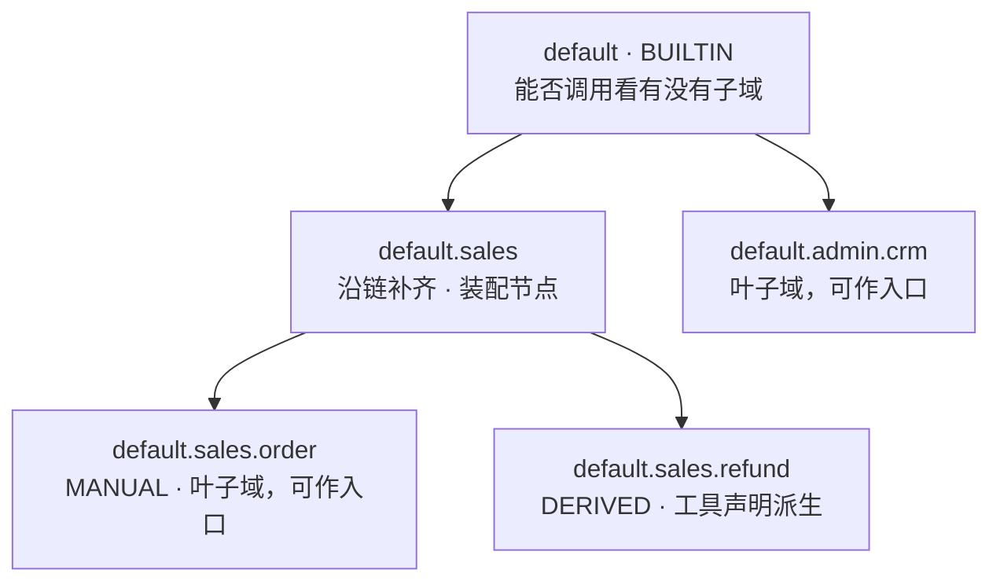

沿链补齐的两个实例：管控台只建了 `default.sales.order`，`default.sales` 由补齐产生（装配节点，不可调用）；`@Tool(domains={"default.sales.refund"})` 只是声明，`default.sales.refund` 与它的祖先都由这条声明派生而来。

## 3.2 登记：沿链补齐

所有登记都走 `link(domainId, source, targetCallable)`，三条不变量：

1. **不存在悬空节点**：给 `default.sales.order`，链上缺的 `default.sales` 一并建出，每个域都挂得到根上。
2. **已存在节点原样保留**：不改它的 `source`，也不改它的 `callable`（显式声明过的优先）。
3. **祖先一律不可调用**：只有链尾那个被显式声明的域才可能是入口，且它必须**出生时就是叶子**（已有子域则按叶子规则建成装配节点）。

`loadManual` 有个不起眼但必要的细节：**条目按路径长度升序处理**。反过来的话，`default.sales.order` 先落盘会把 `default.sales` 建成装配节点，之后轮到 `default.sales` 自己的条目时"已存在即保留"，它自己声明的可调用性就永远丢了。

## 3.3 可调用性：写入存意图，读取算生效

这是本块最值得讲的一处设计：

```java
isCallable(id) = 已登记 ∧ 显式标记 callable ∧ 无子域
```

**为什么不在写入路径上维护这个标记**：标记有三个来源（管控台显式声明、工具声明派生、落盘文件里的历史值），任何一处漏改都会破掉叶子规则。改成读取时派生，就只有一个判据实现，绕不过去，**写入侧存的是"意图"，读取侧算的是"生效"**。

配套的两个动作：

- `manualConfig()` 落盘的是**生效值**（不是原始意图）。一个有子域的域，无论曾被声明成什么，落盘都记装配节点，于是"文件、管控台展示、入口判据"三者永远一致。
- 启动期有一次**一次性迁移**（`DomainConfiguration.domainCallableMigration`）：把落盘里"已经有子域还写着 true"的历史条目改成 false。它只做数据归一，叶子规则本身不靠它保证。

## 3.4 四维继承：三维累加 + 一维就近覆盖 + 一个只看自身

这是最容易讲错的地方。"沿链"不等于"累加"，四维实际是三种不同语义：

| 维度 | 语义 | 实现点 | 方向 |
| --- | --- | --- | --- |
| **工具** | 可见 = 声明命中自身**或**任一祖先（OR 累加） | `ToolDescriptor.visibleIn`（F01/F08） | 自身 ∪ 祖先 |
| **知识** | 通道 = 自身 ∪ 全部祖先的索引，每条带 `depth` | `DomainChannelProvider.channels`（F05） | 自身 + 祖先，**带层级衰减** |
| **提示词** | 从根到自身**依次拼接**，跳过空段 | `DomainSystemPromptResolver.compose`（F09） | 根 → 叶 |
| **模型** | 由自身向根找**最近一份非空绑定**，找到即止 | `ModelProfileSettings.resolveAlong`（F10） | 叶 → 根，**覆盖不累加** |
| **工具回写开关** | **只认自身显式值，不沿链回落** | `DomainSettings.toolCallEcho` | 只看自身 |

三种语义各自的理由：

- **累加（工具/知识/提示词）**：公共能力挂到根域一次，全树可用。这是"父域装配、子域继承"的全部价值。
- **覆盖（模型）**：模型是"用哪个"而不是"多给点"。累加会让子域无法换掉父域的模型，只能被迫继承。所以是最近的非空绑定胜出，且**按族分别回落**：一个域绑了生图但没绑语音时，语音继续向祖先找，不被"本域已有绑定"截断。
- **只看自身（回写开关）**：如果允许沿链回落，子域就永远关不掉祖先打开的开关，那是个单向阀。默认关（未配置 = 不发工具执行信息），只有显式打开才发。

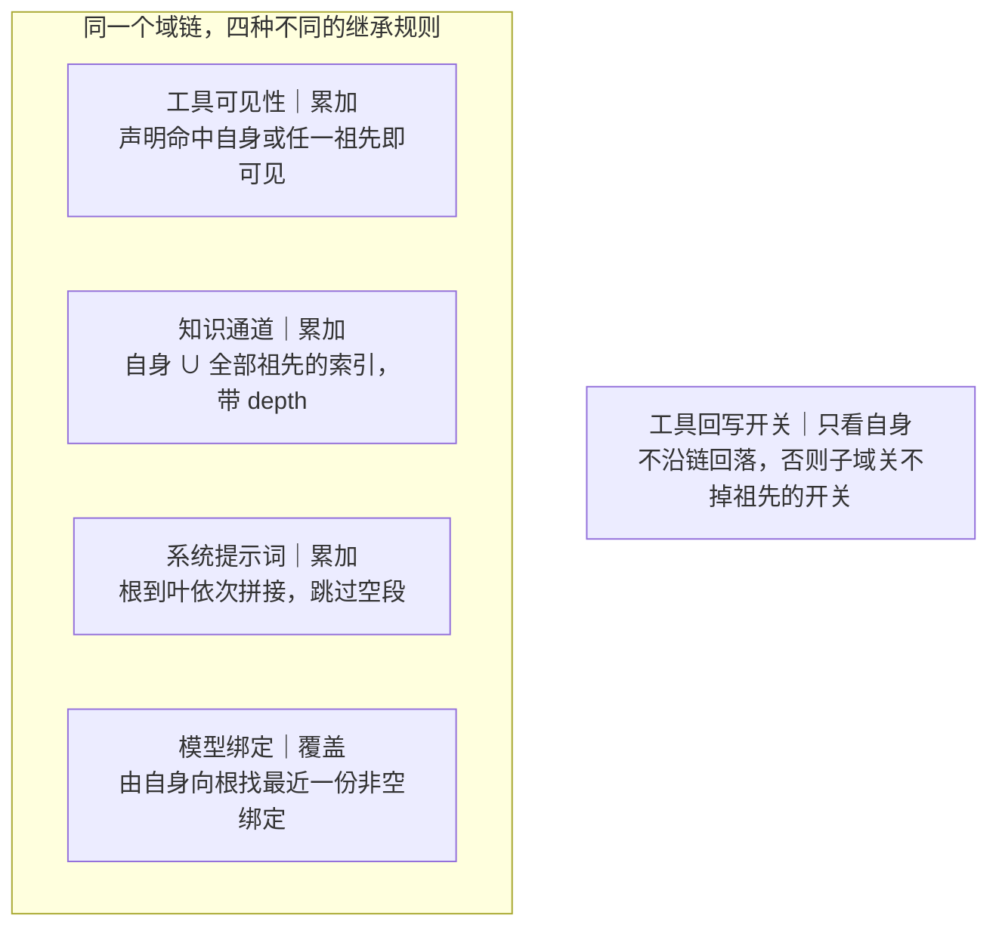

同一个 `Domains.chainOf(域)` 被四个消费点分别使用，语义却不同，这是本章最容易被讲错的一处（我方的功能划分文档初版就写成"四维共用沿链累加"）。

知识这一维还有个细节：`depth = 距查询域的距离`（0 = 自身），供融合阶段做层级衰减，**本域自有知识优先于从祖先继承来的知识**。没有这个衰减，根域的一堆公共文档会盖掉子域的专属文档。

## 3.5 落盘与损坏保护

| 文件 | 内容 | 谁写 |
| --- | --- | --- |
| `domains.json` | `domains[]`（id + callable）、兼容旧格式 `manualDomains[]`、`callableMigrated` 标记 | `DomainStore` |
| `prompts.json` | 域 → 提示词片段、域 → 工具回写开关 | `DomainSettingsStore` |

两个 store 都有一套共同的安全姿态：**把"文件不存在"和"文件损坏"分开**。

| 状态 | 含义 | 动作 |
| --- | --- | --- |
| `ABSENT` | 首次启动、还没配置过 | 空配置，允许迁移与写盘 |
| `OK` | 正常读到 | — |
| `CORRUPT` | 文件在，但读不出来 | **禁止迁移、禁止写盘** |

为什么必须分开：损坏时内存里的注册表只剩根域与工具派生域，人工建的域一个都没有。此时把这份空配置写回磁盘，等于**抹掉全部人工域，而且不可逆**（迁移标记一旦置 true 就再也不会重来）。正确做法是让服务带着"只有派生域"的状态启动，原始文件还在，运维修好后重启即可恢复。

`DomainSettingsStore` 同款：`loadFailed` 置位后拒绝任何 `save`，否则会把坏文件"修"成空文件，提示词与回写开关永久消失。

**读写时机**：`domains.json` 启动期读一次进内存（注册表）；`prompts.json` 每次解析都**现读盘**（`DomainToolCallEchoResolver.echoOn` 与 `DomainSystemPromptResolver` 都是），所以提示词与回写开关保存即生效，无需重启。

## 3.6 删除：级联与顺序

- 递归删除自身 + 全部子孙（按 `id + "."` 前缀匹配，不用通配符）。
- 只有根域拒绝删除（它是整棵树的起点）；其余域不论来源都可删。
- 派生域删掉后重启会随工具声明重建，这是它生命周期的固有结果，不另设限制。

删域不是"从注册表删一条"那么简单，它要按顺序清理一串外部状态（顺序由 `AdminDomainDeleteOrderTest` 372 行守着）：

| 要清的 | 不清的后果 |
| --- | --- |
| 会话记忆 | 记忆默认永久，同路径域重建 → 旧对话原样复活 |
| 会话归档 / 摘要 / 倒排索引 | 同上；摘要与归档会"把旧话勾回来" |
| 检查点 | **断点里存着"即将执行、尚未执行"的工具调用**，24h 内重建域就能 `resume(approved=true)` 把当初被拦下的破坏性动作补执行掉 |
| 提示词 / 回写开关 | 键变孤儿，同路径域重建时静默复活旧配置 |
| 工具声明里的域名 | 见 F01 的 `<revoked>` 哨兵：剥成空列表会放大授权到全域 |

其中检查点那条是最重的：**删域没撤销授权，只要断点还在，授权就还在**。所以这几处的清理一律 fail-closed：失败直接抛，中止删域流程，域保留。

## 3.7 入口校验

```java
domain 为空 → 归一化为 default（不当作入参错误）
未登记     → DOMAIN_NOT_FOUND 10004（附已登记的域清单）
非可调用   → DOMAIN_NOT_CALLABLE 10010（附可调用域清单 + 怎么改）
```

两个错误码都带"当前有哪些可选"，是为了让调用方不必去翻管控台就知道该填什么。

## 3.8 关键取舍

| 决策 | 被否方案 | 代价 |
| --- | --- | --- |
| 可调用性读取时派生 | 写入时维护标记 | 每次判定多算一次 `hasChildren`（O(n) 流式扫）；换来规则只有一处实现 |
| 路径即主键 | 内部 ID + 展示名 | 重命名域 = 删旧建新（历史数据不跟随）；换来零歧义与可读性 |
| 三来源同级 | 派生域低人一等（如不许删） | 删派生域后又"自己长回来"会让人困惑；换来规则简单 |
| 模型按族分别回落 | 按域整份绑定回落 | 配置项变多；换来"只绑了生图也能继承语音" |
| 提示词不设公共基线 | 单独的全局基线 + 域增量 | 根域就是基线（`prompts["default"]` 与别的域同构）；换来只有一套机制 |
| `prompts.json` 每次现读 | 缓存进内存 | 每次解析一次磁盘读；换来"保存即生效、无需重启" |

## 3.9 易错点

1. **`domains` 留空 = 挂根域 = 全树可见**。收紧必须写完整路径，这一条反直觉，也是 `<revoked>` 哨兵存在的理由。
2. **先建父域、后建子域，父域的可调用性会变**。父域建的时候是叶子（可调用），一旦有了子域，`isCallable` 立刻变成 false（因为读取时派生）。管控台会立刻显示"装配节点"，这是设计不是 bug，但很容易被当成"我的设置丢了"。
3. **`loadManual` 不排序就会丢可调用性**（见 3.2）。
4. **迁移标记与业务数据同文件**。`callableMigrated` 放在 `domains.json` 里，文件损坏时"迁移是否已完成"也无从得知，所以损坏时只能既不清空也不迁移，等服务带着降级状态跑。
5. **删域顺序错会留下授权**。检查点必须在域消失前清掉，反过来做就有一段"域没了但断点还在"的窗口。

## 3.10 观察点（登记，未改动）

| # | 现象 | 影响 | 建议 |
| --- | --- | --- | --- |
| 1 | `DomainStore` 类注释称"可调用性是显式声明，不靠有没有子域这种派生事实推断"，但 `DomainRegistry.manualConfig()` 落盘的正是 `显式 ∧ 无子域`，`isCallable` 也派生 | 行为自洽，只是两处注释口径相反，读代码容易被绕 | 统一成"存储生效值、读取再派生一次作兜底" |
| 2 | `delete()` 没有 `synchronized`，而 `link()` / `setCallable()` 有 | 并发"删父域 + 建同路径域"可能交错（ConcurrentHashMap 不脏，但语义可能不通顺） | 单实例 + 仅管控台调用的前提下风险低，登记备查 |
| 3 | `DomainToolCallEchoResolver.echoOn` 每次调用都 `store.load()` 读盘 | 每轮对话多一次磁盘 IO（与 `DomainSystemPromptResolver` 同款） | 若成热点可加"文件 mtime 变了才重读"的缓存 |
| 4 | `domains.json` 的 `callableMigrated` 与域列表混在同一份文件 | 文件损坏时无法单独得知迁移状态 | 见易错点 4，暂无解 |

## 3.11 讲这一块的抓手

- **建三级域看派生**：管控台建 `default.sales.order`，观察 `default` 与 `default.sales` 自动变成装配节点，只有 `default.sales.order` 可调用。
- **反过来验一遍**：给 `default.sales` 加个工具声明的域 `default.sales.refund`，再回头看 `default.sales` 的 callable 值，它已经是 false 了，因为"有子域"。
- **打一个不可调用域**：调 `chat` 时传 `domain=default.sales` → `DOMAIN_NOT_CALLABLE 10010`，错误信息里带可调用域清单。
- **读 `DomainRegistry.isCallable` 的注释**（约 15 行），那是全章的核心论证。

## 3.12 覆盖清单（5 类）

| 类 | 行 | 一句话 |
| --- | ---: | --- |
| `runtime.domain.DomainRegistry` | 405 | 域树唯一登记处：沿链补齐、可调用性派生、级联删除、落盘归一 |
| `server.settings.DomainStore` | 250 | `domains.json` 读写，区分 ABSENT / CORRUPT，损坏时拒绝写 |
| `server.settings.DomainSettingsStore` | 144 | `prompts.json` 读写，`loadFailed` 时拒绝覆盖 |
| `server.settings.DomainSettings` | 48 | 域 → 提示词片段、域 → 工具回写开关（后者不沿链回落） |
| `server.tool.DomainToolCallEchoResolver` | 22 | 回写开关的解析实现，每次现读盘 |

## 3.13 测试（7 类 / 1,222 行）

| 测试 | 行 | 覆盖 |
| --- | ---: | --- |
| `AdminDomainDeleteOrderTest` | 378 | 删域的级联顺序与 fail-closed |
| `DomainSemanticsTest` | 297 | 沿链补齐、叶子规则、可调用性派生、迁移 |
| `DomainStoreTest` | 142 | ABSENT / OK / CORRUPT 三态与迁移标记 |
| `ToolDomainRetentionTest` | 131 | 工具声明与域删除后的可见性 |
| `AdminDomainToolCallEchoTest` | 120 | 回写开关 |
| `DomainSettingsStoreTest` | 96 | 提示词落盘与损坏保护 |
| `AdminPromptsToolCallEchoKeepTest` | 60 | 改提示词时保留回写开关 |
| `DomainToolCallEchoResolverTest` | 58 | 每次现读盘 |

域的语义几乎全靠测试固化，`DomainSemanticsTest` 里那条"建它时它还是叶子，可调用 → 建了子域后不可调用"是全章最好的一页说明。

---

# F04 会话记忆与检查点

`domain.memory` + `infrastructure.redis.*` —— 6 类 / 2,074 行

## 4.0 一句话

一轮对话要落三处互不相干的东西：**记忆**（给模型看的历史消息）、**归档**（给人查的全流程档案）、**检查点**（编排图断点，用于审批中断后 resume）。三者键不同、结构不同、生命周期不同，混成一个存储是这套设计最早被否掉的方案。

## 4.1 为什么是三层而不是一层

| 层 | 存什么 | 谁读 | 生命周期 |
| --- | --- | --- | --- |
| **记忆** | 消息列表（User / Ai / ToolResult），给模型拼上下文 | 编排层每轮装配 | 默认**永久**（可配 TTL） |
| **归档** | 一轮一个元素：用户输入 + 全流程事件 + 最终回答 + 用量 + 摘要 | 历史检索、管控台 | **永久**，无封顶无淘汰 |
| **检查点** | langgraph4j 的状态快照（含待审批的工具调用） | resume | **24h** TTL |

三者的读写频率与失败代价完全不同：记忆每轮读写多次、失败了这一轮就废；归档只在开轮/闭轮各写一次、失败只是"这轮没进档案"；检查点只在中断/恢复时用、失败了审批就无法继续。混在一起会让"归档写失败"牵连到"对话失败"，现在归档写失败只降级告警。

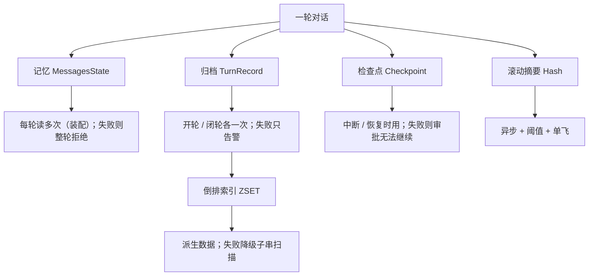

## 4.2 Redis key 全景

| 键 | 结构 | TTL | 粒度 |
| --- | --- | --- | --- |
| `domainplane:chat:memory:{域}\|{sessionId}` | List | 默认永久 | 一条消息 |
| `domainplane:chat:archive:{域}\|{sessionId}` | List | 永久 | 一整轮 |
| `domainplane:conv:sum:{域}\|{sessionId}` | Hash（`text` + `upTo`） | 永久 | 一会话一条（覆盖写） |
| `domainplane:conv:idx:{域}\|{session}:{词根}` | ZSET（member/score = turnId） | 无 | **一个词根一个键** |
| `domainplane:conv:terms:{域}\|{session}` | Set（本会话出现过的词根） | 无 | 一会话一个键 |
| `domainplane:graph:checkpoint:{域}\|{sessionId}` | String（base64 Java 序列化） | 24h | 一会话一个键（最多 200 个断点） |

三点说明：

- 所有键都以 `{域}|{sessionId}` 结尾，所以**按域级联清理就是按 `{域}|` 前缀 SCAN**（用 SCAN 不用 KEYS，KEYS 会阻塞整个 Redis 实例）。
- `deleteByDomain("")` 在拼接 pattern **之前**就必须拒绝：空域会让 pattern 退化成 `domainplane:chat:memory:|*`，一次误传就是全量清空。两处实现（记忆、检查点）都有这条守卫。
- 索引是唯一"一个词根一个键"的，这是它键数量爆炸的来源，见 4.10。

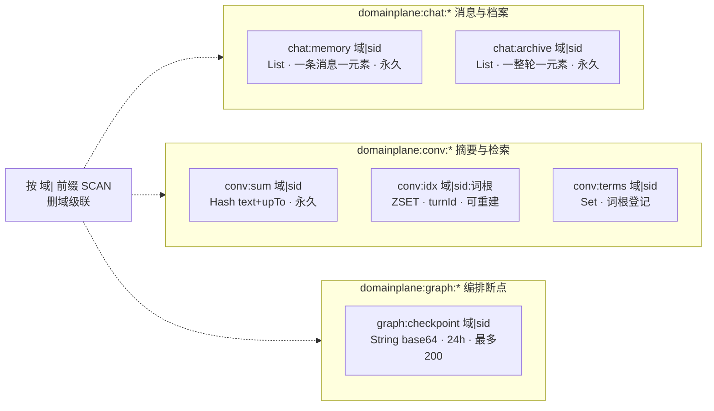

## 4.3 记忆：只追加 + 增量写 + 尾部回滚

`DualConstraintChatMemory` 是 langchain4j `ChatMemory` 的实现，`RedisChatMemoryStore` 是 `ChatMemoryStore` 的实现。

**记忆没有上限，也不淘汰。** 写入是纯追加，TTL 默认 `null`（永久），靠 Redis RDB+AOF 保底。

历史上的"双约束"字段还在：`domainplane.memory.max-messages: 100` / `max-tokens: 30000`，`capacityFor()` 也还在算，但它**不再决定能不能开新一轮**，主线代码里没有任何调用点：

> M2 起开轮不看这两个数。封顶只能约束"会话存了多少"，约束不了"这轮给模型看多少"；后者是 F09 `ContextAssembler` 的预算与降级链。`capacityFor` 退居内部自检与回归测试口径。

真正生效的约束在装配侧：`assembly-budget: 24000` token，其中近况窗口占 60%、摘要段 2000、卡片 5 张、窗口 8 轮。装不下逐级降级，永不拒绝开轮。拒绝开轮等于让用了半年的会话突然死掉，而"少给模型看几条老消息"显然更合理。

**Token 估算**（`CjkWidth.estimateTokens` + 每消息 4 token 结构开销 + 媒体分档）：

| 媒体 | 估算值 | 口径 |
| --- | ---: | --- |
| 图片 | 800 | ≈ 1 兆像素；OpenAI 系约 765 |
| 音频 | 6,000 | ≈ 1 分钟（100 tokens/秒） |
| 视频 | 12,000 | ≈ 45 秒（258 tokens/秒） |

全部**刻意估高**：装配预算按高估值裁，宁可少带一条老消息，也不要在上游模型那儿撑破上下文（记忆只增不淘汰，估低了一轮比一轮更挤）。

**性能改造**是这个类存在的主要理由。改造前每次写一条消息都要"读全量 → 反序列化 → 加一条 → 序列化 → 写全量"，而一次对话要走六遍这条路，复杂度 O(全量)。现在：

| 能力 | 存储方法 | Redis 命令 | 探测方式 |
| --- | --- | --- | --- |
| 单条追加 | `appendMessage` | `RPUSH` | 反射 `getMethod` |
| 取尾部 N 条 | `tailMessages` | `LRANGE -N -1` | 同上 |
| 取条数 | `sizeOf` | `LLEN` | 同上 |
| 截断到前 N | `truncate` | `LTRIM` | 同上 |

**为什么用反射探测而不是 instanceof**：可追加的实现落在基础设施层，领域层不能反向依赖它；声明一个共享接口也一样会把基础设施拖进领域层。探测只在构造时做一次，探不到就退回全量路径（单测的 Map 实现走的正是那条），行为不变、只是慢。

**回滚**：停止/失败时不再"读快照 → 整体回写"，而是记下 `size()` 再 `truncateTo(keep)`（一次 LTRIM）。语义也更窄：它只能剪尾部，绝不会把历史改写成另一份内容。

**`messages()` 必须回存储拿真值**，不返回缓存：调用方会遍历、`List.copyOf`、交给图编排组装请求体，给一份共享可变列表会被改坏。

## 4.4 归档：按轮存全流程

`ConversationArchive` 的 SPI 在 api（F01 已讲接口语义），实现是 `RedisConversationArchive`。核心是 **turnId = 开轮时 List 长度 + 1，下标恒为 turnId - 1**，这条不变式依赖"同一会话开轮串行"（编排层的同会话并发控制保证），`resume` 不开新轮所以不破坏它。

四个写入口的语义差别：

| 方法 | 时机 | 处理 |
| --- | --- | --- |
| `openTurn` | 轮开始 | 落一条 `finishedAt=null` 的开放轮，**用户输入即刻落盘**，回答慢慢跑 |
| `closeTurn` | 成功收尾 | 原位 LSET 补全 answer / flow / flags / digest / usage |
| `abortTurn` | 停止 / 异常 / 崩溃恢复 | 标记 `aborted=true` 后闭合，**现场保留** |
| `rejectTurn` | 审批被拒 | 同 abort，只多一个 `approvalOutcome=REJECTED` |

"保留现场不删"是刻意的：回滚掉的是"这一轮问过了但没答"，而现场本身就是档案，它问过什么、卡在哪，恰恰是排查最需要的。

**崩溃恢复**：下一次开轮前先 `recoverStaleOpenTurn`，发现上一条仍是未闭合开放轮（进程崩在闭轮之前）先标 aborted 再开新轮。**归档里不允许出现两条开放轮**。

单一元素超过 8192 字符存截断版 + `flags.truncated = true`。归档不是日志系统的替身，一次工具返回不该把整条轮记录撑爆。

## 4.5 摘要与倒排索引：有损 vs 可重建

这两个都是"给新轮次喂老信息的中间层"，但失败姿态完全相反：

| | 滚动摘要 | 倒排索引 |
| --- | --- | --- |
| 本质 | **有损压缩**，生成它的那次模型调用丢了就没了 | **派生数据**，重放归档即可完全复原 |
| TTL | 永久（删域才清） | 无 TTL，但可整个删掉重建 |
| 写失败 | 不能重建 → 按档案对待 | 只告警，本轮不能倒排列中 |
| 查不到 | 退化为 digest 拼接 | 退化为子串扫描最近 200 轮 |
| 存储 | Hash（`text` + `upTo` 一次 HSET） | 一词根一 ZSET + 一会话一 Set（登记词根，避免用 glob 删） |

索引的打分：`Σ 命中词根权重（3/2/1） + 2.0 × 0.5^(轮龄/50)`。前一项是"多相关"，后一项是"多新"；半衰期 50 轮，意味着 50 轮前的命中权重只剩新命中的一半。

词根上限 200 与 `CjkTokenizer.MAX_TERMS_PER_DOC` 是同一个数（见 F02 观察点 3）。

## 4.6 检查点：断点续跑

`RedisCheckpointSaver` 实现 langgraph4j 的 `BaseCheckpointSaver`，是整个审批中断/恢复能力的物理基础。

| 设计点 | 值 / 做法 | 理由 |
| --- | --- | --- |
| 保留期 | 24h TTL | 中断后未 resume 的会话不会主动清理，靠 TTL 兜底 |
| 单会话断点上限 | 200 个 | 每次 put 都是"读全部 → 加一条 → 写回整份"，无上限则写放大 O(n²)，一次长会话足以撑成大 key |
| 并发 | 64 个分片锁（`hashCode % 64`） | 同会话的读改写必须串行（并发 put 会互相覆盖，表现为"走完一步之后 resume 找不到断点"）；不同会话不该互相排队 |
| 写入 + 续期 | 带 TTL 的 `SET` 一条命令 | 先 SET 再 EXPIRE 的话，崩在两步之间会留下永不过期的键 |
| 损坏 | 抛 `CheckpointCorruptedException` | 见下 |

**读不出来绝不能当空列表**，这是本块最重要的一条：

`put` 走的是"读全部 → 加一条 → 写回整份"。如果读取时把损坏当成空，就会把原有整段会话历史覆盖成一条，**全程无异常**；紧接着 `get/list` 报"无检查点"，用户收到"会话不存在，请新建会话"，一个与真实原因毫无关系的错误。所以读失败一律抛子类，让调用方能区分"数据损坏（重试无效、清键自愈）"与"Redis 连不上（重试可能就好）"。

`release()` 是个例外：它的语义是"把这个 threadId 的断点整个删掉"，不依赖读到的内容是否可用，所以数据损坏也**必须**执行删除，否则一个坏键会永远卡在那里，既读不出也清不掉。

## 4.7 生命周期总表

| 存储 | 默认 TTL | 可配 | 谁清 |
| --- | --- | --- | --- |
| 记忆 | 永久 | `domainplane.memory.ttl` | 删域级联 / 手工 DEL |
| 归档 | 永久 | 无（有意不搭记忆的 TTL 车） | 删域级联 |
| 摘要 | 永久 | 无 | 删域级联 |
| 倒排索引 / 词根登记 | 无 | 无 | 删域级联 / 可重建 |
| 检查点 | 24h | `domainplane.memory.checkpoint-ttl` | 到期 / release / 删域级联 |

"归档不搭记忆的 ttl 车"写在 `MemoryConfiguration` 的注释里：`ttl` 是"消息列表"的保留期，而归档装的是全流程档案，被一个"记忆只保留 30 天"的配置顺带删掉说不通。要保留期就单独立项。

## 4.8 关键取舍

| 决策 | 被否方案 | 代价 |
| --- | --- | --- |
| 记忆用 List 而非一根 String | 整段会话序列化成一个值 | 键数量变多；换来写入 O(1) 与并发安全（RPUSH 原子） |
| 反射探测存储能力 | 共享接口 / instanceof | 有反射开销（每次 getMethod）；换来领域层不反向依赖基础设施 |
| 归档无封顶 | 按轮数淘汰 | Redis 永久增长；换来"用户以为还记得"这件事永远成立 |
| 摘要单独存、不塞进归档 | 存进轮记录 | 多一套 SPI；换来"轮记录不可变"这条前提不被破坏 |
| 检查点每次全量读写 | 增量追加 | 写放大 O(n²)（已被 200 封顶）；换来实现简单、与框架接口对齐 |
| 封顶不拒绝开轮（M2） | 满了让调用方换 sessionId | 会话无限增长、Redis 容量需要预估；换来不会"用着用着突然作废" |

## 4.9 易错点

1. **负数 TTL 会让 Redis 立即删除**。`ttl = -1` 落进 `EXPIRE` 被当作"立即删除"，记忆表现为"刚写即丢、永远失忆"且没有任何报错。两处实现都改成"负数按永久处理 + 告警"，让配置错误浮出来。
2. **`updateMessages` 不能用 pipeline 合并 DEL + RPUSH**。有并发写入时，pipeline 里后到的 RPUSH 仍可能被前面的 DEL 清掉；分成两条命令时最坏结果是"这次写入没生效"，不会出现"记忆被清空"。
3. **`LSET` 下标 `turnId - 1`：`turnId = 0` 会变成 `-1`**，Redis 把 `-1` 解释成"最后一个元素"，不报错、不越界，**静默改写最近一轮的记录**。`closeTurn` 与 `readAt` 都有 `turnId < 1` 的守卫。
4. **图片 token 不能靠 `toString()`**。多模态 `UserMessage` 的 `toString()` 会把整段 base64 拼进去，一张 1MB 照片在容量判定里会被算成上百万 token，该会话此后每轮都判"已满"且清不掉。`extractText` 只逐块收 `TextContent`，媒体由 `mediaTokensOf` 分档计。
5. **检查点读失败不能返回空**（见 4.6）。
6. **`deleteByDomain("")` 必须在拼 pattern 之前拒绝**，否则 pattern 退化成 `...:|*` 清空全部域。
7. **增量值与全量重算值必须一致**。`add()` 里 `mediaTokensOf` 一旦漏算，缓存值与重算值就分叉，而"增量 == 重算"正是这套缓存能被信任的前提，`DualConstraintChatMemoryAppendTest` 里有专门比对两者的用例。

## 4.10 观察点（登记，未改动）

| # | 现象 | 影响 | 建议 |
| --- | --- | --- | --- |
| 1 | 四族键前缀并存：`chat:memory`、`chat:archive`、`conv:sum/idx/terms`、`graph:checkpoint` | 归档与记忆同族、摘要与索引另一族，命名不统一 | 各自按域 SCAN 清理都正确，仅影响可读性 |
| 2 | 倒排索引**一个词根一个键**，单轮上限 200 词根 | 一个 100 轮会话最多可产生上万键；`indexedTerms` 指标只记词根数，不记键数 | 容量预估时别只算记忆的 60–120 KB/会话 |
| 3 | 容量规划只覆盖记忆（架构口径：单会话 60–120 KB）。归档（全流程）、摘要、索引都不在估算里 | 实际 Redis 占用可能显著高于预估 | 估容量时应把归档与索引按"轮数 × 每轮体积"另算 |
| 4 | 检查点每次 `put` 全量读写（LinkedList → base64 字符串） | 200 断点 × 每断点含消息状态，单键仍可能达 MB 级 | 已用 200 封顶；若真成热点再改分片 |

## 4.11 讲这一块的抓手

- **看键**：起服务端问一句话，然后 `redis-cli --scan --pattern 'domainplane:*'`，一次对话会产生 4 类键，一眼看清"记忆 / 归档 / 检查点"是三套东西。
- **造一次损坏**：往检查点键里写一段非 base64 的垃圾，再 `resume` → 报 `CHECKPOINT_ERROR`，日志里能看到"按损坏处理并中止本轮读写以免覆盖历史数据"。
- **验一次回滚**：中途 `stop`，然后看记忆条数回到本轮之前（`LLEN` 减 2），归档里那一轮变成 `aborted` 但**还在**。
- **跑这 6 个测试类**：`RedisConversationArchiveTest`（419 行，开闭轮语义最全）、`RedisHistorySearchTest`（604 行，打分与兜底）、`DualConstraintChatMemoryAppendTest`（301 行，增量 vs 重算一致性）。

## 4.12 覆盖清单（6 类）

| 类 | 行 | 一句话 |
| --- | ---: | --- |
| `domain.memory.DualConstraintChatMemory` | 503 | 只追加记忆：增量累加、尾部回滚、容量自检；反射探测存储能力 |
| `infrastructure.redis.conversation.RedisHistorySearch` | 429 | 倒排检索，一词根一 ZSET，权重 + 新近衰减打分 |
| `infrastructure.redis.conversation.RedisConversationArchive` | 398 | 按轮归档，开轮/闭轮/中止/崩溃恢复，8192 字符截断 |
| `infrastructure.redis.memory.RedisChatMemoryStore` | 340 | List 存消息，RPUSH / LRANGE / LLEN / LTRIM，默认永久 |
| `infrastructure.redis.checkpoint.RedisCheckpointSaver` | 279 | 图断点，24h TTL / 最多 200 / 分片锁 / 损坏 fail-closed |
| `infrastructure.redis.conversation.RedisConversationSummary` | 125 | 滚动摘要，一会话一 Hash（`text` + `upTo`），永久 |

`conversation` 三类合计 952 行，与本块汇总（2,074）一致。

## 4.13 测试（9 类 / 2,556 行）

| 测试 | 行 | 覆盖 |
| --- | ---: | --- |
| `RedisHistorySearchTest` | 614 | 分词、打分、兜底、按域删 |
| `RedisConversationArchiveTest` | 426 | 开/闭/中止/拒绝/崩溃恢复/截断 |
| `DualConstraintChatMemoryAppendTest` | 301 | 增量写与全量重算的一致性 |
| `DomainCleanupFailClosedTest` | 238 | 删域清理的 fail-closed |
| `DualConstraintChatMemoryWindowTest` | 222 | 尾部读、回滚、容量边界 |
| `RedisConversationSummaryTest` | 220 | 摘要落盘与覆盖写 |
| `RedisChatMemoryStoreTest` | 202 | List 读写、尾部、截断、TTL |
| `DualConstraintChatMemoryTest` | 189 | 容量自检判定（只增不淘汰） |
| `RedisCheckpointSaverTest` | 144 | put/get/release、分片锁、损坏 |

F04 是全项目 Redis 相关逻辑最集中的一块，测试量也最大：2,556 行测试对 2,074 行主代码（≈123%，全项目最高的一块）。

---

# F05 知识检索与融合

`domain.rag.*` + `domain.capability.knowledge` + `infrastructure.elasticsearch` + `server.knowledge` —— 24 文件 / 3,167 行

## 5.0 一句话

知识库 = **一域一索引** + **双轨召回**（向量 kNN / BM25）+ **自适应融合**（分数制 / RRF）+ **两道收口**（条数 / 字符预算）。文档怎么进去是 F06 的事，本章只管"怎么查出来"。

## 5.1 一域一索引：越权边界靠"查哪些索引"，不靠过滤条件

| 项 | 做法 |
| --- | --- |
| 索引粒度 | 一个域 = 一个 ES 索引 |
| 索引名 | `domainplane_kb_{可读前缀≤80}_{8位SHA-256}`，由域路径确定性派生（F01 的 `KbIndexes`） |
| 创建时机 | **首次上传时按需创建**：域是运行期建的，不存在"启动期全局索引" |
| 域边界 | 检索域 D 时，只查 **D 自身 + 全部祖先**的索引 |

为什么不是"一个大索引 + `domain` 字段过滤"：过滤条件漏写一次就是**数据越权**，而"查哪些索引"是物理隔离，漏不了。`metadata.domain` 仍然写入，但它只用于管控台展示与排查，**不参与过滤**。

## 5.2 一条检索的七步

| # | 步骤 | 关键点 |
| --- | --- | --- |
| 1 | 绑域 | `RetrievalScope.bind(domain)`（ThreadLocal，与工具体系同绑定点，F07 讲） |
| 2 | 解析通道 | 域链上每个索引 × 2 路模态 = 通道；每条带 `depth` |
| 3 | 并发召回 | 整轮**共享一个 deadline**，不是每通道各等一次 |
| 4 | 融合 | 按"有命中的来源数"自适应选算法 |
| 5 | 收口 | `injectTopN`（默认 8）+ `maxContextChars`（默认 3000） |
| 6 | 格式化 | 片段号 / 相关度 / 来源 / 小节标题 |
| 7 | 回写分数 | 分项分、融合分、名次、命中通道写回 metadata，供排障 |

第 7 步值得单说：四个分数（`vector_score` / `keyword_score` / 归一化后的两个 / `fused_score`）全部落进 metadata。排查"为什么这条排在前面"时不用重跑，直接看索引里的值。

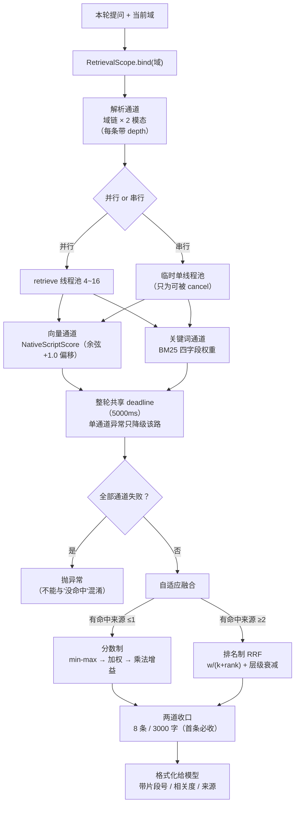

## 5.3 通道与层级衰减

```java
chain = chainOf(查询域)          // [root, ..., 自身]
depth = chain.size() - 1 - i     // 0 = 自身，越靠根越大
```

`depth` 只有融合阶段用，作用是**层级衰减**：本域自有知识优先于从祖先继承来的知识。没有它，根域的一堆公共文档会盖掉子域的专属文档（这也是为什么 `ancestorDecay` 默认 0.7 而不是 1.0）。

一个兜底：**未绑定域时走通配**（`domainplane_kb_*`），对全部索引做一次检索。管控台预览、诊断这类非对话路径没有域上下文，保持"全库检索"的旧行为，否则它们会凭空查不到东西。

不预判索引是否存在：祖先域没上传过文档时它压根没索引，通道安静返回空（检索器开了 `ignoreUnavailable / allowNoIndices`），比先探测一遍省 N 次往返。

## 5.4 两路召回

| 通道 | 实现 | 关键细节 |
| --- | --- | --- |
| 向量 | `NativeScriptScoreContentRetriever` | `cosineSimilarity` 的 Painless script score。**`minScoreRaw = minScore + 1.0`**：余弦值域是 −1..1，加上 1.0 归一到 0..2，阈值必须同幅偏移，否则 0.35 的阈值实际卡在 −0.65 |
| 关键词 | `KeywordMatchContentRetriever` | BM25，四字段权重一次性表达：`text^1.0` / `text.standard^0.8` / `metadata.section_path^1.5` / `metadata.section_title^2.0` |

两处设计要点：

- **多字段权重一次性表达，不把字段拆成多张排名表**。因为融合阶段是按"模态"均摊权重的，字段数一变（拆表）就会把权重稀释掉，向量/关键词的比例随字段数漂移。
- `text.standard` 是标准分词器（非 IK）。IK 会把英文单词、版本号、订单号切碎，标准分词器不变长归一，正好救这一类词根。

## 5.5 融合：两种算法 + 一个选择器

| | 分数制 `DefaultFusionStrategy` | 排名制 `RrfFusionStrategy` |
| --- | --- | --- |
| 用于 | **单来源**（有命中的来源 ≤ 1） | **多来源**（≥ 2） |
| 算法 | 按模态拼回两路 → 去重 → 各自 min-max → 加权求和 → ×增益 | `Σ w_L/(k+rank_L)`，k=10 |
| 权重处理 | 配置直取（0.6/0.4） | 按模态均摊，**只统计有命中的表** |
| 层级衰减 | 不用（同源，无意义） | `权重 × ancestorDecay^depth`，同模态内重新归一化 |
| 名次上限 | — | `MAX_RANK = 200`（防长尾把 k 的平滑效果冲淡） |

**为什么多索引必须换 RRF**：BM25 的 idf 用本索引的文档频率计算，同一个词在不同索引里量纲不同。把多索引的 BM25 分池化后做 min-max，只会把"小索引里稀有词被抬高的分"当成 max、把其余结果压扁。RRF 只看名次，天然免疫。

**选择器的判据是"有命中的来源数"，不是"通道里出现过几个来源"**。通道是按域链无条件解析出来的；若按通道数判，任何非根域都会被判成多来源、一律走 RRF，分数制只在根域生效，等于白留一轨。

两个共用的细节：

- **去重身份 = 文件名 + 切片序号 + 正文**的 SHA-256，不是纯正文。只取正文会把"不同切片但正文相同"的内容折叠掉：PDF 每页的页眉页脚、表格里重复的行、合同的标准条款都是这种形态，用户看到的是"明明有 10 处依据，只回了 1 处"。
- **标题/文件名增益必须是乘法**（`分 × (1+boost)`）。RRF 的值域是 `w/(k+rank)`，单表名次 1 约 0.01 量级；加法 boost 在本轨（0~1 归一化）看着合理，在 RRF 轨会变成十几倍、直接统治排序。

## 5.6 收口：两道而不是一道

```java
int limit = min(contents.size(), RetrievalLimits.injectTopN());   // 默认 8
int budget = RetrievalLimits.maxContextChars();                   // 默认 3000
```

条数不是真正的瓶颈：同样 8 条，切片长短能差几倍，只有按**字符**收口才控得住上下文占用。而**首条无论如何都收**：否则预算配得偏小时一条都给不出去，检索等于关闭。

`retrieval.*` 的两个值通过 `RetrievalLimits` 这个静态取值点注入（domain 不能反向依赖 server），与 `TxtChunking` 同一套路。

## 5.7 索引生命周期

| 操作 | 语义 |
| --- | --- |
| 创建 | 首次上传时按需建，`dims` 来自模型实测或声明；已有索引维度不一致 → 报错（`dense_vector` 的 dims 是 mapping 不可变参数） |
| 删除 | **fail-closed**：`exists` 查询失败必须抛，不能当"不存在" |
| 列表展示 | **fail-open**：查询失败返回空列表，页面能开就行 |
| 换向量模型 | `VectorReindexer`：先**全部**索引的 text+metadata 捞进内存，再删、按新维度重建、用新模型重灌 |

三条都值得讲清：

**`exists` 为什么必须 fail-closed**：调用方拿它做破坏性决策，`deleteIndex` 先问"存在吗"，答"不"就跳过删除。把"查不到"当"不存在"，ES 一抖动，删域就会静默跳过索引删除并继续往下走；而索引名是域路径哈希，同路径域重建后**这份本该删掉的知识会原样复活**，且无任何报错。

**换模型为什么不能"删一个建一个"**：中途失败会留下"前面几个索引已换新向量、后面几个还是老向量"的混合状态。向量空间不同、维度相同的两个模型混在一个索引里，检索结果会**静默失真**：不报错，只是答案慢慢变差。

**维度从哪来**：不写死。装配期用 `currentVectorDims` 读已有 mapping，或由模型的探测/声明给出。

## 5.8 上传侧：先写后删

上传本身是 F06 的活，但"文档进哪个索引、同名怎么办"是本章的边界：

| 环节 | 做法 | 理由 |
| --- | --- | --- |
| 归属域校验 | 必须是已登记的域 | 否则会给树里不存在的域凭空建索引，那个索引**既检索不到、又要手工清**（删域接口只认注册表） |
| 串行 | `ingestPermit` 信号量 + 等待上限（默认 60s） | 导入是进程内串行的（单实例契约的一部分） |
| 队列 | 满即拒绝（`KNOWLEDGE_UPLOAD_REJECTED`） | 不无界堆积 |
| 同名冲突 | `replace=false` → `KNOWLEDGE_DOCUMENT_DUPLICATE`；`true` → **先写新、确认落库后再删旧** | 反过来"先删后写"，新文档任一环节失败就变成"只删不写"，旧文档永久丢失 |
| 删旧失败 | **单独吞掉，只记日志** | 若让它冒泡到外层 catch，会回滚新 docId，而此时旧文档可能已删了一半 → 新旧全没 |
| 失败回滚 | `rollback(docId)` 按 doc_id 清切片与导出文件 | 不留"半个文档"占住文件名 |

## 5.9 关键取舍

| 决策 | 被否方案 | 代价 |
| --- | --- | --- |
| 一域一索引 | 单索引 + domain 过滤 | 索引数量随域数增长；换来越权边界物理隔离 |
| 双轨召回 | 只做向量 | 体积与写入成本翻倍；换来精确词（订单号、错误码）能命中 |
| 自适应两套融合 | 只用 RRF | 两套算法两套测试；换来单来源时分数制更精确 |
| 融合分全部回写 metadata | 只回写融合分 | 索引体积略增；换来可离线排障 |
| 索引删除 fail-closed、列表 fail-open | 统一一种姿态 | 两处要各写一遍判断；换来"该严的严、该宽的宽" |
| 上传先写后删 | 先删后写（省空间） | 覆盖期间新旧并存；换来不丢文档 |

## 5.10 易错点

1. **`exists` 不能 fail-open**（见 5.7）。
2. **全部通道失败必须抛异常**，不能返回空列表，否则"检索链路坏了"和"真没命中"长得一模一样，调用方会换个问法反复试，而不是去查配置。
3. **串行模式也必须把通道放进线程**。直接在调用线程上跑就无法 `cancel(true)`，超时完全失效，这正是"串行模式没有超时保护"的根因。现在用一个临时单线程池：仍是串行，但每条都能被打断。
4. **`minScore` 必须 +1.0**（余弦偏移）。
5. **自适应判据是"有命中的来源数"**，不是通道数。
6. **去重键含文件名**，否则标准条款类内容会被跨文档误杀。

## 5.11 观察点（登记，未改动）

| # | 现象 | 影响 | 建议 |
| --- | --- | --- | --- |
| 1 | 串行模式每次检索都 `Executors.newSingleThreadExecutor` 新建一个池 | 每轮一次线程创建/销毁；量不大但没必要 | 可复用 `domainplane-retrieve-serial` 单线程池 |
| 2 | `RetrievalLimits` / `TxtChunking` 都是静态取值点，由配置类**启动时注入一次** | 改 `retrieval.*` / `chunking.*` 需重启；与 F13 的"配置热切换"不是一套机制 | 文档里要写明这两个是"重启生效"，别让人误以为保存即生效 |
| 3 | `EsIndexManager` 与 `EsMetadata` 都参与 mapping 拼装（后者是字段映射的辅助） | 两处都要改才能加字段 | 加字段时以 `buildIkMapping` 为准，`EsMetadata` 是诊断用 |
| 4 | 知识库索引按域（不是按会话），键规模可控；但与 F04 的会话索引不同族前缀（`domainplane_kb_`） | 按域清理归档/记忆时不会连带知识库，反之亦然 | 这是对的，登记以免被当成遗漏 |

## 5.12 讲这一块的抓手

- **看一次融合**：问一个知识库里有的问题，从日志里拿 `[融合] 向量命中X条,关键词命中Y条(新增Z条),去重后N条,融合重排Top15` 这一行，双轨与去重就都讲清了。
- **造一次跨索引**：在 `default` 和 `default.sales` 各传一份含同一段话的文档，然后在 `default.sales` 下检索，观察 RRF 被选中（多来源）以及 `depth` 衰减让本域文档排前面。
- **验一次 fail-closed**：把 ES 连接改错，然后删一个带知识库的域，删域应该失败并保留域，而不是"删除成功"。
- **跑这三个测试**：`CompositeRetrieverTest`（103）、`CompositeRetrieverTimeoutTest`（94）、`Retrieval` 相关的 `RrfFusionStrategyTest`（197）。

## 5.13 覆盖清单（24 文件）

| 包 / 类 | 行 | 一句话 |
| --- | ---: | --- |
| `rag.retriever.CompositeRetriever` | 214 | 通道编排：串行/并行 + 整轮 deadline + 失败隔离 |
| `rag.fusion.DefaultFusionStrategy` | 207 | 分数制融合：min-max + 加权 + 乘法增益 |
| `rag.fusion.FusionSupport` | 195 | 去重哈希、取分、标题/文件名命中、同分排序 |
| `rag.fusion.RrfFusionStrategy` | 173 | 排名制融合：权重均摊 + 层级衰减 + 名次上限 |
| `rag.fusion.AdaptiveFusionStrategy` | 40 | 按"有命中的来源数"选算法 |
| `rag.fusion.FusionConfig` | 39 | 七项参数（0.6/0.4/0.15/0.10/15/10/0.7） |
| `rag.model.RankedList` | 34 | 一张排名表（来源 + 模态 + depth + 内容） |
| `rag.model.RetrievalScoreKeys` | 32 | 四个分数的 metadata 键 |
| `rag.fusion.FusionStrategy` | 29 | 融合策略接口 |
| `rag.model.Modality` | 12 | VECTOR / KEYWORD |
| `capability.knowledge.KnowledgeSearchService` | 93 | 检索 → 收口 → 拼成给模型看的文本 |
| `capability.knowledge.RetrievalLimits` | 36 | 条数与字符预算的静态取值点 |
| `elasticsearch.EsIndexManager` | 415 | 索引存在性/创建/删除/诊断，IK + dense_vector mapping |
| `elasticsearch.VectorReindexer` | 230 | 换向量模型保原文重灌，先全捞再删 |
| `elasticsearch.retriever.KeywordMatchContentRetriever` | 115 | BM25 四字段权重 |
| `elasticsearch.retriever.NativeScriptScoreContentRetriever` | 106 | 余弦 script score（含 +1.0 偏移） |
| `elasticsearch.retriever.EsMetadata` | 63 | mapping 字段诊断辅助 |
| `elasticsearch.EsAccessException` | 21 | ES 访问失败的运行时异常 |
| `server.knowledge.KnowledgeBaseService` | 767 | 上传/列表/删除/状态 + 一域一索引生命周期 |
| `server.knowledge.ChunkExporter` | 200 | 切片预览 txt 导出（人工核对切点） |
| `server.knowledge.DomainChannelProvider` | 94 | 按域链解析召回通道（含 depth） |
| `server.knowledge.KnowledgeSearchTool` | 40 | 暴露给模型的检索工具壳 |
| 两个 `package-info` | 12 | — |

> 本块合计 24 文件 / 3,167 行。

## 5.14 测试（13 类 / 1,755 行）

| 测试 | 行 | 覆盖 |
| --- | ---: | --- |
| `VectorReindexerTest` | 315 | 保原文重灌、先捞后删 |
| `EsIndexManagerFailClosedTest` | 214 | fail-closed / fail-open 的分界 |
| `RrfFusionStrategyTest` | 207 | 权重均摊、衰减、名次上限 |
| `EsMetadataMappingTest` | 138 | mapping 结构与字段 |
| `DefaultFusionStrategyTest` | 137 | min-max、增益、同分稳定 |
| `FusionSupportKeywordMatchTest` | 118 | 标题/文件名命中判定 |
| `CompositeRetrieverTest` | 108 | 多通道编排与去重 |
| `RetrieverErrorClassificationTest` | 105 | 检索异常的归类 |
| `CompositeRetrieverTimeoutTest` | 100 | 整轮 deadline、全失败抛异常 |
| `KnowledgeSearchToolTest` | 93 | 工具壳与收口 |
| `AdaptiveFusionStrategyTest` | 76 | 单/多来源选择 |
| `KnowledgeSearchServiceTest` | 74 | 收口与格式化 |
| `KnowledgeBaseServiceTest` | 70 | 上传/重名/覆盖 |

---

# F06 文档摄取与切片

`infrastructure.ingestion` —— 31 文件 / 3,737 行

## 6.0 一句话

把 8 种格式的文件，翻译成"带标题路径与序号的切片"，再向量化写进某个域的索引。核心是**两层架构**：格式适配层只管 `byte[] → List<Block>`，通用打包层只管 `List<Block> → 切片`。

## 6.1 两层架构

```
上传字节
  │  ① 入口分叉：文本类先统一字符集 / 二进制类绝不解码
  ▼
格式适配层（Reader / Strategy）  ──►  List<Block>       ← 唯二有格式差异的地方
  ▼
通用打包层（BlockSplitter + Chunker）──►  List<TextSegment>  ← md/docx/pdf 共用同一份
  ▼
去重 → 分批向量化 → 写索引
```

`Block` 是中间的通用语：7 种 `BlockKind`（TITLE / PARAGRAPH / LIST_ITEM / QUOTE / CODE / TABLE / IMAGE）+ 标题层级 + 文本 + 页码。有了它，txt 那种"猜结构"的管线与 md/docx/pdf"读结构"的管线，后段可以完全共用。

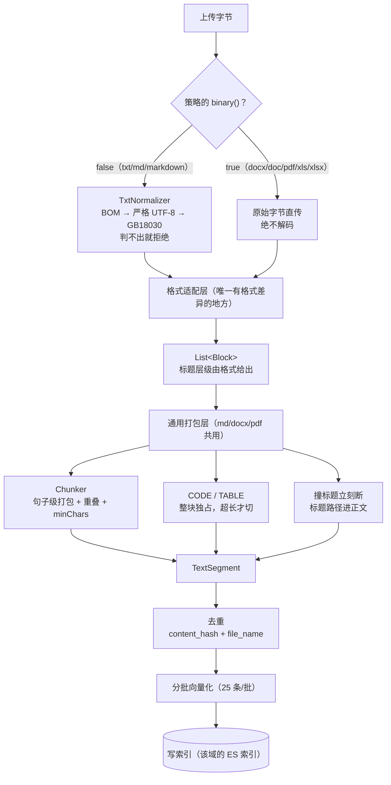

## 6.2 入口分叉：文本类 vs 二进制类

| 类型 | 处理 | 为什么 |
| --- | --- | --- |
| 文本类（txt / md / markdown） | 入口一次性统一字符集，策略只取 `text()` | 编码问题必须在拿导入锁**之前**判掉 |
| 二进制类（docx / doc / pdf / xls / xlsx） | **绝不解码**，原始字节交给 `content()` | 二进制走统一字符集只有两种结果：恰好能通过严格 UTF-8 → **静默灌进一堆乱码知识**（最糟）；否则报一句用户永远解决不了的"编码错误" |

分叉判据是策略的 `binary()`。8 种扩展名：`txt / md / markdown / docx / doc / pdf / xls / xlsx`。

## 6.3 编码统一（文本类第 1 步）

探测顺序**固定**：BOM →（无 BOM 时）严格 UTF-8 → GB18030。两条都判不出就**拒绝该文件**：猜错编码会静默灌进乱码知识，比直接报错糟得多。

全链路只有 UTF-8 一种字符集，后面的清洗、切片、写索引、导出都不含任何编码分支。解码结果带上实际识别到的编码名，原样回传给上传返回值（`TxtNormalizer.Decoded`），用户在管控台能看到"这份文件被当成 GB18030 打开了"。

## 6.4 Block 与三条定死的切片规则

无法切（`atomic()`）与可切（`splittable()`）是两种处置：

| 类别 | 成员 | 行为 |
| --- | --- | --- |
| 可切 | PARAGRAPH / LIST_ITEM / QUOTE / IMAGE | 按语意攒行，交给 `Chunker` 按句子打包，与 txt 完全同一套规则 |
| 不可切 | **CODE / TABLE** | 整块独占一片；超长才按行/按数据行切（表格每片重复表头） |

三条规则写在 `BlockSplitter` 的注释里，标着"别改回去"：

1. **撞标题立刻断**。短的开篇段落不会被并进下一节，它是上一节的归属，合并会让模型看不出层级。
2. **代码块与表格整块独占**。一条 shell 命令被切成两半、一张表被拦腰截断，这条知识就废了；宁可让单片超过 `maxChars`。
3. **标题层级直接用格式给的**。`level` 由 `Block` 带进来，不猜、不归一化，md 的 `###` 与 docx 的 `Heading 3` 都是 level 3。

## 6.5 格式适配差异

| 格式 | 结构来源 | 三个关键取舍 |
| --- | --- | --- |
| txt | **猜**（正则认标题，`OutlineReader`） | 与 md/docx 相反：没有格式可读 |
| md | **读**（`#` 级数、围栏代码块、表格、引用） | 代码块与表格整块保留 |
| docx | **读**（POI 直读段落样式 / 大纲级别） | 不用 Tika：Tika 的 XHTML 把标题降级成普通段落，**恰好丢掉我们最需要的层级**；页眉页脚根本不读（它们不是 body element，压根进不来）；表格与段落按文档顺序穿插，不"先全段落再全表格" |
| doc | OLE2/HWPF 直读 | 旧格式，独立 Reader |
| pdf | **推**（文字 + 坐标 + 字号） | 多做三件事：抽行、删页眉页脚（边缘 2 行 + 两页以上同位置重复 + 数字归一化）、跨页拼接。**不做**字号推断标题（没有可信标题时分节退回"第 N 页"）、表格还原、双栏顺序、扫描件（抽不出文字明确报错，不静默成功） |
| xls / xlsx | 每个工作表渲染成 markdown 表格 | 公式必须传 `FormulaEvaluator`（否则拿到的是公式文本 `C2*2`）；不能按 `firstRowNum..lastRowNum` 遍历（稀疏表区间巨大）；合并单元格按区域回填左上角值；取值用 `DataFormatter`（日期出 `2026-05-29` 而不是序列号 `46170`） |

pdf 与 excel 的分节方式同形：`文件名 > 第N页` / `文件名 > 工作表名`，都是"格式天然存在的边界"，也是最适合引用回原文的锚点。

## 6.6 通用打包：切片正文 = 标题路径 + 正文

```java
切片正文 = section_path + "\n\n" + 正文
```

把标题路径**写进正文**，是为了让模型看出这段话在第几章第几节，同时让向量通道与 BM25 通道吃同一份文本，两条召回不会各看各的。

打包参数（`TxtChunking` 静态注入，默认值来自 `TxtSplitter`）：

| 参数 | 默认 | 说明 |
| --- | ---: | --- |
| `maxChars` | 400 | 单片字符上限 |
| `overlapSentences` | 1 | 相邻片重叠的句子数 |
| `minChars` | 60 | 低于它的尾片并入前一片 |

其余阈值（页码正则、标题行长、层级数、跨页重复阈值）**全是代码常量**：注释明说"改就重新构建，避免配置面越摊越大"。理由很直接：可配项越多，运维的认知负担越重。

## 6.7 去重：键里必须带文件名

```java
content_hash = SHA-256(正文)
dedup_key    = content_hash + file_name
```

只用正文哈希会**跨文档误伤**：一次上传可能包含多个文件，而两个文件里出现同一句话（合同标准条款、多份文件共用的表头、政策里的通用表述）是常态。纯正文哈希会让后一个文件的这条切片被当成"已存在"而丢弃，报告仍按文档数返回、日志仍写"写入完成"，**用户完全看不出来有内容没入库**。

加了文件名之后：同一文档内的重复段落仍会去重（真正想做的），而"改了文件名重传同一份"不再是同一身份，可接受，因为文档管理侧本来就有同名校验与 replace。

**ES 去重是两步**：先按 `content_hash` 做 terms 查询召回候选（单次上限 10000），再**在内存里按 `(hash + file_name)` 配对**。为什么不在 ES 里直接查 `dedup_key`：mapping 里没有这个字段，而新增字段要重建存量索引，代价太大。两步法让存量索引无需迁移。

## 6.8 批次向量化

- 每批 **25 条**（百炼 `text-embedding-v2` 的单次请求上限，硬编码在 `AbstractDocumentProcessStrategy`）；
- 切片总数有上限（`domainplane.rag.max-chunks-per-document`，默认 2000），在**向量化之前**挡掉，几百页文档一次能产出几千片，一次上传就能把导入队列堵住。

## 6.9 关键取舍

| 决策 | 被否方案 | 代价 |
| --- | --- | --- |
| Block 中间表示 | 每种格式各自直接产出 TextSegment | 多一层转换；换来 md/docx/pdf 共用打包与切片逻辑 |
| 二进制不解码 | 统一按 UTF-8 解码 | docx/pdf 的编码问题要各 Reader 自己处理；换来不会灌乱码 |
| docx 直读 POI、pdf 直读 PDFBox | 统一用 Tika | 每种格式多写一个 Reader；换来拿到字号/坐标/标题层级 |
| 切片参数只开放 3 项 | 全部可配 | 调优空间小；换来配置面不膨胀 |
| 图片只留占位、不做 OCR | 接 OCR | 图片里的知识查不到；换来零额外依赖与零错误率 |
| 去重键带文件名 | 纯正文哈希 | 同一内容换个文件名会重复入库；换来不误杀 |

## 6.10 易错点

1. **二进制绝不按文本解码**（见 6.2）。判断"恰好能通过严格 UTF-8"是最坏的情况：不报错，但入库的是乱码。
2. **`maxChars` 不是硬上限**。撞标题、代码块、表格都会让单片超限，这是刻意的，超限比切断知识好。
3. **切片正文必须含 `section_path`**。漏了它，向量与 BM25 都失去"这段话在哪一节"的线索，检索质量下降但不报错。
4. **excel 公式不传 `FormulaEvaluator` 会存公式文本**。个别函数 POI 算不出来时退回公式文本，宁可露原文也不能让一格毁掉整张表。
5. **pdf 页眉页脚不去就是每页灌一遍噪音**，而且它们混在正文里（docx 的页眉页脚是独立部件，读不到）。
6. **同一策略组处理失败必须上抛**。吞掉会让本次导入返回非零计数，调用方据此判成功并跳过回滚，留下"半个文档"且占住文件名。

## 6.11 观察点（登记，未改动）

| # | 现象 | 影响 | 建议 |
| --- | --- | --- | --- |
| 1 | `EMBEDDING_BATCH_SIZE = 25` 是常量（按百炼 v2 的上限） | 换其他向量服务商时可能过小（慢）或过大（被拒） | 若支持多服务商，宜随模型档案走 |
| 2 | 页眉页脚识别、标题行长等阈值全是代码常量 | 换一类版式就要改代码 | 注释已声明这是刻意取舍，登记备查 |
| 3 | pdf 不做字号推断标题，分节退化为"第 N 页" | 长 pdf 的 `section_path` 价值有限 | 若要提升，这是最值得投入的一处（有字号与坐标，能做） |
| 4 | `IngestLimits` 与 `TxtChunking` / `RetrievalLimits` 三个静态取值点并存 | 三处都要记得"启动时注入" | 可合并成一个 `IngestionLimits`，但会影响既有调用点 |

## 6.12 讲这一块的抓手

- **同一份内容三种格式**：把同一段带三级标题的话写成 md / docx / pdf，分别上传，对比切片里的 `section_path`：md 与 docx 完全一致，pdf 只有页码。
- **看一次去重**：同一份 docx 传两次（第二次 replace=false）→ `KNOWLEDGE_DOCUMENT_DUPLICATE`；把它改名再传 → 入库两次（因为去重键带文件名）。
- **看一次超限**：上传一份含大表格的 md，观察某一片的字符数超过 400 但表格完整。
- **跑这四个测试**：`BlockSplitterTest`（138）、`PdfReaderTest`（135）、`ExcelReaderTest`（191）、`TxtSplitterTest`（207）。

## 6.13 覆盖清单（31 文件）

| 包 / 类 | 行 | 一句话 |
| --- | ---: | --- |
| `DocumentIngestor` | 94 | 唯一入口：按扩展名分组、逐策略处理、失败上抛 |
| `IngestSource` | 91 | 入库载具：文本（已解码）+ 原始字节 + metadata |
| `IngestLimits` | 30 | 入库侧阈值静态取值点 |
| `block.BlockSplitter` | 328 | 通用打包：标题路径栈 + 可切/不可切分派 + 句子打包 |
| `block.MarkdownTable` | 83 | 表格 → markdown 文本（docx/excel 共用） |
| `block.Block` | 70 | 中间表示（kind/level/text/pageNo） |
| `block.BlockKind` | 41 | 7 种块类型 |
| `block.BlockChunking` | 38 | md/docx/pdf 的切片参数取值点 |
| `txt.TxtCleaner` | 207 | 去噪：行尾空白、控制字符、跨页重复行 |
| `txt.Chunker` | 196 | 句子级打包 + 重叠 + minChars 合并 |
| `txt.OutlineReader` | 192 | txt 的"猜标题"（正则认章节） |
| `txt.TxtSplitter` | 125 | txt 四步串联：规范化→清洗→认标题→打包 |
| `txt.TxtNormalizer` | 113 | 字符集统一（BOM→UTF-8→GB18030） |
| `txt.TxtChunking` | 34 | 三项切片参数的静态取值点 |
| `pdf.PdfReader` | 357 | 抽行 + 删页眉页脚 + 跨页拼接 |
| `markdown.MarkdownReader` | 254 | md → Block（标题/代码/表格/引用） |
| `docx.DocxReader` | 202 | POI 直读样式与大纲级别 |
| `excel.ExcelReader` | 196 | 工作表 → markdown 表格（公式/合并/格式） |
| `doc.DocReader` | 191 | 旧版 .doc（OLE2/HWPF） |
| `processor.AbstractDocumentProcessStrategy` | 310 | 模板方法：分片→去重→分批向量化 |
| `processor.DocumentProcessStrategyFactory` | 90 | 扩展名 → 策略分组 |
| `processor.PdfDocumentProcessStrategy` | 69 | pdf 策略 |
| `processor.ExcelDocumentProcessStrategy` | 68 | excel 策略 |
| `processor.DocxDocumentProcessStrategy` | 66 | docx 策略 |
| `processor.DocDocumentProcessStrategy` | 71 | doc 策略 |
| `processor.MarkdownDocumentProcessStrategy` | 58 | md 策略 |
| `processor.DocumentProcessStrategy` | 46 | 策略接口（`binary()` 决定入口分叉） |
| `processor.UnknownDocumentProcessStrategy` | 38 | 未识别格式 |
| `processor.TextDocumentProcessStrategy` | 34 | txt 策略 |
| `processor.IngestReport` | 23 | 报告：文档数 + 标题数 + 删噪行数 |
| `processor.SplitResult` | 22 | 切片结果 + 诊断计数 |

## 6.14 测试（14 文件 / 1,519 行，含 2 个夹具）

`TxtSplitterTest` 230、`BlockSplitterTest` 138、`PdfSamples` 139（夹具）、`ExcelReaderTest` 191、`PdfReaderTest` 135、`DocxReaderTest` 133、`MarkdownReaderTest` 122、`DocReaderTest` 84、`ExcelDocumentProcessStrategyTest` 85、`DocumentProcessStrategyFactoryTest` 83、`AbstractDocumentProcessStrategyTest` 63、`DocDocumentProcessStrategyTest` 47、`PdfDocumentProcessStrategyTest` 45、`DocFixtures` 24（夹具）。

真实二进制夹具（pdf/docx/xls 样本）随测试落库，这类格式的解析只能靠真样本验，合成数据测不出页眉页脚与合并单元格。

---

# F07 编排引擎

`runtime.orchestration` + `cancellation` + `stream` + `usage` + `message` —— 7 文件 / 2,785 行

## 7.0 一句话

把一次提问变成"`agent → tools → agent`"的循环，并把过程拆成一串事件推给调用方。**单个类 2,295 行的 `AgentOrchestrationService` 是全项目最重的一块**，占本块 83%。

## 7.1 图长什么样

```
START ──► agent ──┬─ exit ──────────────────────────────► END
                  ├─ auto ──► tools ──► agent          （全自主工具，直连）
                  └─ review ──► tools ──► agent          （含需授权工具，先中断）
```

| 设计点 | 做法 | 为什么 |
| --- | --- | --- |
| `review` 节点 | **no-op**，什么都不做 | 它只作**中断锚点**：真正要停的地方是"执行工具之前"，没有节点就没法 `interruptBefore` |
| 中断位置 | `interruptBefore("review")` | 只在这里中断；`tools` 直连不暂停，否则每个工具都要人批 |
| 条件边三路 | `routeAfterAgent()` 返回 `Command(分支键)` | 分支键不是节点名，映射在 `addConditionalEdges` 的第三个参数里 |
| 检查点释放 | `releaseThread(true)` | 正常结束后释放检查点，避免无限堆积（异常路径另有一套主动清理，见 7.5） |
| 消息通道 | `appenderWithDuplicate` | 同名消息允许重复追加（多轮同文不折叠） |

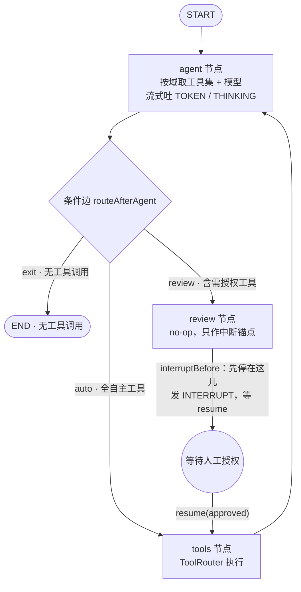

三个设计点一眼可见：**review 是空节点**（它什么都不做，只为给 `interruptBefore` 一个停靠点）；**只有 review 前中断**（`tools` 直连不暂停，否则每个工具都要人批）；**条件边在同一份域过滤下判审批**（与 agent 节点看到的工具集一致，不会出现"工具看不见却路由到 review"）。

**工具集与模型不在构造期固化**：域是按请求变化的，所以 `agentNode` 每次都用 `toolRouter.toolSpecifications(domainId)` 按本轮域过滤工具、用 `resolveModel(domainId)` 解析模型。构造期只打一条日志说明"注册表里共有 N 个工具"。

条件边也做同一份过滤（`toolsRequiringApproval(domainId)`），保证"模型可见工具集"与"路由判断"用的是同一份，否则会出现"工具不可见却被路由到 review"这种自相矛盾。

## 7.2 一轮的七个阶段

`runOrchestrate` 的骨架，顺序有讲究：

| 阶段 | 动作 | 顺序理由 |
| --- | --- | --- |
| ① 占位 | `tryMarkRunning(key)` | 同会话串行：已有轮次在执行就回 `SESSION_BUSY` |
| ② 读断点 | `pendingApproval(key)` | 决定这一轮要不要多写一条占位回答，**必须先于**任何容量判断 |
| ③ 清理上一轮残留 | 待审批断点 → 视为拒绝；否则 → 崩溃恢复（标 aborted） | 两种情况处置不同，判据就是 ② 的结果 |
| ④ 视觉路由 | 带图时先定"图走哪条路" | 定不下来就在**写记忆之前**拒绝，否则记忆里会留一条永远没回答的提问 |
| ⑤ 写记忆 | 写入本轮 UserMessage，记下 `memorySizeBefore` | 回滚用 |
| ⑥ 开归档 | `openTurn` | **在跑图之前**：提问必须先落档（崩了也知道他问过什么）；又必须在"这轮能不能跑"的判定之后（不给注定被拒的轮留开放轮） |
| ⑦ 装配 + 跑图 | `ContextAssembler` 装配 → `compiledGraph.stream(...)` | 装配细节见 F09 |

图跑完分两种收尾：**未中断** → 写最终回答进记忆 + 发 `DONE`；**中断** → 发 `INTERRUPT`（带待审批工具清单）并 `break`，等 `resume`。

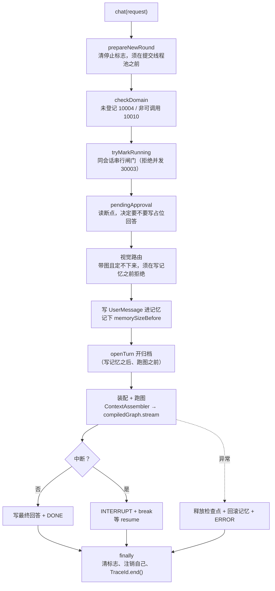

七个阶段的顺序不是随手排的：**①必须在提交线程池之前**（排队期间点停止才有效）、**④必须在写记忆之前**（否则留一条永远没回答的提问）、**⑥必须在跑图之前**（崩了也知道他问过什么）又必须在前置判定之后（不给注定被拒的轮留开放轮）。

## 7.3 事件怎么产生，停止怎么生效

| 事件 | 产生点 |
| --- | --- |
| `TOKEN` | 模型 `onPartialResponse` 每片 |
| `THINKING` | 模型 `onPartialThinking`（只有开了"输出思考"的档案才有） |
| `TOOL_CALL` | `toolsNode` 执行前 |
| `TOOL_RESULT` | `toolsNode` 执行后（受域上的回写开关控制，F03） |
| `INTERRUPT` | 图在 review 前中断后 |
| `DONE` | 未中断的正常收尾 |
| `STOPPED` | 停止路径 |
| `ERROR` | 各类失败，带 `code` / `traceId` / `retryable` |

**停止不是"中断线程"，是轮询标志位**。三处回调里都要检查：

```java
if (cancellationRegistry.isCancelled(key)) {
    future.completeExceptionally(new CancellationException("用户主动停止"));
    return;
}
```

三处分别是 `onPartialResponse`（吐 token 时）、`onPartialThinking`（只思考不吐字时）、`onCompleteResponse`（模型一次性返回时）。**漏掉任何一处，现象都只是"停止偶尔不灵"**：尤其是第二处：模型一直在"想"而没吐答案时，用户点了停止，这一轮照旧跑完。

**`awaitAiMessage` 不能用 `future.join()`**，这是本块最硬的一条：

`join()` 既没有上限也不看停止标志。上游连接半开（既不吐 token、也不回调 `onError`）时，本会话的"执行中"标记会被**永久占住**，`stop()` 设的标志再也没人读，该会话此后只能重启进程才能再用。现在是分片等待：`MODEL_WAIT_SLICE_MILLIS = 200ms` 醒一次看标志，`MODEL_WAIT_LIMIT_MILLIS = 10 分钟` 总上限。

## 7.4 会话并发与状态键

| 机制 | 类 | 语义 |
| --- | --- | --- |
| 状态键 | `stateKeyOf(domain, sessionId)` | `域|sessionId`，记忆/归档/断点/停止标志全用它 |
| 执行中标记 | `CancellationRegistry.tryMarkRunning` | 同会话只允许一轮在跑 |
| 停止标志 | `requestStop` / `isCancelled` / `clear` | `AtomicBoolean`，幂等 |
| 流注册 | `StreamSinkRegistry` | 会话 → `StreamContext`；同会话并发注册会覆盖并结束旧流 |

两处顺序敏感，都是排查过"偶发不灵"之后写下的：

- **`prepareNewRound` 必须在提交进线程池之前调用**。任务要排队，而用户可以在排队期间点停止；若清理放在任务出队后执行，那次停止就被抹掉了，界面显示"停止中"，任务照跑到底，不报错不留痕。
- **`SESSION_BUSY` 分支必须"先注销、再 complete"**。`complete()` 会同步触发 `sink.onDispose`，而 `onDispose` 里靠 `isCurrent` 判断"这是不是我这一轮"。注销在前它就判 false，不会把停止标志打到别人身上；反过来（先 complete）会让**被拒绝的这一轮亲手把正在正常执行的那一轮停掉**。

## 7.5 失败与回滚矩阵

| 情况 | 判定 | 动作 |
| --- | --- | --- |
| 检查点**数据损坏** | `CheckpointCorruptedException` | 清键让它自愈，按"无待审批"继续本轮。安全侧：断点没了 = 审批被拒 |
| 检查点**瞬时故障** | `IllegalStateException` | 整轮拒绝，报 `CHECKPOINT_ERROR`（可重试）。**绝不能走入口清理**：那会把待审批的断点删掉 |
| 用户停止 | `CancellationException` | 回滚记忆到 `memorySizeBefore`、归档标 aborted、发 `STOPPED` |
| 依赖未配置 | `NotConfiguredException` | 专门文案（去哪配），不按通用失败处理 |
| 其他异常 | — | **同时**释放检查点 + 回滚记忆 + 发 `ERROR` |

最后一条的两步必须成对，理由各一条：

- 图没走到 END，`releaseThread` 不触发，checkpoint 会残留。残留状态里可能有"带工具调用却没有结果的悬空 `AiMessage`"，下一轮带着它继续跑会**反复失败**，一次异常拖垮后续所有提问。
- 记忆不回滚就留下"有问无答"的记录，下一轮模型看到上次提问没有回应，会顺着答非所问，**偏差会累积**。

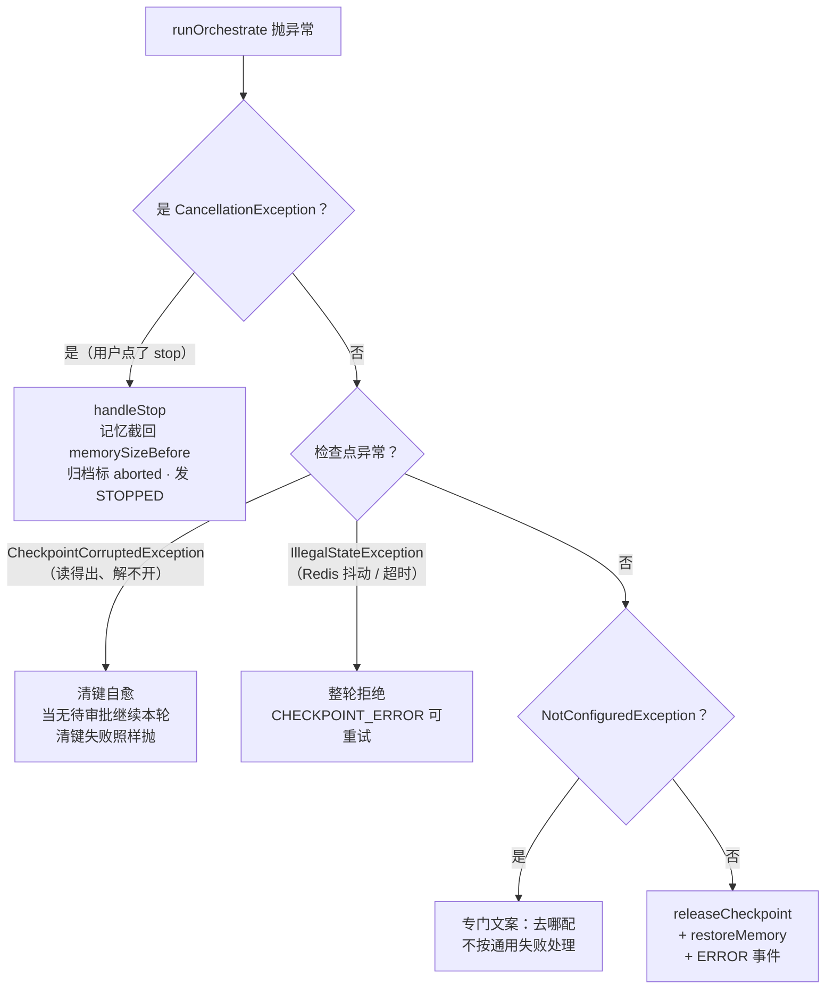

注意 `SELFCURE` 与 `REJECT` 的方向差异：**数据损坏要清键重来，瞬时故障要拒绝重试**。把两者混同，要么让一个坏键永久废掉会话，要么把"重试也没用"的失败重复十次。

顺带一个易错点：`memorySizeBefore` 的哨兵必须是 `null` 而不是 `0`。`null` = "还没量过"，`0` = "量到的是空的"；混用会让"异常早于测量"被误判成"清空记忆"，而那次清空会把**上一轮**的内容一起抹掉。

## 7.6 多模态入参的三处坑

`buildUserMessage` 的注释列了三个实测踩过的：

1. `UserMessage.from(String, Content...)` 的第一个 `String` 是**用户名**，不是文本。拿它拼多模态，文字会静默跑进 `name` 字段，模型只收到图、看不到那句话，两边都不报错。
2. **TEXT 块不能再拼一遍**：`message` 本来就是各 TEXT 块的合并结果（`AgentRequest.getMessage()`），再拼等于把用户的话说两遍。
3. **平台追加的 `notice`（附件清单）必须并进同一个文本块**，不能自成一个 `TextContent`。多个文本块在部分服务商上会被拼接，另一些上只取第一块；附件清单被丢掉的话，模型看不到引用名，既不会去调 `seeImage`，也无从解释自己为什么看不到图。

## 7.7 Token 计量：估算永远有，上报优先

| 来源 | 何时有 | 用途 |
| --- | --- | --- |
| 平台估算 | **永远有**（流式分片按字符宽度累加 + 工具参数/结果按文本估） | 兜底 |
| 服务商上报 | `ChatResponse.tokenUsage()` 给了才有 | 落档优先用它 |

`TokenUsageRecorder` 用 ThreadLocal 攒本轮统计，`finally` 里 `finishAndLog()`；失败路径也要记（模型已经开始产 token 就产生了用量，只记成功路径会漏）。

`totalTokens` 的口径随来源变（F01 的 `TokenUsage`）：实报时 = prompt + completion，**不含工具估算**（工具用量已计入下一轮 prompt，重复相加会虚高）；估算时 = 输出 + 工具输入 + 工具输出。

## 7.8 关键取舍

| 决策 | 被否方案 | 代价 |
| --- | --- | --- |
| review 用 no-op 节点做中断锚点 | 在 tools 节点内部判断 | 图多一个节点；换来中断语义由框架保证，不用自己写"暂停/恢复" |
| 停止靠轮询标志 | `Thread.interrupt()` | 最多 200ms 延迟生效；换来可控、可重入、不会中断到别人的线程 |
| 同会话严格串行 | 允许并发、靠锁保护记忆 | 同会话吞吐为 1；换来记忆与断点不会互相覆盖 |
| 异常时清检查点 + 回滚记忆 | 保留现场等下次继续 | 丢失"跑到一半"的现场；换来不会一次异常拖垮后续所有轮次 |
| 单类 2,295 行 | 拆成节点/装配/归档几个类 | 见 7.10 观察点 1 |

## 7.9 易错点

1. **`future.join()` 不能用**（见 7.3）。
2. **三处停止检查缺一不可**，尤其 `onPartialThinking`。
3. **`prepareNewRound` 的调用时机**（排队期间停止）。
4. **`unregister` 必须在 `complete()` 之前**（见 7.4）。
5. **`memorySizeBefore` 哨兵用 `null`**（见 7.5）。
6. **`turnId` / `graphStarted` 必须声明在 `try` 之外**，`catch` 里要靠它们做归档收尾，而 `try` 块里声明的局部变量对 `catch` 不可见。
7. **`TraceId.end()` 必须清**：线程池复用线程，不清的话下一个任务会继承上一轮的 traceId。
8. **`UserMessage.from` 的第一个参数是用户名**（见 7.6）。

## 7.10 观察点（登记，未改动）

| # | 现象 | 影响 | 建议 |
| --- | --- | --- | --- |
| 1 | `AgentOrchestrationService` 2,295 行、约 40 个私有方法，混了图节点、入参装配、归档收尾、错误处理、上下文装配 5 类职责 | 单文件难以整体理解，改一处要先读一大段 | 天然切面已现成：`agentNode`/`toolsNode`/`routeAfterAgent` 可拆成一个 Graph 类；归档收尾（`closeTurnQuietly` 等 6 个 `*Quietly`）可拆成一个 TurnLifecycle 类 |
| 2 | `runOrchestrate` 与 `runResume` 各 300 行左右，收尾逻辑高度相似 | 改一处容易漏另一处 | 未做重复度实测，但两处都在收尾阶段调同一批 `*Quietly` 方法，可抽公共模板 |
| 3 | `MODEL_WAIT_LIMIT_MILLIS = 10 分钟`、`SLICE = 200ms` 都是 private 常量 | 慢模型（长思考）会被硬切；时间分散在各模块（实例调用 30s、检索 5s、模型 10min） | 若要暴露，建议与 `domainplane.instance.invoke-timeout-ms` 一起做成"超时总表" |
| 4 | 事件里 `TOOL_CALL` 的参数经 `displayArguments` 处理（敏感参数掩码），但 `TOOL_RESULT` 原样下发 | 工具结果里可能带敏感数据（手机号、身份证） | 回写开关默认关（F03），开了就要自己确保工具不回传敏感字段 |

## 7.11 讲这一块的抓手

- **看一张图**：讲的时候先画 7.1 那三行图，再指出"review 是空的，它只是个停靠站"，这一句能让听众立刻理解 `interruptBefore` 的设计。
- **停一次**：`chat` 后 1 秒内 `stop/{sessionId}`，观察 `STOPPED` 事件、记忆条数回到本轮之前、归档里那一轮变成 aborted（F04）。
- **批一次**：给工具加 `approval = ALWAYS`，问一个会触发它的问题 → `INTERRUPT` + 待审批清单；`resume(approved=false)` → 模型重新决策（不是直接结束）。
- **半开连接演示**（如果环境允许）：`awaitAiMessage` 的注释里那段"会话被永久占住"是最好的"为什么不能用 join"的教材。

## 7.12 覆盖清单（7 文件）

| 类 | 行 | 一句话 |
| --- | ---: | --- |
| `orchestration.AgentOrchestrationService` | 2,295 | 图构建、agent/tools 节点、路由、事件、失败矩阵、归档收尾、上下文装配 |
| `cancellation.CancellationRegistry` | 154 | 停止标志 + 执行中标记（按会话状态键） |
| `usage.TokenUsageRecorder` | 148 | 本轮 token 估算与上报合流（ThreadLocal） |
| `stream.StreamContext` | 72 | 单个会话的流上下文：sink、域、traceId、半截回答、检索预算 |
| `stream.StreamSinkRegistry` | 60 | 会话 → 上下文注册表，含"是否仍是当前这一轮"判定 |
| `message.JsonContentSerializer` | 50 | 图状态序列化时 `Content` 的 JSON 通道（多模态必需，F04 提过） |
| `stream.package-info` | 6 | — |

## 7.13 测试（4 类 / 363 行）

| 测试 | 行 | 覆盖 |
| --- | ---: | --- |
| `CancellationRegistryTest` | 111 | 停止标志、执行中标记、`prepareNewRound` 时机 |
| `TokenUsageRecorderTest` | 104 | 估算累加与合流口径 |
| `StreamSinkRegistryTest` | 79 | 覆盖注册、`isCurrent`、只注销自己 |
| `GraphContextCarryingTest` | 69 | `StreamContext` 经 `RunnableConfig.metadata` 跨节点传递 |
| `ServerAgentControllerChatGuardTest`（server，128） | — | 入口护栏与错误码 |

编排本身（`AgentOrchestrationService` 2,295 行）**没有独立单测**：它依赖 Redis/ES/模型三件外部设施，只能端到端验。这是全项目最大的测试缺口，也是它最难改的根因：改一行无法快速验证。若要做，第一步应是把图节点与收尾逻辑拆出去（见 7.10 观察点 1），让它们能在无外部依赖下测。

---

# F08 工具体系

`api.tool` + `api.annotation` + `runtime.tool` + `server.tool` + `domainplane-tool-provider` —— 37 文件 / 4,686 行

## 8.0 一句话

一条六段流水线：**来源 → 元数据 → 注册表 → 按域裁剪 → 路由 → 执行/审批**。两端各有一个 SDK：本地 Bean 工具（引 `domainplane-tool-provider` 之外的进程内注册）与远程工具实例（HTTP 注册 + 反向调用）。

## 8.1 一条工具调用的一生

| 阶段 | 发生时机 | 主责类 |
| --- | --- | --- |
| ① 声明的两种写法 | 启动期 | `@Tool` + `@ToolParam` + `@ToolAdvanced`（或远程实例的 `ToolSpec` JSON） |
| ② 变成元数据 | 启动期 / 注册时 | `AnnotatedToolScanner` / `ToolManifest` + `ToolParamSchema` → `ToolDescriptor` |
| ③ 进注册表 | 启动期 / 心跳 | `ToolRegistry.register` / `replaceInstanceTools` |
| ④ 按域裁剪 | **每次请求** | `ToolRegistry.toolSpecifications(domainId)` → 交给模型的工具清单 |
| ⑤ 路由 | 模型要调工具时 | `ToolRouter.execute(ToolExecutionRequest)` → 本地 or 远程 |
| ⑥ 执行 | 同上 | 本地：`ToolExecutorService`（隔离池）；远程：`RemoteToolExecutor`（HTTP POST 到实例） |

第 ④ 步是全项目最核心的一处差异化：**工具集不在构造期固化**，每次请求按 `(域, sessionId)` 的域重新裁剪。构造期只记日志说明"注册表里共有 N 个工具"。

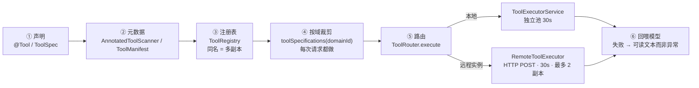

## 8.2 两个来源，两套扫描器（不要混为一谈）

| | `AnnotatedToolScanner`（runtime，311 行） | `ToolProviderScanner`（tool-provider，356 行） |
| --- | --- | --- |
| 扫的是 | 本进程内要注册进**本服务端**的工具 | 本进程内要注册到**远端服务端**的工具 |
| 产物 | `ToolDescriptor` → 进本地 `ToolRegistry` | `ToolSpec` → 上报，本地不留副本 |
| 何时扫 | 服务端启动期 | 客户应用装配 `ToolInstanceClient` 时，早于心跳 |

两者的类名刻意不同，注释里专门写了"不要当成同一个概念的两份实现"。

**`ToolProviderScanner` 的失败策略很硬**：参数名解析不出、工具名重复、`desc` 缺失，启动期直接抛异常。理由是"工具声明错了等模型来调用才发现，排查成本远高于启动失败"。

`tool-provider` 侧还提供一个空标记接口 `ToolInstanceContributor`：客户应用实现它来声明自己提供的工具（比逐个 `registrar.register(...)` 更省事），编程式注册仍然保留（`ToolRegistrar.register(ToolSpec, ToolHandler)`）。

## 8.3 注册表：同名 = 同一逻辑工具的多个副本

`ToolRegistry` 的核心结构是 `Registered(descriptor, specification, executor, endpoints)`：

| 能力 | 语义 |
| --- | --- |
| `replaceInstanceTools(instanceId, endpoint, manifest)` | 按 diff 同步某个实例的全部工具（幂等，MCP 盖章、实例心跳都靠它） |
| 同名多副本 | `endpoints` 是列表：同一工具名可以由多个实例提供（水平扩容 / 多活） |
| `toolSpecifications(domainId)` | 按域裁剪后的可给模型的清单 |
| `toolsRequiringApproval(domainId)` | 同一份过滤条件下的待审批集合（编排层的条件边用同一份，保证路由与可见性一致） |
| `forgetDomains` / `allowDomains` | 删域时把域名从工具声明里剥离（配合 F01 的 `<revoked>` 哨兵） |
| `sensitiveParams(toolName)` | 递归收集 `@ToolAdvanced.sensitive` 声明的参数名，供掩码用 |

## 8.4 实例在线表：四态状态机与快慢路径

`InstanceState` 四态，`DRAINING` 的存在理由值得单说：

```
ONLINE ──(lastSeen 超时 / 强制下线标记)──► DRAINING ──► OFFLINE
  │                                            ▲
  └──► MUTED ──(控制台恢复 / 实例重启)──► ONLINE │
```

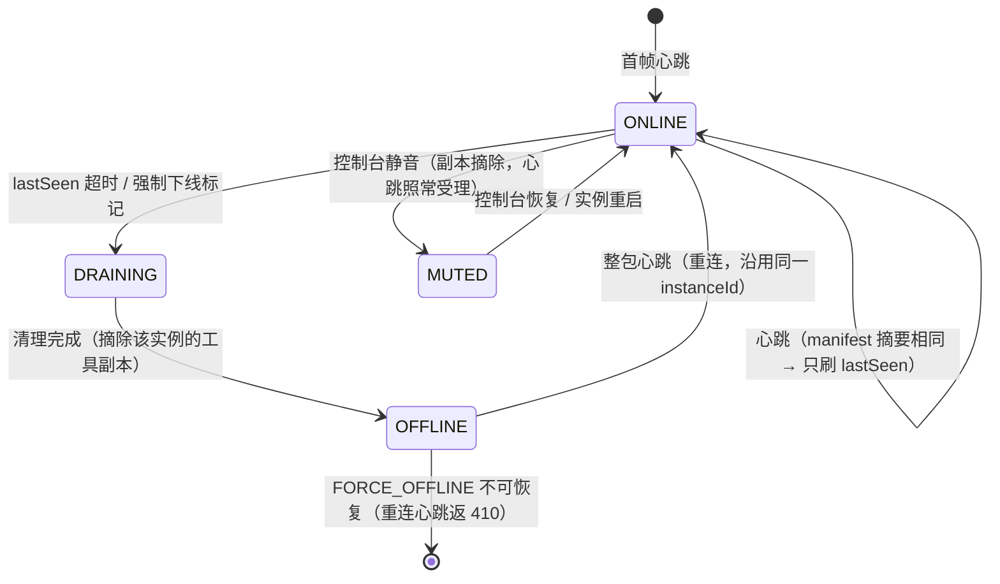

图里有两条容易忽略的边：**MUTED 不隔断心跳**（"静音"不是"拔线"，实例随时能回来）；**重连必须沿用同一个 `instanceId`**，否则旧副本摘不掉，同一种工具会同时存在两份（一份活的、一份死的）。

**`DRAINING` 是为"判死与清理并发"准备的中转态**：超时定时器与强制下线可能同时触发，靠状态机单飞，**只有把 ONLINE 改成 DRAINING 成功的那一方，才获得清理权**。没有它，两边都会去清理，注册表被摘两次。

`InstanceRegistry.onHeartbeat(instanceId, endpoint, manifestDigest, toolNames, syncManifest)` 是热路径，分两速：

| 路径 | 条件 | 动作 |
| --- | --- | --- |
| 快 | manifest 摘要与 endpoint 都没变 | **只刷 `lastSeen`**，不进注册表 |
| 慢 | 摘要或 endpoint 变了 | 调 `syncManifest` 回调，重建该实例的工具副本 |

心跳周期默认 5s，服务端判死窗默认 35s（= 7 个周期）；实例侧退避上限 20s 必须小于判死窗，否则实例在被判死前都来不及重连。

`InstanceLifecycle` 提供 `scan()`（定时判死）、`forceOffline`、`mute`（摘副本但心跳照常受理）、`restore`。`FORCE_OFFLINE` 不可恢复，重连心跳直接返 410。

## 8.5 执行：三件隔离层，池各自独立

本地 Bean 工具是在**编排线程**上直接调用的。一个死循环或永久阻塞的方法会占住一个编排线程直到进程结束；编排池 max 32，几十个这样的调用就能让整个服务停摆，而且**不报错、不释放，日志上只表现为"突然变慢"**。

所以执行被挪到独立的有界池，`future.get(timeout)` 卡上限。三件隔离层参数各不相同，理由是"量级天生不同，共池会互相牵连"：

| 隔离层 | 典型上限 | 服务的对象 | 共池的后果 |
| --- | --- | --- | --- |
| `ToolExecutorService` | 30s | 本地工具 | — |
| `VisionCallExecutor` | 60s | `seeImage` 看图 | 大图必然超 30s，超了还看不出是图太大还是模型太慢 |
| `CapabilityCallExecutor` | 120s | 生图 / 语音 / 视频 | 一次生图占线程一分钟以上，几个并发就能把检索类工具一起拒掉，"一个域在生图，另一个域连检索都不可用" |

**池满直接拒，不排队**：排队等于把超时压力转嫁给编排线程。

换线程执行有个必须显式处理的副作用：**三个 ThreadLocal 是编排在自己线程上绑的**（`ToolInvocationContext` 审计身份、`RetrievalScope` 检索域、`TraceId` 排障标识），换线程就丢了。丢失后果不对等：

- `RetrievalScope` 丢 → 知识库从"按本轮域过滤"退化成"全库检索"（**越权读**）；
- `sessionId` 丢 → 历史检索工具不知道该读哪个会话的档（跨会话读是越权口子）；
- `searchBudget` 丢 → "每轮限次"退化成每次调用各自为政，限不住。

所以 `ToolExecutorService` 里必须显式搬运并复原。

**工具失败不是异常，是给模型的可读信息**。`ToolRouter` 把"工具不存在 / 执行异常"都转成文本回喂（`describeUnavailable` / `describeFailure` + 脱敏 `sanitize`），让模型据此改写参数或改述；只有意外异常才抛出。远程与 MCP 执行器同一口径。

## 8.6 审批与掩码

审批链路已在 F07 讲过（条件边 → `review` → `INTERRUPT` → `resume`），本章补两个细节：

- **审批判据用同一份域过滤**：`toolsRequiringApproval(domainId)` 与 `toolSpecifications(domainId)` 共享过滤条件，否则会出现"工具看不见却被路由到 review"。
- **`SensitiveMasker` 只掩展示，不动执行**。`@ToolAdvanced.sensitive` 声明"这些值不要外露"，掩码只作用于两处展示文本（推给客户端的 `TOOL_CALL` 事件、审批 payload）；真正交给工具执行、以及回喂模型的参数**始终是原值**，否则工具会拿到 `***` 而彻底失效。匹配是递归按键名的（敏感项可能是 DTO 展开出的 `args.phone`），名字命中就把整个值（标量/对象/数组）一起替换，宁可多盖也不漏。

另有一个防"把检索当抛球游戏"的预算：`RoundSearchBudget` 让 `read_history` + `recall_history` 合计每轮最多 3 次，对象挂在 `StreamContext` 上（一轮一个，跨多次 agent→tools 循环共用一个桶）。

## 8.7 工具实例 SDK（`domainplane-tool-provider`）

| 组件 | 职责 | 关键约束 |
| --- | --- | --- |
| `ToolInstanceClient` | 客户侧核心：注册 + 心跳 + 退避重试 | **心跳失败从不阻断启动**（服务端没起，接入方照常跑） |
| `ToolInstanceConfig` | 不可变接入参数（链式 `with*`） | `instanceId` 重连必须沿用同一个，否则留下摘不掉的旧副本 |
| `ToolInstanceBootstrap` | 心跳开关，装配完成后启动、容器关闭时停止 | — |
| `ToolInstanceInvokeController` | 反向端点（服务端 POST 到这里执行工具） | 推模式 |
| `ToolInstanceConnectionStatus` | 连接状态快照 + `asMap()` | 刻意不实现 Actuator `HealthIndicator`：会给 SDK 引入可选依赖 |
| `ToolInstanceProperties` | `domainplane.tool-instance.*` | 默认关闭，引了 jar 不等于要当工具提供方 |

`endpoint` 推导不出来时为空串，语义是"本实例不接反向调用"，**不影响注册与心跳**（工具照样能被发现，只是调不动），这是个容易误解的配置项。

## 8.8 关键取舍

| 决策 | 被否方案 | 代价 |
| --- | --- | --- |
| 工具集按请求裁剪 | 启动期固化 | 每次请求都要过滤一遍；换来域隔离真正成立 |
| 三个独立执行池 | 共用一个大池 | 多两份线程池；换来生图不会饿死检索 |
| 池满即拒 | 排队等待 | 并发峰值直接失败；换来不把超时压力转给编排线程 |
| 工具失败回喂文本 | 抛异常给编排层 | 模型可能反复试；换来模型能自我修正 |
| 掩码只改展示 | 执行时也脱敏 | 两处要分别处理；换来工具拿到真实参数 |
| 心跳失败不阻断启动 | 连不上就启动失败 | 故障静默（靠状态快照发现）；换来接入方能先起自己的应用 |

## 8.9 易错点

1. **`DRAINING` 不能省**。去掉它，判死定时器与强制下线会并发清理同一个实例。
2. **`RetrievalScope` 不搬运 = 越权读**。这是换线程执行最危险的副作用，不是"日志少个字段"那种级别。
3. **`instanceId` 重连必须沿用**。换一个就留下一个摘不掉的旧副本，表现为"同一个工具出现两份、其中一份永远是死的"。
4. **退避上限必须小于判死窗**（20s < 35s）。反了的话实例在被判死前都来不及重连，永远在"注册—判死—重连"之间循环。
5. **`sensitive` 只影响展示**。以为它能防止参数进日志是误解，它管的是事件与审批 payload。
6. **MCP 与工具实例是两条独立通道**：MCP 走标准协议（F12），工具实例走私有 HTTP 契约。同名工具可以来自任一侧。

## 8.10 观察点（登记，未改动）

| # | 现象 | 影响 | 建议 |
| --- | --- | --- | --- |
| 1 | 三个执行池的默认上限散落在三处（`ToolExecutorService` / `VisionCallExecutor` / `CapabilityCallExecutor` 各自的构造参数） | 调整要改三处配置 | 可考虑统一到 `domainplane.capability.*` 一张表 |
| 2 | 心跳失败只进状态快照，不进 `MetricsRegistry` | 实例"活着但没注册上"只能靠接入方主动查状态 | 可加 `instanceHeartbeatFailures` counter |
| 3 | `ToolRegistry` 550 行承担了注册、副本管理、域裁剪、脱敏收集、domain 记忆五件事 | 改一处要先读大半 | 域相关的 `knownDomains` / `forgetDomains` 可挪到 `DomainRegistry` 旁 |
| 4 | 本地工具池满时回喂"系统繁忙"，远程实例池满时行为取决于实例侧 | 两侧话术不完全对称 | 已在 `describeUnavailable` 里收敛，登记以免被当成不一致 |

## 8.11 讲这一块的抓手

- **看一次裁剪**：同一个工具声明 `domains={"default.admin"}`，在 `default` 下问"你能用什么工具"，再在 `default.admin` 下问，模型的回答会不一样。
- **看一次多副本**：同一个 `ToolInstanceContributor` 起两个进程（不同 `instanceId`），管控台「在线实例」会显示同名工具两条副本。
- **看一次判死**：杀掉实例进程，35s 后实例变 `DRAINING → OFFLINE`，工具从可用清单消失。
- **验一次掩码**：给参数加 `sensitive`，观察 `TOOL_CALL` 事件里是 `***`、而工具实际收到的是真值。

## 8.12 覆盖清单（37 文件）

| 包 / 类 | 行 | 一句话 |
| --- | ---: | --- |
| `api.tool.ParamSchemaResolver` | 476 | 方法签名 + 注解 → 参数结构，DTO/集合递归展开，深度 ≤5 |
| `api.tool.ToolDescriptor` | 167 | 工具全部认知 + 域可见性判定 + `<revoked>` 哨兵（F01 详述） |
| `api.tool.DomainPlaneToolProvider` | 10 | AOP 代理场景的扫描标记 |
| `api.annotation.*` | 124 | `@Tool` / `@ToolParam` / `@ToolAdvanced` / `@ToolDomains`（F01 详述） |
| `runtime.tool.ToolRegistry` | 550 | 注册表：副本管理、按域裁剪、删域剥离、敏感参数收集 |
| `runtime.tool.AnnotatedToolScanner` | 311 | 本地 `@Tool` 扫描 → `ToolDescriptor` |
| `runtime.tool.ToolRouter` | 250 | 唯一执行入口：本地/远程分派 + 失败话术 |
| `runtime.tool.InstanceRegistry` | 241 | 在线实例表：心跳快/慢路径、drain/mute/restore |
| `runtime.tool.ToolExecutorService` | 212 | 本地工具隔离池 + ThreadLocal 搬运 |
| `runtime.tool.SensitiveMasker` | 111 | 敏感参数递归掩码（只改展示） |
| `runtime.tool.InstanceLifecycle` | 98 | 判死扫描、强制下线、恢复 |
| `runtime.tool.ToolInvocationContext` | 73 | 工具线程上下文（traceId / sessionId / 预算） |
| `runtime.tool.InstanceState` | 41 | 四态状态机 |
| `runtime.tool.RoundSearchBudget` | 35 | 每轮历史检索次数预算 |
| `runtime.tool.InstanceSession` | 31 | 在线表条目（含 manifest 摘要） |
| `runtime.tool.InstanceEndpoint` | 25 | 副本地址（实例 + 回流地址） |
| `runtime.tool.ToolCallEchoResolver` | 23 | 回写开关的接口（实现在 server，F03） |
| `runtime.tool.StripedLocks` | 21 | 条带锁 |
| `server.tool.ToolManifest` | 257 | 整包 manifest JSON → 注册项 |
| `server.tool.RemoteToolExecutor` | 207 | 远程工具执行（HTTP POST 到实例） |
| `server.tool.ToolParamSchema` | 153 | JSON Schema → 内核用的两样东西 |
| `server.tool.DomainToolCallEchoResolver` | 24 | 回写开关实现（F03） |
| `toolprovider.ToolProviderScanner` | 356 | 客户侧注解扫描 → `ToolSpec`（启动期失败即抛） |
| `toolprovider.ToolInstanceClient` | 328 | 注册 + 心跳 + 退避 |
| `toolprovider.ToolSpec` | 122 | 工具声明（实例侧） |
| `toolprovider.ToolInstanceConfig` | 84 | 不可变接入参数 |
| `toolprovider.ToolInstanceConnectionStatus` | 58 | 连接状态快照 + `asMap()` |
| `toolprovider.ToolInstanceProperties` | 43 | `domainplane.tool-instance.*`，默认关闭 |
| `toolprovider.spring.ToolInstanceAutoConfiguration` | 150 | 自动装配 |
| `toolprovider.ToolInstanceInvokeController` | 34 | 反向调用端点 |
| `toolprovider.ToolInstanceBootstrap` | 31 | 心跳开关 |
| `toolprovider.ToolHandler` / `ToolRegistrar` | 15 / 15 | 执行体 / 编程式登记口 |
| `toolprovider.ToolInstanceContributor` | 10 | 工具贡献者标记接口 |
| `api.tool.ParamSchemaResolver` | 476 | 方法签名 + 注解 → 参数结构，DTO/集合递归展开，深度 ≤5 |
| `api.tool.ToolDescriptor` | 167 | 工具全部认知 + 域可见性判定 + `<revoked>` 哨兵（F01 详述） |
| `api.annotation.*` | 124 | `@Tool` / `@ToolParam` / `@ToolAdvanced` / `@ToolDomains`（F01 详述） |
| `api.tool.DomainPlaneToolProvider` | 10 | AOP 代理场景的扫描标记 |

> 本块合计 37 文件 / 4,686 行（与 F01 共享 `api.tool` + `api.annotation` 的 777 行，见目录脚注）。

## 8.13 测试（12 类 / 1,225 行）

`ToolExecutorServiceTest` 335、`ToolAnnotationScanTest` 142、`ToolDomainRetentionTest` 131、`ToolProviderScannerTest` 136、`ToolRouterFailureTest` 91、`ToolRegistryMcpPrefixTest` 66、`ToolManifestTest` 60、`SensitiveMaskerTest` 58、`ToolInstanceInvokePayloadTest` 58、`InstanceMuteTest` 55、`ToolRegistryLookupTest` 47、`ToolParamSchemaTest` 46。

工具执行器与注解扫描是测试重点；**实例生命周期（判死/强制下线/四态迁移）几乎没有直接单测**，只靠 `InstanceMuteTest` 覆盖了一角，这是本块最大的缺口，也是并发问题最容易藏的地方。

---

# F09 提示词与上下文装配

`runtime.prompt` + `server.prompt` + `runtime.conversation` + `server.conversation` —— 11 文件 / 1,607 行

## 9.0 一句话

决定**这一轮给模型看什么**：提示词按域链拼接、历史按"窗口 + 摘要 + 卡片"三层装配、装不下就逐级降级，永远不拒绝开轮。

## 9.1 提示词：接口在内核，实现在服务端

| 侧 | 类 | 职责 |
| --- | --- | --- |
| 内核 | `SystemPromptResolver`（16 行） | 契约：按域给提示词 |
| 服务端 | `DomainSystemPromptResolver`（247 行） | 从 `prompts.json` + yaml 取值，沿域链拼接，每段"管控台值优先、回落 yaml" |

拼接规则（F03 讲过语义，这里是实现口径）：`chainOf(域)` 由根到叶，跳过空段，用 `JOIN` 连接。整条链都为空时打一条 warn 并**不带系统提示词**：注释明确写了"缺提示词只是体验降级，不是故障：域对工具的限制由代码保证，与提示词无关"。

**一处注释冲突**（观察点 1）：`SystemPromptResolver` 的接口注释说"提示词组成是【公共基线 + 域差异】"，而 `DomainSettings`、`PromptProperties`、`DomainSystemPromptResolver` 全都说"**没有公共基线这一层**，根域 `default` 就是基底"。实现以后者为准，接口注释过期。

## 9.2 装配：五段拼成一条消息序列

`ContextAssembler` 的输出顺序固定：

```
系统提示（域链拼接）
  + 早期摘要（RollingSummary 产物，~2000 token 预算）
  + 相关轮卡片（HistoryCard：轮号 / 时间 / 一句话摘要 / 工具，不附全文）
  + 近况窗口（最近若干轮的原文，消息块原样带 → 图片不丢）
  + 本轮提问
```

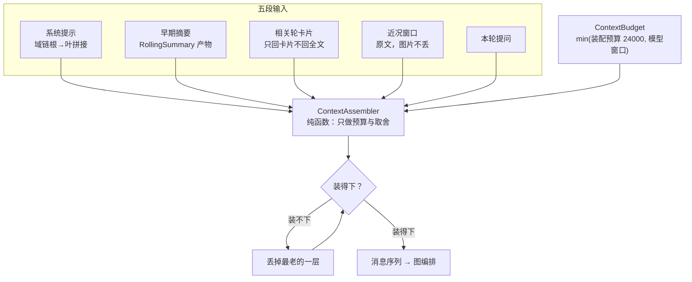

降级的顺序就是"先丢最不新鲜的"：卡片 → 摘要 → 窗口层数。**永不拒绝开轮**，所以图中没有指向 `ERROR` 的箭头，这是 M2 移除封顶语义后的形状。

它是**纯函数**（不碰存储、不调模型），注释里说"装配策略是'这轮给模型看多少'的唯一决策点，值得有测试盯着"。注释还列了"三条不可让的边界"，第一条最硬：

> **永不拒绝开轮**：装不下就按 `DEGRADE` 降级，不存在"会话满了"这个状态。

这正是 M2 移除封顶语义的落点（F04 讲过 `capacityFor` 退居自检）。

## 9.3 预算：只封顶，不放大

`ContextBudget` 把"平台想给多少"与"模型能吃多少"取小：

```java
预算 = min(domainplane.memory.assembly-budget（默认 24000）, 模型声明的上下文窗口)
```

**为什么需要它**：装配预算是与模型无关的常量。一旦本轮解析到的模型窗口更小（自建端点上的小模型、老模型只开 8k/16k），装配结果照样按 24000 拼出来，请求打到服务商才以"context length exceeded"失败，而平台既认不出这是超限，也说不清是哪一步导致的（统一落进 `ORCHESTRATION_FAILED`）。

**为什么只封顶不放大**：模型窗口比配置预算大时，预算维持配置值不变。放大等于让一个 200k 模型把 24000 的装配预算撑到 200k，成本失控，而且没有必要。

`ModelLimits` 的两个分量都可为 `null`，语义是"该档案没声明这一项"，不是"为零。把未声明当成零会让所有没填过的档案装配预算被压到下限。

## 9.4 滚动摘要：异步 + 阈值 + 单飞

`RollingSummaryService` 三个设计点，缺一个都出问题：

| 设计 | 理由 |
| --- | --- |
| **异步**（闭轮后触发） | 摘要是额外一次模型调用，同步做等于每轮都加一份延迟与成本；而"老轮次压缩"不需要实时 |
| **阈值门** | 只在"滑出窗口且未进摘要"的轮次攒够之后才真正发起调用 |
| **单飞** | 同一会话同时只允许一个未完成摘要。否则用户连点几轮会并发起多个调用，各自基于"自己那份旧摘要"生成，**后写覆盖先写 → 摘要倒退**（已并进去的轮次丢了） |

生成侧 `ChatModelSummarizer` 有三个"刻意"：**非流式**（没有边生成边展示的消费方）、**不给任何工具**（否则摘要调用可能反过来查库、跑出副作用）、**设输出上限**（摘要段预算本身只有 ~2000 token，不设上限可能生成一篇长文把预算吃掉）。

## 9.5 读写分离：TurnRecorder 存，TurnView 给模型看

| 侧 | 类 | 截断口径 |
| --- | --- | --- |
| 写 | `TurnRecorder` | 存档 8K/元素（防爆） |
| 读 | `TurnView` | 每轮节流 ≤ ~1500 token（防撑上下文） |

两个口径不同是刻意的：存档要"尽量全"，给模型看要"尽量省"。合在一起就会出现"要么档案丢了细节、要么上下文被一段工具输出撑满"。

`TurnRecorder` 全是纯函数（内容块 → 媒体引用、图状态消息 → 流程事件、摘要生成），放这里而不是塞编排层，就是为了可单测，抽取规则是归档正确性的一部分。

## 9.6 两个历史工具的会话隔离

| 工具 | 干什么 | 隔离做法 |
| --- | --- | --- |
| `read_history` | 按**轮号**取原文 | 域读 `RetrievalScope`、sessionId 读 `ToolInvocationContext`，**工具签名里一个都不带** |
| `recall_history` | 按**内容**找轮号（只回卡片） | 同上 |

为什么不带参数：带参数就等于给模型一个"读别人的会话"的口子，而这个工具的返回是**全量对话原文**，越权读的后果比知识库越权重得多。两者共用同一个 `RoundSearchBudget`（每轮 3 次）。

`recall_history` 只回卡片不回全文，是"选取召回 + 自主深挖"的分工：卡片塞全文就等于没选取，上下文又会线性胀回去。

## 9.7 一致性自检：PromptToolConsistencyAudit

启动期跑，只提醒不阻断。挡的是一类**不报错的问题**：域同时绑定工具集与提示词，而两者分处两地维护（工具在 `@Tool`，提示词在 `prompts.json`/yaml），很容易写出"提示词里点名了某个工具、但它在当前域不可见"。后果是模型被告知有能力却调不到，要么反复失败、要么拿近义工具硬凑。这类问题 HTTP 依旧 200，只能靠人工比对发现。

## 9.8 关键取舍

| 决策 | 被否方案 | 代价 |
| --- | --- | --- |
| 摘要异步 + 阈值 | 每轮同步生成 | 摘要滞后（滑出窗口后才补）；换来不加每轮延迟 |
| 近况窗口带原文 | 全部摘要化 | 窗口内 token 占用高；换来图片与工具结果不丢 |
| 卡片不附全文 | 卡片带摘要 + 首段 | 模型要再调一次工具；换来上下文不被老轮次吃掉 |
| 预算只封顶不放大 | 按模型窗口放大 | 大窗口模型用不满；换来成本可控 |
| 历史工具不带域/session 参数 | 显式传参 | 工具签名无法独立测试；换来没有跨会话读的口子 |

## 9.9 易错点

1. **接口注释与实现口径不一致**（9.1 的"公共基线"）。
2. **`ModelLimits` 的 null 不是 0**（9.3）。
3. **摘要单飞不能省**。去掉就是摘要倒退，而倒退是静默的，模型只是"记性变差"。
4. **`TurnView` 与 `TurnRecorder` 的截断口径不能统一**（9.5）。
5. **历史工具必须只读本会话**。域与 sessionId 从上下文读，不从参数读。

## 9.10 观察点（登记，未改动）

| # | 现象 | 影响 | 建议 |
| --- | --- | --- | --- |
| 1 | `SystemPromptResolver` 接口注释说"公共基线 + 域差异"，实现是"根域即基线" | 读接口会误解拼装模型 | 改接口注释 |
| 2 | `ContextAssembler` 注释提到"三条不可让的边界"，文档只展开第一条（永不拒绝开轮） | 另两条需要读代码确认 | F09 定稿时应补全三条 |
| 3 | `assembly-budget` 默认 24000 是全局常量，不随模型能力自动调 | 小窗口模型靠 `ContextBudget` 兜底（已封顶），大窗口模型用不满 | 与 F10 的档案字段联动即可，暂不改 |

## 9.11 讲这一块的抓手

- **看一次降级**：把 `assembly-budget` 调到很小，再问一个依赖长历史的问题，观察装配层降级而不是报错。
- **看一次摘要倒退的反例**：连续快速发 3 轮，观察日志里摘要任务是否被单飞挡住（同一会话只有一个任务）。
- **验一次隔离**：试图让模型调 `read_history` 时传一个别的 sessionId，参数根本不存在，拿不到口子。
- **跑两个测试**：`ContextAssemblerTest`（307）、`ContextAssemblerBudgetTest`（98）。

## 9.12 覆盖清单（11 文件）

| 类 | 行 | 一句话 |
| --- | ---: | --- |
| `runtime.conversation.ContextAssembler` | 406 | 五段装配 + 降级链 |
| `runtime.conversation.RollingSummaryService` | 229 | 摘要调度：异步 + 阈值 + 单飞 |
| `runtime.conversation.TurnView` | 173 | 读侧渲染，每轮 ≤1500 token |
| `runtime.conversation.TurnRecorder` | 169 | 写侧抽取（媒体引用 / 流程事件 / 摘要） |
| `server.prompt.PromptToolConsistencyAudit` | 167 | 提示词点名的工具是否在该域可见（启动自检） |
| `server.conversation.HistoryReadTool` | 106 | `read_history`（按轮号取原文） |
| `server.conversation.ChatModelSummarizer` | 94 | 非流式 / 无工具 / 有输出上限的摘要生成 |
| `server.conversation.HistoryRecallTool` | 86 | `recall_history`（按内容找轮号，只回卡片） |
| `runtime.conversation.ContextBudget` | 81 | 预算 min(配置, 模型窗口) |
| `server.prompt.DomainSystemPromptResolver` | 80 | 域链拼接提示词，管控台优先、回落 yaml |
| `runtime.prompt.SystemPromptResolver` | 16 | 提示词解析契约 |

## 9.13 测试（10 类 / 1,822 行）

`RollingSummaryServiceTest` 364、`ContextAssemblerTest` 316、`TurnRecorderTest` 255、`HistoryRecallToolTest` 232、`HistoryReadToolTest` 189、`ChatModelSummarizerTest` 113、`ContextAssemblerBudgetTest` 101、`PromptToolConsistencyAuditTest` 97、`TurnViewTest` 93、`ContextBudgetTest` 62。

装配与摘要这两块测试密度很高（1,822 行测试对 1,607 行主代码），因为它们是纯函数，且"给模型看多少"这件事错了很难从现象倒推。

---

# F10 模型层

`server.model` + `runtime.model` —— 16 文件 / 5,018 行

## 10.0 一句话

一句话：**域绑定的是"档案"不是"模型"**。档案 = 一个 OpenAI 兼容端点的一份配置；模型层负责识别它有什么能力（端点族 + 模态），并按域把这些能力解析出来。

## 10.1 档案：两个正交维度

`ModelProfile` 是本块的核心数据结构，两个维度**可同时命中、不互斥**：

| 维度 | 字段 | 取值 |
| --- | --- | --- |
| 端点族（"怎么调它"） | `endpoints` | `chat` / `embedding` / `images` / `tts` / `asr` / `video` / `rerank` |
| 模态（"能吃什么 / 产出什么"） | `input` / `output` | `text` / `image` / `audio` / `video` |

**为什么叫"档案"而不是"模型"**：同一个模型可以被配成多份档案（不同 Key、不同温度、不同额度），域绑定的是档案而不是模型名。

## 10.2 两条产品规则体现在结构里

`ModelProfileSettings`（落盘 `config/models.json`）：

| 规则 | 结构上的体现 |
| --- | --- |
| 档案建完**不自动绑任何域** | `domainBindings` 只能由管控台手工填写 |
| 一个域绑**一组**模型，按族分桶、整体覆盖 | `域 → {族 → 别名列表}`；每族列表首个是当前使用，其余留给多 agent / 降级；空列表 = 该族解绑 |
| **向量模型全局只有一个** | `embeddingAlias` 是单选，**不参与域绑定**：向量检索是全树共用一套向量空间 |
| **没有内置对话模型** | 对话只走用户自建档案；域未绑定时沿域链向上找（F03 的就近覆盖） |

## 10.3 识别：三种手段，成本递增

| 手段 | 类 | 成本 | 能得到什么 |
| --- | --- | --- | --- |
| 读元数据 | `ModelMetadataReader` | **零 token**（只发 `GET /models`） | 这个 Key 能用哪些模型；**拿不到端点族与模态** |
| 实测探测 | `ModelCapabilityProbe` | 几个 token | 端点族 + 输入/输出模态（全部模态都判） |
| 人工声明 | 管控台表单 | 人工 | 兜底 |

为什么需要探测：标准 OpenAI 规范的服务商（OpenAI / DeepSeek 官方、各类中转）`/models` 清单里**不给类型**，档案就停在"未识别"（端点族为空），既绑不了域、也当不了向量模型。探测是那些档案**手动补识别**的唯一手段。

为什么改成读元数据而不是发试探请求：试探靠"发真实请求看回不回 2xx"推断能力，会消耗额度，成败还受限流与网络抖动影响；而**输出模态根本试不出来**。元数据是提供商的声明，不花钱也更准，本类只发 GET，"不花 token"因此是结构上成立的。

## 10.4 适配：一服务商一文件，三级降级匹配

`ModelAdapterRegistry` 读 `classpath:adapters/*.json`，回答"这个服务商 + 这个模型暴露哪些调优参数"：

| 优先级 | 匹配方式 | 用途 |
| --- | --- | --- |
| ① | `match.models` 模型名精确（忽略大小写） | 表达模型个体差异 |
| ② | `match.modelPatterns` 正则（**全串匹配**） | 表达系列模型差异 |
| ③ | 服务商默认 | 兜底 |

**未登记的服务商 / 模型一律按纯 OpenAI 直连处理，不给参数调优**。这是一个保守但有原则的默认值。

## 10.5 四族多模态端点：自己写客户端

`ModelEndpointClient` 直接用 JDK `HttpClient`，不走 langchain4j，因为 langchain4j 只覆盖对话（`ChatModel`）与向量（`EmbeddingModel`），生图 / 重排 / 语音合成 / 语音识别**它没有抽象**，硬塞进 ChatModel 适配器只会把请求体结构拼错。

四族统一走 OpenAI 兼容路径：`/images/generations`、`/rerank`、`/audio/speech`、`/audio/transcriptions`。档案上**不再有协议分派**：要接新能力在这个格式上扩。

`ModelEndpointException` 把两类结论收拢到一个异常、用 `getErrorCode()` 区分：**服务商报错**（HTTP 非 2xx / 网络异常）vs **该协议根本不提供此端点**。上层据此决定是"提示服务商报错"还是"提示该协议暂未适配"。

## 10.6 内核只看两个抽象

| 接口（runtime 侧） | 实现（server 侧） | 为什么放内核 |
| --- | --- | --- |
| `ModelResolver` | `DefaultModelResolver` | 内核要"按域拿模型"，但档案、绑定、注册表是服务端概念 |
| `ModelLimits` | 由档案填充 | 内核要给装配预算封顶，但"窗口多大"从哪来是实现细节 |
| `VisionTarget` | 由解析器产出 | 内核要决定图片走哪条路（进消息 or 委派） |

`VisionTarget.primary` 是关键字段：

- `primary=true`：它就是本域链的**主模型**，图片直接进 `UserMessage` 内容块，没有第二次调用；
- `primary=false`：它是**视觉子模型**，主模型看不到像素，只能由 `seeImage` 委派（F11）。

没有 `ModelResolver` 实现时（单测、未装配档案的部署），内核退回构造期注入的模型，行为与"全局一个模型"一致。

```mermaid
flowchart TB
  ORCH["AgentOrchestrationService<br/>（内核）"]
  ORCH -->|"resolveModel(域)"|   RESOLVER{"ModelResolver<br/>内核侧接口"}
  RESOLVER -->|"实现"| IMPL["DefaultModelResolver<br/>实现在 server.model"]
  IMPL --> PROBE{"识别手段"}
  PROBE --> META["ModelMetadataReader<br/>GET /models（零 token）"]
  PROBE --> PROBE2["ModelCapabilityProbe<br/>最小请求实测（花 token）"]
  PROBE --> MANUAL["人工声明"]
  ORCH -->|"limitFor(域)"| LIMITS["ModelLimits<br/>窗口 + 最大输出（null=未声明）"]
  LIMITS --> BUDGET["ContextBudget 封顶"]
  ORCH -->|"resolveVision(域)"| VT{"VisionTarget<br/>primary?"}
  VT -->|"true"| DIRECT["图片直接进 UserMessage<br/>无第二次调用"]
  VT -->|"false"| DELEGATE["seeImage 委派视觉子模型"]
```

注意这张图的方向：**接口在内核，实现在服务端**。内核只依赖三个抽象（`ModelResolver` / `ModelLimits` / `VisionTarget`），完全不认识"档案""绑定""端点族"这些概念，这也是为什么 `server.model` 4,902 行可以单独替换而不动内核。

## 10.7 热替换与向量模型的两条来源

`LlmModelHolder` 支持运行时热替换，向量模型按显式程度取：

1. 「模型设置」页里被选中为向量模型的那个档案（`ModelProfileSettings.embeddingAlias`）；
2. 都没选时回落部署 yaml），**部署期兜底，不是界面上的第二套配置**。

`ProviderConnectionStore`（`provider-connections.json`）是"连接快捷方式"，**不是引用关系**：选中后把地址与密钥填进档案表单，保存档案时仍按原样写进 `models.json`。所以删一条连接不影响任何已保存档案，界面必须说清这点，否则用户会以为"删了就等于从档案里撤掉了"。

## 10.8 关键取舍

| 决策 | 被否方案 | 代价 |
| --- | --- | --- |
| 域绑档案不绑模型名 | 直接绑模型名 | 改 Key 要改绑定；换来同一模型可多份配置、互不干扰 |
| 向量模型全局单选 | 每域一个向量模型 | 域间无法用不同向量空间；换来跨域检索只算一套空间（F05） |
| 读元数据 + 实测探测 | 只发试探请求 | 未识别的档案要人工点一次「探测」；换来不花冤枉钱、输出模态可测 |
| 适配用外部 JSON 文件 | 代码里写死服务商分支 | 多一份文件要维护；换来加服务商不用改代码 |
| 四族自己写客户端 | 全部塞进 langchain4j | 请求体要自己拼；换来支持 langchain4j 没有的能力 |

## 10.9 易错点

1. **端点族与模态是两个维度**。只填了 `endpoints=chat` 不会让模型变成"能看图"；`input` 里没有 `image` 就是不能看图。
2. **标准 OpenAI 规范的 `/models` 不给类型**：新建档案后大概率是"未识别"，必须点「探测」或手工声明。
3. **`embeddingAlias` 不参与域绑定**。给域绑向量模型是无效操作，向量模型只有全局一个。
4. **连接库与档案没有引用关系**。删连接不回收档案里的地址与密钥。
5. **`ModelLimits` 的 null 不是 0**（F09 已提）。

## 10.10 观察点（登记，未改动）

| # | 现象 | 影响 | 建议 |
| --- | --- | --- | --- |
| 1 | `server.model` 4,652 行里最大三个类是 `ModelProfile`(27KB)、`ModelAdapterRegistry`(44KB)、`ModelMetadataReader`(34KB) | 适配与元数据两块逻辑都偏重 | 若适配要重设计（注释提到"参数识别已整体移除"），这两块可先合并审视 |
| 2 | `ModelPresets` 只承担"选中后填默认地址"，不携带协议与元数据 | 加服务商很轻，但无法表达"这家有什么特殊参数"（那在 adapters/*.json） | 两处职责要分清，避免重复登记 |
| 3 | 探测会真实消耗 token，且结果只用于"补识别" | 用户可能反复点 | 管控台应有明确提示（当前靠按钮文案） |

## 10.11 讲这一块的抓手

- **看一次未识别**：新建一个 OpenAI 兼容档案，不点探测：端点族为空、绑不了域；点一次探测后端点族与模态出现。
- **看一次就近覆盖**：根域绑档案 A、子域绑档案 B，在子域提问用 B；在子域解绑后用 A。
- **看一次向量空间**：把向量模型从一个档案换成另一个（维度不同）→ 必须走 `VectorReindexer` 重灌（F05）。

## 10.12 覆盖清单（16 文件）

| 类 | 行 | 一句话 |
| --- | ---: | --- |
| `server.model.ModelAdapterRegistry` | 902 | adapters/*.json 三级降级匹配（模型名 → 正则 → 服务商默认） |
| `server.model.ModelMetadataReader` | 653 | 只读 `GET /models`，零 token |
| `server.model.ModelEndpointClient` | 588 | 生图 / 重排 / 语音合成 / 语音识别四族 |
| `server.model.ModelCapabilityProbe` | 516 | 实测端点族与模态（花几个 token） |
| `server.model.ModelProfileRegistry` | 506 | 档案与「域 → 档案」绑定的唯一真相 |
| `server.model.ModelProfile` | 479 | 档案：端点族 + 模态 + 参数 |
| `server.model.ModelProfileSettings` | 369 | `models.json` 结构（按族分桶、向量单选） |
| `server.model.ProviderConnectionStore` | 297 | 服务商连接快捷方式（非引用关系） |
| `server.model.ModelClientFactory` | 230 | langchain4j 客户端构建 |
| `server.model.DefaultModelResolver` | 200 | 沿域链解析（F03 的就近覆盖） |
| `server.model.ModelProfileStore` | 97 | `models.json` 读写 |
| `server.model.ModelPresets` | 40 | 内置服务商预设（只填地址） |
| `server.model.ModelEndpointException` | 25 | 端点失败 vs 协议不支持 |
| `runtime.model.ModelResolver` | 65 | 内核契约（无实现时退回全局模型） |
| `runtime.model.VisionTarget` | 29 | 视觉目标（`primary` 决定走消息还是委派） |
| `runtime.model.ModelLimits` | 22 | 窗口与最大输出（null = 未声明） |

> `settings.Llm*`（6 个类，约 1,100 行）在 F13 里计数，本章只讲它们承担的"档案 → 客户端"装配职责。

## 10.13 测试

`ModelProfileRegistryTest`、`ModelAdapterRegistryTest`、`ModelCapabilityProbeTest`、`ModelMetadataReaderTest`、`ModelEndpointClientTest`（均在 server，共 55 个测试类里占一部分）。模型层测试以"档案解析与匹配"为主，真实端点调用靠联调。

---

# F11 多模态

`runtime.vision` + `server.vision` + `server.capability` —— 11 文件 / 1,432 行

## 11.0 一句话

一句话：**像素永远不进主模型的上下文**。图片要么直接进主模型（它自己会看），要么存进暂存区拿一个引用名，由 `seeImage` 委派给视觉子模型；生图 / 语音 / 视频同理由能力工具产出字节，但**返回值只有引用名**。

## 11.1 四条硬规则

| 规则 | 理由 |
| --- | --- |
| **字节不进返回值** | 返回值会进工具调用事件与会话记忆，两者都会落库，一张 1024² 的图 base64 上兆，塞进去等于把整段图像数据写进对话历史 |
| **只认引用名，不认地址** | `transcribeAudio` 若接受模型给的 URL，等于让服务端去取那个地址；而那个地址可能是被话术诱导现编的，能指向任意内网地址或超大文件 |
| **不发不支持的模态** | 主模型 `input` 里没有 `image` 就不把图塞进去，服务商要么报 400，要么**静默忽略** |
| **工具签名不带域** | 域从本轮上下文读（F08 的 ThreadLocal 搬运），带参数等于给模型一个"调别的域模型"的口子 |

## 11.2 暂存区：引用名按内容哈希派生

`MediaAttachmentStore`（接口在内核，实现 `RedisMediaAttachmentStore` 在服务端）：

| 设计点 | 做法 | 好处 |
| --- | --- | --- |
| 介质 | Redis + TTL | 项目本身强依赖 Redis，不需要额外的清理任务 |
| 引用名 | **按内容哈希派生**（`img_xxxxxxxx` / `aud_xxxxxxxx`） | 同一份内容重复上行只占一个键（幂等）；名字与内容一一对应，模型看到的名字与它传给工具的名字必然对得上 |
| 存活 | 会话活跃期间续期，沉寂后自然过期 | 归档只存引用名（F01 的 `MediaRef.attachmentId`） |

为什么放 Redis 而不是本地文件/进程内 Map：多实例部署下"编排层存、工具线程取"不落在同一个进程里，存本地就是取不到。

## 11.3 图片：两条路，由 `VisionTarget.primary` 决定

| 场景 | `primary` | 图片怎么走 |
| --- | --- | --- |
| 主模型自己能看图 | `true` | 图片直接进 `UserMessage` 内容块，**没有第二次模型调用** |
| 主模型是纯文本模型 | `false` | 图片暂存成引用名，提示里给附件清单；模型需要时调 `seeImage`，由视觉子模型做一次 completion 拿回文字 |

`seeImage` 的注释说清了两种场景都要有它：第一种情况是**必须**（否则模型根本看不到图），第二种情况是**可以**（图已经进了上下文，但平台仍允许模型复核或再问一次）。

## 11.4 透明底图片：一个真实的线上事故

`ImageAlphaFlattener`（171 行）只做一件事：图片发往视觉模型前，**把带 alpha 通道的 PNG 合成到白底**。

理由写在注释里，是 2026-10-16 实测的：一张手写签名 PNG（RGBA、90% 像素 `alpha=0`、所有像素 RGB 均为黑，笔画内容 100% 承载在 alpha 通道），原样推给硅基流动后模型回"一片完全黑色的画面，没有任何内容"；同一张图合成到白底再发，同模型即能辨认。

根因是**服务商图像预处理丢 alpha**（Pillow `convert('RGB')` 式只留 RGB 三通道），对本平台完全不可见、也无法要求服务商改。官网聊天页能在客户端 canvas 上先合成再上传，所以正常。在推送给上游之前自己做这一步，是唯一不依赖服务商行为的修法。

## 11.5 四类能力工具 + 两个独立池

| 工具 | 产出 | 族 |
| --- | --- | --- |
| `generateImage` | `img_xxxxxxxx` | `images` |
| `synthesizeSpeech` | `aud_xxxxxxxx` | `tts` |
| `transcribeAudio` | 文字（不落暂存区） | `asr` |
| `generateVideo` / `checkVideo` | 视频编号 + 任务号 | `video` |

`CapabilityToolSupport` 是四者的共同骨架，注释说得直白：四工具真正不同的只有三件事：**查哪个族**、**调客户端哪个方法**、**产出怎么落暂存区**；其余（取域、沿链解析、超时/满池/异常各自回喂什么话、绝不把字节拼进返回值）完全一样，"抄四份的话，改一处漏三处几乎是必然"。

**视频为什么拆两个工具**：视频生成动辄 60–180 秒，而一次工具调用上限是 `domainplane.capability.timeout-ms`（默认 120s）。把整段等待塞进一次调用，快的时候白等、慢的时候必然超时且超时后进度就丢了。所以 `generateVideo` 提交后**只等一小段**（`video-wait-ms`，默认 90s），出成品直接给编号，没出就把任务号交回模型，由 `checkVideo` 接着查。而且**刻意不记任务状态**：任务号是服务商发的，拿它去问同一个端点即可。

| 池 | 上限 | 为什么独立 |
| --- | --- | --- |
| `VisionCallExecutor` | 60s | 大图 + 慢模型轻易超 30s；共用工具池会让几个看图请求把检索类工具一起拒掉 |
| `CapabilityCallExecutor` | 120s | 一次生图占线程一分钟以上；"一个域在生图，另一个域连检索都不可用"这种耦合查起来非常费劲 |

## 11.6 关键取舍

| 决策 | 被否方案 | 代价 |
| --- | --- | --- |
| 字节只走暂存区 | 直接把 base64 回给模型 | 模型没法直接"拿到"文件；换来不把图像数据写进历史 |
| 引用名用内容哈希 | 随机 UUID | 同内容重复上行共享一份；换来名字可预测（也意味着同名即同内容） |
| 主动合成白底 | 依赖服务商处理 | 每次发图多一步解码/编码；换来视觉模型能看见透明底图 |
| 视频拆提交/查询两个工具 | 一次调用等到底 | 需要模型多调一次；换来不超时、进度不丢 |

## 11.7 易错点

1. **`seeImage` 只接受引用名**。模型若能传 URL，就是 SSRF 面。
2. **`transcribeAudio` 遇到非音频要显式拒绝**。附件清单里还有图片与视频的引用名，模型完全可能拿错；放过去就是把那段字节按错的模态推给上游，上游可能报错、也可能**静默返回胡话**。
3. **图片 token 估算与真实开销差很多**（F04：图片按 800 计），容量判断宁可早拒。
4. **白底合成只对需要它的图做**。对所有图无脑重编码会损失画质、增加延迟。

## 11.8 观察点（登记，未改动）

| # | 现象 | 影响 | 建议 |
| --- | --- | --- | --- |
| 1 | 白底合成是"遇到透明底才做"的判断逻辑 | 判断依据是 alpha 通道是否存在/是否有透明像素，边界图（几乎不透明）行为需实测 | 已有 `ImageAlphaFlattenerTest` 219 行覆盖，可放心 |
| 2 | 四个能力工具都挂根域（全树可见），执行时再按域校验有没有模型 | 没配模型的域上模型会看到工具但调不动 | 注释里论证过这是有意的（比"看不见"更好排障），登记以免被当 bug |
| 3 | 视频"刻意不记任务状态" | 任务号只存在于对话上下文里，模型忘了就查不回来 | 若要持久化，得引入任务表，当前刻意不做 |

## 11.9 讲这一块的抓手

- **看一次附件清单**：给纯文本模型发一张图，提示里会出现"本轮附件：img_xxxx"这样的清单，这就是模型知道"有图可看"的唯一线索。
- **验一次透明底**：拿一张透明 PNG 直接调上游（黑图）vs 经过平台（正常），这是最好的"为什么要自己合成"的演示。
- **看一次引用名幂等**：同一张图连发两次，暂存区的键只有一个。

## 11.10 覆盖清单（11 文件）

| 类 | 行 | 一句话 |
| --- | ---: | --- |
| `server.vision.VisionDelegateTool` | 239 | `seeImage`：把看图委派给同域视觉模型 |
| `server.capability.VideoGenTool` | 205 | `generateVideo` / `checkVideo`（提交 + 查询） |
| `server.vision.RedisMediaAttachmentStore` | 180 | 暂存区 Redis 实现，引用名按内容哈希 |
| `runtime.vision.ImageAlphaFlattener` | 171 | 透明底 → 白底（服务商丢 alpha 的修法） |
| `runtime.vision.MediaAttachmentStore` | 159 | 暂存区契约（内核侧） |
| `server.capability.TranscribeTool` | 118 | `transcribeAudio`（只认引用名、只处理音频） |
| `server.capability.ImageGenTool` | 94 | `generateImage` |
| `server.capability.CapabilityToolSupport` | 91 | 四工具共同骨架 |
| `server.capability.SpeechTool` | 80 | `synthesizeSpeech` |
| `server.vision.VisionCallExecutor` | 49 | 视觉委派隔离池（60s） |
| `server.capability.CapabilityCallExecutor` | 46 | 能力调用隔离池（120s） |

## 11.11 测试

`ImageAlphaFlattenerTest` 219、`ImageAlphaFlattenerOverflowTest` 76（余量/溢出边界）。能力工具的测试主要在 server 侧的 `Capability*Test` 里。

---

# F12 MCP 接入

`server.mcp` —— 15 文件 / 2,088 行

## 12.0 一句话

一句话：把**外部 MCP server** 当成一种"连接资源"来管理：连上、拉工具清单、把工具"盖章"进本地注册表并按域授权、调用时翻译成 `tools/call`。它与 F08 的工具实例是两条独立通道：MCP 走标准协议，工具实例走私有 HTTP 契约。

## 12.1 一条连接的一生

```
配置（connections + domainBindings，同一份 mcp-connections.json）
   │  ① 启动后异步建连（不阻塞启动，失败只记状态）
   ▼
McpConnectionRuntimeProvider ──► McpRpcClient（initialize → tools/list）
   │  ② 工具目录
   ▼
McpToolCatalog（Schema 翻译 + 命名空间前缀）──► List<Registered>
   │  ③ 盖章
   ▼
McpToolBridge ──► ToolRegistry.replaceInstanceTools（按 diff 同步，幂等）
   │  ④ 调用
   ▼
McpToolExecutor ──► 现取"活的"运行时 ──► McpRpcClient（tools/call）
```

**一个连接 = 一个 MCP 实例**，provider id 为 `mcp:<name>`；域绑定不是"禁止/允许整条连接"，而是**把域名盖章进这些工具的 `domains` 字段**（与 F03 的累加语义一致）。

## 12.2 盖章：唯一入口 + 周期兜底

`McpToolBridge` 是唯一盖章入口，必须被三处驱动：① 连接就绪 / 工具目录刷新；② 绑定变更；③ 启动恢复。**谁来都按"当前连接状态 × 当前持久化绑定"盖一次章**，一次消掉"绑定先于连接"与"连接先于绑定"两种时序问题（两边都不做注册，只有这里做）。

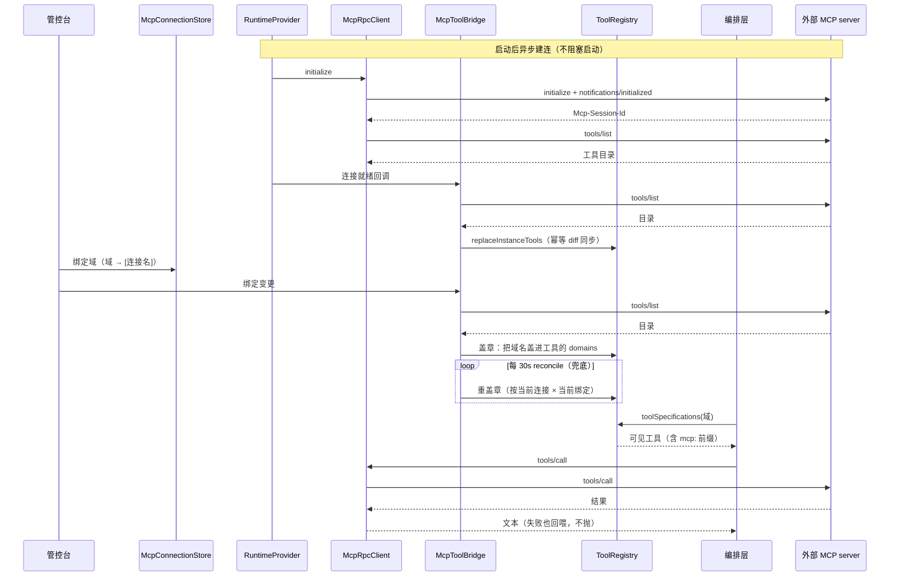

序列图里最值得指出的两处：**盖章只发生在 Bridge**（provider 不注册、Admin 控制器不注册），所以三种到达顺序都收敛到同一结果；**执行器不闭包客户端**（每次经 provider 取"活的"运行时），否则重连后仍拿着死连接调用。

`McpCoordinator` 做周期性 reconcile（30s）：拉起失败连接（带冷却）、重盖章、摘掉已删连接的运行时。**store 的 bindings 是唯一真相，注册表是派生缓存**，兜底防的就是"绑定落盘后盖章失败/漏盖章"导致两边长期不一致。

## 12.3 两种传输

| 传输 | 规范 | 会话维系 |
| --- | --- | --- |
| `STREAMABLE_HTTP` | 2025-03-26 | 单一端点，POST JSON-RPC，响应可能是 JSON 或 SSE；`Mcp-Session-Id` 头 |
| `LEGACY_SSE` | 2024-11-05 | 先 `GET /sse` 开流、服务端回 `endpoint` 事件给动态 POST 地址，之后 POST 到该地址、响应经原 GET 流回传（按 JSON-RPC id 关联） |

`McpRpcClient` 只实现用到的三个方法：`initialize` / `tools/list` / `tools/call`。**STREAMABLE_HTTP 是 v1 主力**（联调覆盖），LEGACY_SSE 已实现但未对真实旧 server 联调，选用前需自行验证。

## 12.4 工具目录 → 注册项

`McpToolCatalog` 复用 `ToolParamSchema` 做 JSON Schema 翻译，另做六件事：

| 处理 | 说明 |
| --- | --- |
| 命名空间前缀 | 不同 server 的同名工具不能互相覆盖 |
| 字符规范化 + 去重 + 截断哈希 | 工具名有长度与字符集限制 |
| 副作用等级推导 | 从 `annotations` 推 `READ/WRITE/DESTRUCTIVE` |
| 审批策略推导 | 见 12.5 |
| 白名单过滤 | 连接级可声明只放行哪些工具 |

## 12.5 审批：默认最严

`McpApprovalPolicy` 默认 `ALL`（全部需人工批准）。理由：`annotations` 是**外部输入**，平台不该替不可信的 server 背书其 `readOnlyHint`。**默认可信度为零、逐项放权**是更安全的方向。

## 12.6 OAuth：按规范走五步，不引 SDK

`McpOAuthClient` 只用 JDK `HttpClient` + Jackson（契合离线构建）：

1. `discoverResource`：RFC 9728 保护资源元数据（从 401 的 `WWW-Authenticate` 头拿地址）
2. `discoverServer`：RFC 8414 授权服务器元数据（authorization / token / registration 端点）
3. `register`：RFC 7591 动态客户端注册（无 client_id 时）
4. `authorizeUrl` + **PKCE(S256)**：管理员浏览器授权（`state` 经 `McpOAuthSessionStore` 暂存）
5. `exchangeCode` / `refresh`：授权码换 token / refresh_token 续期

授权会话存内存：单实例部署，重启丢失只影响"授权到一半"的流程，重新点「授权」即可。`state` **一次性消费**（consume 即删）防重放，5 分钟过期。

`McpAuthChallengeException` 与普通 401 分开：不带 `WWW-Authenticate` 的 401 是"静态 token 配错"，提示去改请求头；带挑战头的 401 说明 server 主动声明了认证方案，必须走 OAuth。

token 的三条路径都汇聚到 `McpConnectionRuntimeProvider`：建连前过期必须刷新成功（失败留 `NEEDS_AUTH`）、未过期但与刷新窗口只 best-effort（失败不阻断，真失效时执行器兜）、运行中 401 先刷新并**重试一次**。

## 12.7 关键取舍

| 决策 | 被否方案 | 代价 |
| --- | --- | --- |
| 连接与域绑定同文件 | 两个 store 各存一半 | 文件更大；换来不存在"绑了不存在的连接"这种脏状态 |
| 绑定按域维度（域 → [连接]） | 连接维度（连接 → [域]） | 与 `ModelProfileRegistry` 同构；换来删域级联天然可用（只摘 map 条目，不删连接） |
| 盖章集中在 bridge | 连接建立时就注册 | 多一次间接；换来消掉两种时序问题 |
| 默认全部需审批 | 信任 server 的 readOnlyHint | 用户要点更多次；换来不替不可信方背书 |
| 周期 reconcile | 只靠事件驱动 | 每 30s 一次开销；换来"落盘成功但盖章失败"能自愈 |

## 12.8 易错点

1. **`McpToolExecutor` 必须每次现取运行时**。`ToolRegistry.refreshReplica` 对已存在条目会**保留旧 executor**，闭包了旧客户端的执行器在重连后只会用死连接。
2. **`McpConfiguration` 不能省**。provider 与 bridge 互相依赖会成构造环，必须用它在两者都构造完后注入回调。
3. **授权会话存内存**（单实例前提），多实例部署会失效。
4. **凭据明文落盘**（`headers` 里的认证值），只在出口脱敏，这是既有口径，加密是后续专项（`AdminMcpController` 只回 `hasHeaders` 布尔）。
5. **LEGACY_SSE 未经真实 server 联调**。

## 12.9 观察点（登记，未改动）

| # | 现象 | 影响 | 建议 |
| --- | --- | --- | --- |
| 1 | `McpConnectionStore` 350 行，连接 + 绑定 + 凭据同文件 | 凭据与业务配置混在一份 JSON，备份/分享时容易连凭据一起给出去 | 加密专项时优先处理 |
| 2 | `McpRpcClient` 429 行支持两种传输，LEGACY_SSE 未联调 | 选错传输的表现是"连不上"，而错误信息可能指向认证 | 文档里已标注，管控台可加提示 |
| 3 | 周期 reconcile 30s 固定常量 | 连接数多时每次都要遍历 | 连接数过百再考虑按需 |

## 12.10 讲这一块的抓手

- **接一个公开 MCP server**（Streamable HTTP），观察：连接列表 → 工具目录 → 域绑定 → 模型的工具清单里出现 `mcp_xxx_tool`。
- **验一次时序**：先绑域、后建连；再反过来（先建连、后绑域），两种顺序都应最终盖章成功。
- **验一次 401**：用一个要求 OAuth 的 server，观察 `NEEDS_AUTH` 状态与「授权」按钮流程。

## 12.11 覆盖清单（15 文件）

| 类 | 行 | 一句话 |
| --- | ---: | --- |
| `McpRpcClient` | 429 | 最小客户端：initialize / tools/list / tools/call，两种传输 |
| `McpConnectionStore` | 350 | 连接库 + 域绑定（同一份 JSON） |
| `McpOAuthClient` | 248 | OAuth 2.1 五步 + PKCE |
| `McpToolCatalog` | 199 | 工具目录 → 注册项（前缀/规范化/推导/白名单） |
| `McpConnectionRuntimeProvider` | 172 | 运行时持有者 + token 三条路径 |
| `McpConnection` | 164 | 一条连接配置（资源） |
| `McpConnectionRuntime` | 132 | 连接运行时状态（可整体重建） |
| `McpToolExecutor` | 95 | `tools/call` 翻译，现取运行时，401 重试一次 |
| `McpToolBridge` | 70 | 唯一盖章入口（幂等） |
| `McpCoordinator` | 66 | 30s reconcile 兜底 |
| `McpOAuthSessionStore` | 59 | 授权会话暂存（state 一次性、5 分钟） |
| `McpConfiguration` | 34 | 绕开 provider ↔ bridge 构造环 |
| `McpApprovalPolicy` | 29 | 默认 ALL（不替不可信 server 背书） |
| `McpAuthChallengeException` | 21 | 401 + 挑战头 → 走 OAuth |
| `McpTransport` | 20 | 两种传输枚举 |

## 12.12 测试

`McpOAuthClientTest`（内置 `StubOAuthServer`，内存级真 HTTP）、`McpToolCatalogTest`、`McpCoordinatorTest`、`McpConnectionStoreTest`、`ToolRegistryMcpPrefixTest`（命名空间不撞名）。协议层验证靠内置 stub，端到端接入任意符合 Streamable HTTP 的 server。

---

# F13 配置装配与运行环境

`server.config` + `server.env` + `server.settings` —— 46 文件 / 4,859 行

## 13.0 一句话

一句话：`server.config` 的 29 个类（其中 26 个是 `@Configuration`）把各模块的 Bean 装起来；落盘配置支持**热切换**；启动期做三类检查：一类拦启动（单实例守卫），两类只提醒（自检）。

## 13.1 配置装配的分组

| 组 | 配置类 | 装什么 |
| --- | --- | --- |
| 总装 | `DomainPlaneServerAutoConfiguration` | 服务端整体装配入口 |
| 编排 | `GraphConfiguration`（168） | `AgentOrchestrationService` + 三个 Resolver 实现注入 |
| 模型 | `ModelProfileConfiguration`（83）、`AiModelConfiguration`、`AiProperties` | 档案注册表 → 客户端工厂 → 解析器 |
| 存储 | `EsClientConfiguration`、`RedisClientConfiguration`、`ElasticsearchProperties`、`RedisProperties` | ES / Redis 客户端与配置模型 |
| 记忆 | `MemoryConfiguration`（155）、`MemoryProperties` | 记忆 / 归档 / 摘要 / 索引 / 检查点五个 Bean |
| 检索 | `RetrievalConfiguration`（116）、`RetrievalProperties`、`RetrievalLimitsConfiguration` | 组合检索器 + 通道提供者 + 收口参数 |
| 切片 | `ChunkingConfiguration` | 把 `rag.chunking.*` 注入 `TxtChunking` |
| 域 | `DomainConfiguration`（101） | 域注册表 + 一次性迁移 |
| 工具 / 实例 | `ToolConfiguration`（147）、`InstanceConfiguration`（61） | 本地工具注册、在线实例表与生命周期 |
| 多模态 | `VisionConfiguration`（60）、`CapabilityConfiguration`（38） | 两个独立执行池 + 暂存区 |
| Web | `WebMvcConfig`（74） | 跨域 + 凭证拦截器 |
| 守卫 / 自检 | `SingleInstanceGuardConfiguration`（67）、`StartupSelfCheckConfiguration`（53）、`ConfigValidationConfiguration`（29） | 见 13.3 / 13.4 |
| 可热切换 | `SwappableElasticsearchTransport`（177）、`SwappableRedisConnectionFactory`（168） | 见 13.2 |

## 13.2 热切换：注册 + 交换 + 延迟销毁

换 ES / Redis 连接不重启，靠三个角色的配合：

| 角色 | 职责 |
| --- | --- |
| `InfraSettingsHolder`（411） | 合并 yaml 与落盘、`apply(incoming)` 触发全部交换、`register(swappable)` 收集待交换者、探活（EsProbe / RedisProbe） |
| `InfraSwappable`（11） | 契约：`swap()` |
| `SwappableRedisConnectionFactory` / `SwappableElasticsearchTransport` | 实现：`swap()` 时按新配置建连接，把 `current` 指向新连接，**旧连接 `scheduleDestroy` 延迟销毁** |

延迟销毁是这里的关键：立刻关旧连接会把在途请求打断。`requireConfigured()` 保证"没配就明确报错"，而不是悄悄用一个空配置。

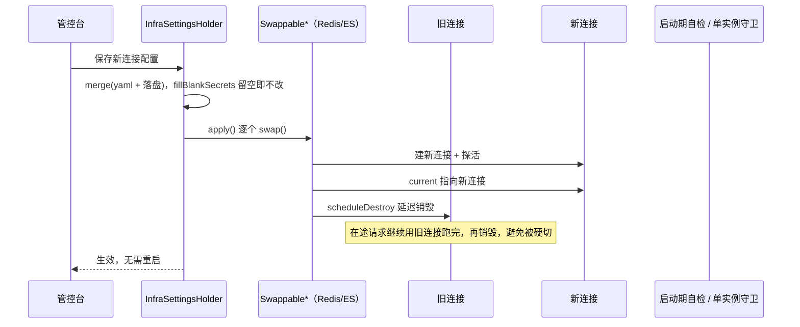

`fillBlankSecrets` 单独存在，是为了处理"前端表单回传时密钥字段留空"的情况，留空表示"不改"，而不是"清空"。

## 13.3 单实例守卫：唯一会拦启动的检查

`SingleInstanceGuard`：启动时在 Redis 上 `SET NX` 抢一个带 TTL（90s）的运行权租约，抢不到直接拒绝启动；优雅停机时释放。可用 `domainplane.single-instance-guard=false` 临时绕过。

它和自检**刻意分开**（`SingleInstanceGuardConfiguration` 的注释写明了理由）：

> 自检是"配置不对但还能跑"（只提醒），而本守卫挡的不是配置不当，而是"多实例共用 Redis 会静默产生错误结果"这种**正确性问题**。

多实例的失败方式确实格外糟糕，全都不报错：同一会话打到两边两个"占用闸门"都通过→记忆丢更新；`stop` 落到没有执行的那个实例→标志设在它那儿，在跑的那轮永远看不到；工具注册表各维护一份；知识库导入锁不互斥；判死扫描各扫各的。

## 13.4 启动自检：挑"声明与事实不一致、但不会报错"的问题

`StartupSelfCheckConfiguration` 用 `SmartInitializingSingleton`（所有单例就绪后才跑），两类检查：

| 检查 | 查什么 | 失败姿态 |
| --- | --- | --- |
| `RedisPersistenceAudit` | RDB/AOF 是否开、淘汰策略是否 `noeviction` | 只告警（客户环境各异，拦启动比丢历史更糟；受管 Redis 常禁 `CONFIG`，读不到也只告警） |
| `PromptToolConsistencyAudit` | 提示词点名的工具在当前域是否可见 | 只告警 |

为什么值得单独一类：这两种配置错了都不会报错，只会"某天重启后用户历史没了"或"内存紧张时记忆被随机淘汰"。

## 13.5 运行环境与落盘位置

`RuntimeEnvironment`（126）在 Spring 装配前判定 OS 族，`StorageLocations`（88）据此给三个目录：

| 用途 | Linux | Windows | macOS |
| --- | --- | --- | --- |
| 配置 | `/var/lib/domainplane/config` | `%ProgramData%\DomainPlane\config` | `/Library/Application Support/DomainPlane/config` |
| 日志 | `/var/log/domainplane` | `%ProgramData%\DomainPlane\logs` | `/Library/Logs/DomainPlane` |
| 切片导出 | `/var/lib/domainplane/chunks` | `%ProgramData%\DomainPlane\chunks` | `…/DomainPlane/chunks` |

覆盖优先级：命令行 `--key` ＞ `-Dkey` ＞ 环境变量 ＞ 平台默认。

**落盘的 JSON 一共 8 份**（分布在 F03 / F10 / F12 / F15）：

| 文件 | 内容 | 归属 |
| --- | --- | --- |
| `accounts.json` | 账号（BCrypt 哈希） | F15 |
| `llm-settings.json` | yaml 兜底设置 | F10 |
| `models.json` | 模型档案 + 域绑定 | F10 |
| `provider-connections.json` | 服务商连接库 | F10 |
| `infra-settings.json` | ES / Redis 连接 | F13 |
| `domains.json` | 域声明 + 可调用性 | F03 |
| `prompts.json` | 域提示词 + 工具回写开关 | F03 |
| `mcp-connections.json` | MCP 连接 + 域绑定 | F12 |

## 13.6 关键取舍

| 决策 | 被否方案 | 代价 |
| --- | --- | --- |
| 配置落文件不进 ES/Redis | 配置存中间件 | 要管文件权限与备份；换来"配置正是用来找中间件的"，不会死锁 |
| 单实例守卫拦启动 | 只在文档里写"只能单实例" | 运维想临时双开要先改开关；换来正确性 | 
| 自检只提醒 | 自检失败即拒绝启动 | 配置问题可能被忽略；换来客户环境各异时也能起得来 |
| 连接热切换 + 延迟销毁 | 改配置需重启 | 多一层间接；换来不打断在途请求 |

## 13.7 易错点

1. **本机开发务必覆盖 `DOMAINPLANE_SETTINGS_PATH`**，否则会写到 `D:\var\lib\...` 这种盘根目录（实际踩过：管控台读不到 infra-settings.json）。
2. **`fillBlankSecrets` 的留空语义是"不改"**，不是"清空"。
3. **单实例守卫的 TTL 是 90s**：进程被 kill -9 后要等最多 90s 才能重启（正常停机释放）。
4. **自检要用 `SmartInitializingSingleton`**，早于它跑看不见全貌（工具没扫完、设置没读到）。

## 13.8 观察点（登记，未改动）

| # | 现象 | 影响 | 建议 |
| --- | --- | --- | --- |
| 1 | `LlmModelHolder` 608 行，是 settings 包最大的类 | 模型热替换 + 向量模型两条来源 + 多模态端点工厂都堆在一起 | 向量模型解析可独立成类 |
| 2 | 两个 `Swappable*` 各自实现 `swap` 与延迟销毁，逻辑同构 | 加第三种可切换依赖要再抄一遍 | 可抽模板 |
| 3 | 配置项总数约 90 个，散在 15 个 Properties 类里 | 没有一张统一表格（本章 13.1 给了分组，但不是全量键表） | 若要运维友好的"配置总表"，需单独维护一份键清单 |

## 13.9 讲这一块的抓手

- **看一次热切换**：管控台改 Redis 地址 → 保存 → 立刻生效（不重启），日志里有 `swap` 记录。
- **看一次单实例守卫**：两个进程同时起，第二个直接失败，日志指明"租约被占用"。
- **看一次自检**：把 Redis `maxmemory-policy` 改成 `allkeys-lru`，启动日志会告警但不阻断。

## 13.10 覆盖清单（46 文件）

| 包 | 文件 | 行 | 代表类 |
| --- | ---: | ---: | --- |
| `server.config` | 29 | 2,081 | `GraphConfiguration`(168) / `SwappableElasticsearchTransport`(177) / `SwappableRedisConnectionFactory`(168) / `MemoryConfiguration`(155) / `ToolConfiguration`(147) / `RetrievalConfiguration`(116) / `DomainConfiguration`(101) |
| `server.env` | 4 | 454 | `SingleInstanceGuard`(151) / `RuntimeEnvironment`(126) / `RedisPersistenceAudit`(89) / `StorageLocations`(88) |
| `server.settings` | 13 | 2,324 | `LlmModelHolder`(608) / `InfraSettingsHolder`(411) / `DomainStore`(250) / `InfraSettings`(196) / `LlmFailureDescriber`(171) / `DomainSettingsStore`(144) / `EsCompatibility`(122) / `LlmModelCatalog`(102) |

---

# F14 管控台

`server.controller` + `static/` —— 14 文件 / 4,323 行，前端 9 页 ≈295 KB

## 14.0 一句话

一句话：给运维用的四个面：**配置**（模型/存储/域/提示词/账号）、**资源**（在线实例/MCP 连接/知识库）、**观测**（指标/概览）、**业务入口**（chunk 上传注册、agent 调用）。

## 14.1 端点分组（14 个 Controller / 85 处 Mapping）

| 面 | Controller | 行 | Mapping | 管什么 |
| --- | --- | ---: | ---: | --- |
| 综合 | `AdminController` | 1,198 | 22 | 设置、账号、存储、提示词、知识库、工具、导出等多面并发 |
| 模型档案 | `AdminModelProfileController` | 1,134 | 14 | 档案增删改 + 域绑定（三条产品规则的落点，F10） |
| MCP | `AdminMcpController` | 535 | 11 | 连接增删改、连通性测试、工具目录、域绑定、OAuth 授权 |
| 域 | `AdminDomainController` | 344 | 4 | 建域、可调用性切换、删除（含级联） |
| 多模态端点 | `AdminModelEndpointController` | 241 | 7 | 生图/重排/语音/识别的试调用入口 |
| 账号 | `AuthController` | 169 | 6 | 登录、初始化、改密、会话 |
| 服务商连接 | `AdminProviderConnectionController` | 146 | 5 | 自定义连接（名称+地址+密钥） |
| 工具实例注册 | `ToolRegistrationController` | 140 | 2 | 外部实例注册 + 心跳（F08 的接入点） |
| 业务入口 | `ServerAgentController` | 141 | 5 | chat / resume / stop / health |
| 适配查询 | `AdminModelAdapterController` | 90 | 3 | 只读：这个 baseUrl + 模型有没有适配 |
| 域清单 | `DomainController` | 75 | 1 | 可调用单元清单（供 starter 启动期自检） |
| 预设 | `AdminProviderPresetController` | 41 | 2 | 内置服务商清单（只读、不落盘） |
| 指标 | `AdminMetricsController` | 38 | 2 | `/admin/metrics` 快照 |
| 健康 | `HealthController` | 31 | 1 | `/health`（免鉴权，只表示进程能对外服务） |

三个值得注意的设计：

- **`AdminMcpController` 的凭据只回 `hasHeaders` 布尔**，明文不回显（F12）。
- **`DomainController` 只返回可调用的域**：目的是让 starter 启动期就能发现"域名写错 / 把装配节点当入口"，而不是等第一次线上调用收到 10004/10010。
- **`AdminMetricsController` 是 `MetricsRegistry` 的唯一读取出口**（F02：6 个上报点、1 个读出口）。

## 14.2 前端：零依赖、同源、统一守卫

| 约束 | 做法 | 为什么 |
| --- | --- | --- |
| 零依赖 | 不引 CDN、不用框架 | 内网部署常见无法出网 |
| 导航 | `console.js` 的 `renderSidebar()` 渲染 | 新增页面 = 落一个 HTML + 在导航数组加一项 |
| 登录守卫 | `console.js` 统一实现：加载时查 `/admin/session`，收到 10002 跳登录页 | 每页各写一遍必然有漏 |
| 同源 | 必须从服务端地址打开 | 凭证是 Cookie，跨站不保存也不携带 |
| 数据 | 页面不内置任何配置数据，全部经 `/admin/**` 读 | 否则页面与后端会各有一份真相 |

页面体量极不均衡（`models.html` 98 KB 一站独大）：

| 页面 | 大小 | 内容 |
| --- | ---: | --- |
| `models.html` | 98 KB | 档案表单 + 域绑定 + 参数调优 + 探测 + 端点试调用，全项目最复杂的单页 |
| `domains.html` | 36 KB | 域树 + 可调用性 + 提示词 + 工具回写开关 |
| `mcp.html` | 29 KB | 连接 + 工具目录 + 域绑定 + OAuth |
| `infra.html` | 26 KB | ES / Redis 连接 + 探活 |
| `instances.html` | 13 KB | 在线实例与工具副本 |
| `prompts.html` | 13 KB | 提示词设定 |
| `knowledge.html` | 11 KB | 上传 / 列表 / 删除 / 切片预览路径 |
| `login.html` | 9 KB | 登录 / 首次初始化 |
| `overview.html` | 6 KB | 概览（uptime、计数、健康） |
| `account.html` | 6 KB | 改密 |
| `assets/console.css` + `console.js` | 46 KB | 统一样式与导航/守卫 |

## 14.3 关键取舍

| 决策 | 被否方案 | 代价 |
| --- | --- | --- |
| 前端零依赖 | 上 Vue/React | 复杂交互写得累（`models.html` 98 KB 就是代价）；换来内网可用 |
| 一页对应一组后端接口 | 单页大应用 | 页面之间冗余；换来每页可独立打开、可单独改 |
| 凭证走 Cookie | Header 传 token | 必须同源；换来浏览器自动携带、前端不用管 |
| 页面不内置数据 | 页面内联默认值 | 每次打开都要请求；换来只有一份真相 |

## 14.4 易错点

1. **必须从服务端地址打开**（`localhost:9527`），用 `file://` 或别的域打开会让凭证 Cookie 不生效，表现为"登录成功后又跳回登录页"。
2. **新增页面要同时改两处**：落 HTML + 导航数组加项（没有自动发现）。
3. **`/health` 不检查 ES/Redis/模型**。它只表示"进程能对外服务"，拿它当"依赖就绪"会误判。
4. **`models.html` 的"配置文件"提示要看接口返回值**，不能写死（曾经写死 `llm-settings.json`，而实际写入 `models.json`）。

## 14.5 观察点（登记，未改动）

| # | 现象 | 影响 | 建议 |
| --- | --- | --- | --- |
| 1 | `AdminController` 1,198 行 / 22 个 Mapping，混合了设置、账号、存储、提示词、知识库、工具六类 | 单文件最重的一块，改一处要先定位 | 已按面拆出 5 个 Admin*Controller，但 admin 综合面还没拆完 |
| 2 | `models.html` 98 KB，是第二名的 2.7 倍 | 维护成本高、加载慢 | 可拆成"档案列表 / 档案详情 / 端点试调用"三页 |
| 3 | 前端无构建、无校验 | 字段校验只在后端 | 可接受（零依赖的代价），但错误提示要靠后端文案质量 |

## 14.6 讲这一块的抓手

- **点一遍概览页**：能看到 uptime、各类计数、ES/Redis 状态，F02 的 17 个 counter 就是从这里读的。
- **演示域空间**：建三级域 → 看父域自动变装配节点 → 给域绑提示词与工具回写开关（F03）。
- **演示模型页**：新建档案 → 点探测 → 端点族与模态出现 → 绑到域（F10）。
- **验一次守卫**：清掉 Cookie 刷新任意页面 → 跳登录页。

## 14.7 覆盖清单（14 Controller + 前端）

| 组 | 文件 | 行 |
| --- | ---: | ---: |
| `server.controller` | 14 | 4,323 |
| `static/admin.html` + `console/*.html`（9 页） | 10 | ≈240 KB |
| `static/console/assets/console.css` + `console.js` | 2 | 46 KB |

## 14.8 测试

`ServerAgentControllerChatGuardTest`、`AdminDomainDeleteOrderTest`（372，删域级联顺序）、`AdminDomainToolCallEchoTest`（114）、`AdminModelProfileController*Test`、`ServerGlobalExceptionHandlerExposureTest`（错误出口文案）。控制器测试以"顺序与不可逆操作"为主，这正是最该测的部分。

---

# F15 鉴权与错误出口

`server.auth` + `advice` + `audit` + `logging` —— 11 文件 / 1,290 行

## 15.0 一句话

一句话：**凭证是无状态 HMAC 签名，不设有效期**；账号是 BCrypt 落盘；错误只有一个出口，且出口只说 `userMessage`。

## 15.1 凭证：不是随机 token，是签名

`CredentialService` 只有五个方法，能看出整套机制：

```java
String issue(AccountSettings account);                    // 签发
boolean verify(AccountSettings account, String credential); // 校验
private byte[] deriveKey(AccountSettings account);          // 由账号派生密钥
private static byte[] hmac(byte[] key, String data);        // 签名
```

| 性质 | 结果 |
| --- | --- |
| 无状态 | 服务端不存凭证表，重启不影响 |
| **不设有效期** | 正常路径下登录只发生一次 |
| 改密码 = 所有旧凭证失效 | key 由账号（含密码哈希）派生，密码一变 key 就变，旧签名全部校验不过 |
| 客户端缓存一份 | `ClientCredential` 进程内缓存（F16），两个 SDK 共用 |

401 的两种含义在 F12 已区分（静态 token 配错 vs OAuth 挑战），这里再补一条：**`AUTH_DEFAULT_CREDENTIAL 10008`**：管理员仍在使用种子默认口令时，变更类操作被拒（提示先去「账号」页改密码）。这是唯一一个"能登录但不让动"的码。

## 15.2 账号：种子 → 落盘

`AccountStore`（240 行）：`classpath:accounts-seed.json` → `<settings.path>/accounts.json`。首个跑起来的实例把种子写到落盘位置，之后只读落盘。

`AuthService`（255 行）对外八个能力：`isInitialized` / `hasEverBeenInitialized` / `isStoreCorrupted` / `initialize` / `login` / `verify` / `changePassword` / `sessionInfo` / `isDefaultCredential`。

其中 **`hasEverBeenInitialized` 与 `isInitialized` 分开**，是为了区分"从没初始化过（可以开放初始化入口）"与"初始化过但账号文件坏了（必须拒绝一切受保护请求，且**不开放初始化入口**）"，后者对应 `AUTH_STORE_CORRUPTED 10007`。这个区分很重要：账号文件坏了又允许初始化，等于任何人都能重建管理员。

`PasswordHasher`（54 行）只管"明文 ↔ 哈希"，不碰存储与凭证，单一职责，也便于单独验。

## 15.3 拦截器：只做一件事

`CredentialAuthInterceptor`（185 行）：校验凭证 → 失败按 `AUTH_REQUIRED 10002` 返回 → 成功放行并把账号信息放进请求上下文。

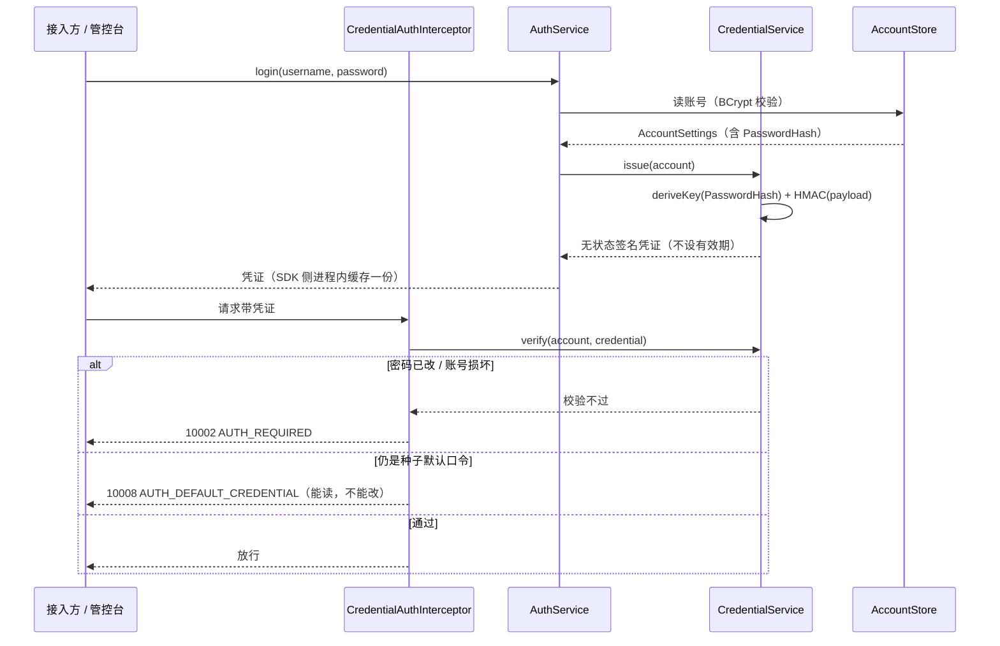

凭证"无状态 + 无有效期"的代价在图上也能看出来：**它没有吊销列表**，改密码是唯一让全部旧凭证失效的手段（因为 key 掺了 `PasswordHash`）。

## 15.4 错误出口：21 个 handler，从具体到笼统

`ServerGlobalExceptionHandler`（291 行）是**唯一出口**，handler 顺序即优先级：

| 层 | 处理 |
| --- | --- |
| 业务异常 | `KnowledgeBaseException` / `ChatMemoryException` / `AuthException` / `NotConfiguredException` / `BaseException`（按 `ErrorCode` 输出） |
| 入参类 | `IllegalArgumentException` / `MissingPathVariable` / `MessageNotReadable` / `MissingParameter` / `TypeMismatch` / `MaxUploadSizeExceeded`（后者会把上限值带进提示） |
| 传输/IO | `SocketTimeout` / `Timeout` / `IOException` / `NoResourceFound` / `Cancellation` |
| 兜底 | `IllegalStateException` → `RuntimeException` → `Exception` |

两个细节：

- **`storageUnavailable` + `isStorageFailure`** 负责把"存储类失败"（Redis/ES 不可用）单独识别成 `STORAGE_UNAVAILABLE 90004`，而不是塌进 `SYSTEM_ERROR`，两者对运维的含义完全不同（一个是依赖挂了，一个是代码炸了）。
- **只输出 `userMessage`**（F01 的双文案约定）：`ERROR` 帧与 HTTP 响应体的 `error` 字段都取对外文案，内部术语只进日志。

## 15.5 审计与日志

| 组件 | 行 | 作用 |
| --- | ---: | --- |
| `AuditLog` | 39 | 管理操作审计（谁在什么时候改了配置） |
| `LevelColorConverter` | 20 | 控制台日志级别着色（文件日志不用） |

## 15.6 关键取舍

| 决策 | 被否方案 | 代价 |
| --- | --- | --- |
| 凭证无状态 HMAC | 服务端存 session 表 | 无法"单独吊销某一个凭证"（只能改密码全吊销）；换来无状态、重启不影响 |
| 凭证不设有效期 | 定期过期 | 泄露后长期有效；换来"登录只发生一次" |
| 账号文件损坏时拒绝一切且不给初始化入口 | 允许重新初始化 | 只能人工修文件；换来不会被"重建管理员" |
| 错误出口只出 userMessage | 直接把异常 message 给前端 | 排查要多看日志；换来终端用户看不到内部术语 |

## 15.7 易错点

1. **`isInitialized` 与 `hasEverBeenInitialized` 不能合并**（15.2）。
2. **改密码会让所有客户端旧凭证失效**，SDK 需要重新换（`DomainPlaneStartupException` 相关，F16）。
3. **默认口令状态下变更类操作被拒**（10008），只读操作不受影响。
4. **`/health` 不在鉴权范围内**（探针要能访问）。

## 15.8 观察点（登记，未改动）

| # | 现象 | 影响 | 建议 |
| --- | --- | --- | --- |
| 1 | 凭证无有效期、无吊销列表 | 泄露后只能改密码（全端失效） | 开发阶段按既定口径不处理；安全专项时再评估 |
| 2 | 21 个 handler 集中在一个类 | 加异常类型要改这个文件 | 规模可接受，但要注意顺序（具体在前） |
| 3 | `AuditLog` 只有 39 行 | 审计粒度未知（可能只记管理写操作） | 需要时再确认覆盖面 |

## 15.9 讲这一块的抓手

- **看一次凭证无状态**：登录拿到 Cookie，重启服务端，Cookie 仍然有效（因为 key 由账号派生，不依赖内存）。
- **看一次改密失效**：改管理员密码 → 老 Cookie 立刻 10002。
- **看一次错误出口**：故意上传超限文件 → 返回体里的 `error` 是对外文案（不是 `KnowledgeBaseException: ...`）。

## 15.10 覆盖清单（11 文件）

| 类 | 行 | 一句话 |
| --- | ---: | --- |
| `advice.ServerGlobalExceptionHandler` | 291 | 唯一错误出口，21 个 handler |
| `auth.AuthService` | 255 | 初始化 / 登录 / 校验 / 改密 / 默认口令判定 |
| `auth.AccountStore` | 240 | 种子 → 落盘，含损坏区分 |
| `auth.CredentialAuthInterceptor` | 185 | 凭证校验拦截 |
| `auth.CredentialService` | 103 | HMAC 签发与校验（无状态） |
| `auth.AccountSettings` | 57 | 账号结构（BCrypt 哈希） |
| `auth.PasswordHasher` | 54 | 明文 ↔ 哈希 |
| `audit.AuditLog` | 39 | 管理操作审计 |
| `auth.AuthBootstrap` | 31 | 启动期账号初始化 |
| `logging.LevelColorConverter` | 20 | 控制台级别着色 |
| `auth.AuthException` | 15 | 账号/凭证异常 |

## 15.11 测试

`AuthServiceTest`、`CredentialServiceTest`、`AccountStoreTest`、`ServerGlobalExceptionHandlerExposureTest`（错误出口只出 userMessage）、`AuthControllerTest`。鉴权是少数几个"错了会立刻暴露"的模块，测试相对充分。

---

# F16 SDK 三件套

`client-core` + `chat-client` + `kb-client` —— 14 文件 / 1,332 行

## 16.0 一句话

一句话：三个按需引入的 starter：**对话**（`DomainPlaneAgent`）、**知识库**（`KnowledgeBaseClient`）、**工具实例**（F08 的 `tool-provider`），共享一个底座（WebClient + 凭证 + 错误翻译）。

## 16.1 依赖与装配

```
sdk-core（契约 + 连接配置，F01）
   └── client-core（WebClient + 凭证缓存 + 错误翻译）
         ├── chat-client（DomainPlaneAgent 门面）
         └── kb-client（KnowledgeBaseClient）
tool-provider 只依赖 sdk-core（与服务端只通过 HTTP 报文耦合）
```

装配只有两条规则：

- **底座只装一份**：`DomainPlaneClientAutoConfiguration` 只装 `WebClient` 与 `ClientCredential`，与"引了哪个 SDK"无关，`@ConditionalOnMissingBean` 保证同时引两个也只装配一次。
- **各 SDK 只多一个 Bean**：`chat-client` 多 `domainplaneAgentFactory`；`kb-client` 多 `domainplaneKnowledgeBaseClient`。

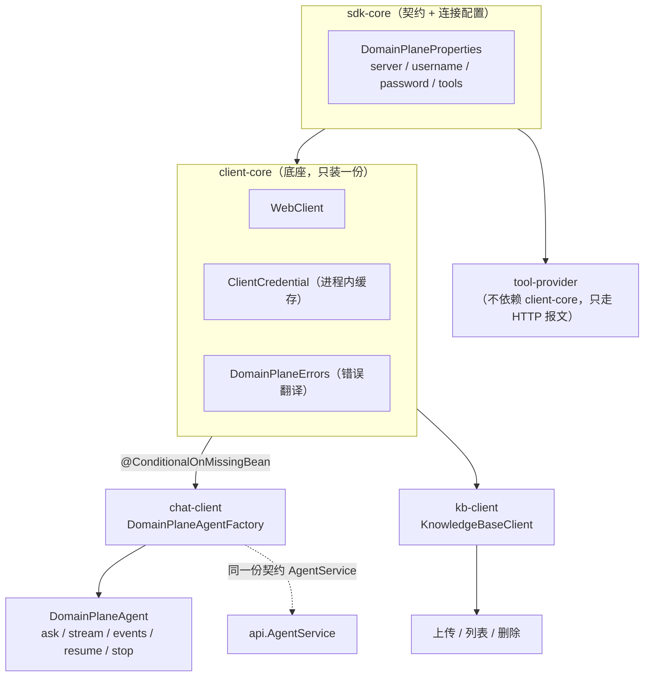

装配只装一份的做法（`@ConditionalOnMissingBean`）让"同时引三个 SDK"这件事无需任何额外配置，底座本来就是与"引了哪个 SDK"无关的。

## 16.2 错误：客户端码与服务端码是两个命名空间

| 命名空间 | 码段 | 谁定义 |
| --- | --- | --- |
| 服务端 | `10xxx–91xxx` | `api.code.ErrorCode`（55 个） |
| 客户端 | **`95xxx`** | `client-core.ClientErrorCode` |

刻意分开，避免任何一方加码时撞车或误判。**客户端码随 SDK 版本演进，不需要与服务端同步发版**，这正是拆开的目的。

分工是硬边界（`DomainPlaneErrors`）：

| 情况 | 处理 |
| --- | --- |
| **我这一侧的失败**（连不上 / 超时 / 凭证被拒 / 响应读不懂） | 客户端码 + SDK 给的可操作提示 |
| **服务端返回的业务错误** | `ServerRejectedException`，码与文案**原样透传** |

为什么不翻译（`ServerRejectedException` 的注释说得很清楚）：

> 翻译要求 SDK 与服务端共用一份枚举，于是两边被绑在同一条发版线上。服务端加一个新码，老 SDK 就只能把它兜底成"未预期错误"，调用方从此分不清"服务端说了什么"和"我这边没认出来"。透传则没有这个问题：新码照样原样到达宿主。

唯一还"看服务端"的地方是 HTTP 状态码（401/403/409），那是传输层的事实，属于客户端自己的关注面。

`DomainPlaneException` 让两个 SDK 共用同一个异常类型，接入方写一个全局异常处理器就够。

## 16.3 门面：先绑域，再调用

```java
DomainPlaneAgent agent = factory.forDomain("default.customer");  // 必须叶子域
agent.ask(sessionId, "…");       // 同步拿答案
agent.stream(sessionId, "…");    // 逐字
agent.events(sessionId, "…");    // 完整事件流
agent.resume(sessionId, true);   // 审批后继续
agent.stop(sessionId);
```

`DefaultDomainPlaneAgentFactory` **按归一化域名缓存门面**：`null` / 空白 / `" default "` 都落到同一个门面，不会因为写法不同造出多个等价实例。门面本身无状态、线程安全。

三种消费方式（`ask` / `stream` / `events`）底层走的是**同一条事件流**，没有第二套协议、也没有第二份状态。

## 16.4 知识库 SDK：只管"放进去"和"拿出来"

`KnowledgeBaseClient` 只有上传 / 列表 / 删除，**检索是服务端的事**：模型通过检索工具自动取用，SDK 侧没有检索入口，也没有"检索参数"要配。上传时声明的域决定哪些对话能检索到这份文档（F05）。

## 16.5 关键取舍

| 决策 | 被否方案 | 代价 |
| --- | --- | --- |
| 两个码命名空间分开 | 共用一份枚举 | 调用方要认两套码；换来 SDK 与服务端独立发版 |
| 服务端错误透传 | 翻译成本地枚举 | 调用方拿到的是原始码名；换来新码不用等 SDK 升级 |
| 三个 SDK 互不依赖 | 一个大 starter | 引一个就带全部；换来按需引入 |
| 底座 `@ConditionalOnMissingBean` | 各 SDK 自带一份 | 同时引入时只装一份；换来不冲突 |
| 门面按域缓存 | 每次 new | 极小的内存占用；换来避免重复创建 |

## 16.6 易错点

1. **`forDomain` 必须是叶子域**。传装配节点会在第一次调用时收到 10010（`DomainController` 就是为启动期自检准备的）。
2. **服务端改密码后 SDK 需要重新换凭证**，否则 10002。
3. **同时引两个 SDK 不会重复装配**（`@ConditionalOnMissingBean`），不用手动排除。
4. **`ClientErrorCode` 与服务端 `ErrorCode` 数字不重叠**，别按数字区间猜来源。

## 16.7 观察点（登记，未改动）

| # | 现象 | 影响 | 建议 |
| --- | --- | --- | --- |
| 1 | `DomainPlaneClientAutoConfiguration` / `ChatAutoConfiguration` / `KnowledgeBaseAutoConfiguration` 三处注释都写"**不做启动期连通性校验**：服务端未启动不阻断接入方启动"，但 `DomainPlaneStartupException`（"换凭证失败这类还没发业务请求就失败的情形"）仍然存在 | 口径不一致：到底会不会阻断启动需实测确认 | 建议核实 `ClientCredential` 的初始化时机，并在文档里写定 |
| 2 | `ClientCredential` 是进程内缓存，无失效通知 | 服务端改密码后要等首次调用失败再重换 | 已有"失败后重登一次"的路径（F16 注释提到），需确认覆盖 |
| 3 | `kb-client` 没有检索入口 | 想"自己查一下知识库"的接入方没有 API | 设计如此（检索归模型），登记以免被当缺失 |

## 16.8 讲这一块的抓手

- **最小接入**：引 `chat-client` → 配 `domainplane.server/username/password` → 注入 `DomainPlaneAgentFactory` → `forDomain(...).ask(...)`。
- **看一次码分离**：把服务端地址改成不存在的端口 → 拿到 `95xxx` 客户端码；把域名写错 → 拿到 `10004`（服务端码，透传）。
- **同时引两个 SDK**：确认只装配一份 `ClientCredential`（看 Bean 数量或日志）。

## 16.9 覆盖清单（14 文件）

| 模块 | 类 | 行 | 一句话 |
| --- | --- | ---: | --- |
| chat-client | `DefaultDomainPlaneAgent` | 254 | 门面：三种消费方式收在已绑域的实例上 |
| chat-client | `AgentServiceClient` | 116 | HTTP/SSE 通道（`AgentService` 的客户端实现，F01） |
| chat-client | `ChatAutoConfiguration` | 46 | 只多一个 `agentFactory` Bean |
| chat-client | `DefaultDomainPlaneAgentFactory` | 38 | 按归一化域名缓存门面 |
| client-core | `DomainPlaneErrors` | 193 | 错误翻译：本侧失败 vs 服务端拒绝 |
| client-core | `ClientCredential` | 133 | 账号密码 → 凭证，进程内缓存 |
| client-core | `ServerRejectedException` | 120 | 透传服务端码与文案 |
| client-core | `ClientErrorCode` | 71 | 客户端码（95xxx） |
| client-core | `DomainPlaneClientAutoConfiguration` | 71 | WebClient + 凭证，只装一份 |
| client-core | `DomainPlaneException` | 49 | 两个 SDK 共用的异常类型 |
| client-core | `ClientProperties` | 38 | `domainplane.client.*`（只管"怎么调"） |
| client-core | `DomainPlaneStartupException` | 17 | 启动期失败（换凭证） |
| kb-client | `KnowledgeBaseClient` | 152 | 上传 / 列表 / 删除 |
| kb-client | `KnowledgeBaseAutoConfiguration` | 34 | 只多一个客户端 Bean |

## 16.10 测试

`DefaultDomainPlaneAgentTest`（274）、`ClientCredentialTest`、`DomainPlaneErrorsTest`（错误翻译的码映射）、`KnowledgeBaseClientTest`。SDK 侧的测试以"错误翻译与门面行为"为主，这两处错了接入方会拿到莫名其妙的异常。

---

# 收口：全项目的取舍与边界

## A 七个贯穿全项目的设计主张

| # | 主张 | 落点 |
| --- | --- | --- |
| 1 | **请求级装配** | 工具 / 知识 / 提示词 / 模型四维都按本轮域裁剪（F03 F05 F08 F09 F10） |
| 2 | **越权显式拒绝，不静默降级** | `DOMAIN_NOT_CALLABLE`、`MODEL_NO_VISION`、`DEPENDENCY_NOT_CONFIGURED` 全都如实报错 |
| 3 | **派生值不进存储，读取时算** | 可调用性（F03）、融合分（F05）、状态机单飞（F08） |
| 4 | **破坏性操作 fail-closed，只读展示 fail-open** | 索引存在性（F05）、删域级联（F03/F04）、归档清理（F04） |
| 5 | **派生数据可重建，有损数据按档案对待** | 倒排索引 vs 滚动摘要（F04） |
| 6 | **字节不进上下文，只给引用名** | 多模态（F11）、归档 `MediaRef`（F01） |
| 7 | **不报错的失败最贵** | 日志注入、摘要倒退、判死并发、配置损坏，每一处都有专门机制 |

## B 明确未实现 / 不支持

| 项 | 现状 |
| --- | --- |
| 入口限流 `RATE_LIMITED 20000` | 码已定义，代码不发出 |
| 上游限流映射 `LLM_RATE_LIMITED 20001` | 仅在上游 429 时定性，平台侧不限流 |
| 并发会话数上限 `CONCURRENT_LIMIT 20003` | 码已定义，不发出 |
| `SESSION_MEMORY_FULL 30004` | M2 起语义移除（改为装配降级），码保留不再发出 |
| 多实例部署 | **不支持**，启动期单实例守卫强制拦截（F13） |
| 归档 / 记忆的自动清理 | 无，需手工 `DEL`；只有删域会级联 |
| 滚动摘要的 TTL | 无（有损数据，按档案对待） |
| MCP `LEGACY_SSE` 联调 | 已实现，未对真实旧 server 验证 |
| pdf 字号推断标题 / 表格还原 / 双栏 / 扫描件 | 明确不做（F06） |
| 图片 OCR | 不做，只留占位（F06） |

## C 九个功能块的技术债（汇总）

| 块 | 债务 |
| --- | --- |
| F07 | `AgentOrchestrationService` 2,295 行、无独立单测（最大一笔） |
| F04 | `DualConstraintChatMemory` 类注释仍写旧封顶语义 |
| F03 | `DomainStore` 与 `DomainRegistry` 对"可调用性是否派生"注释相反 |
| F05 | 串行检索每次新建线程池；`RetrievalLimits`/`TxtChunking` 重启生效 |
| F06 | 向量批大小 25 硬编码；`TextClip` 无直接测试 |
| F08 | 实例生命周期四态几乎没有单测 |
| F09 | `SystemPromptResolver` 接口注释与实现口径不一致 |
| F13 | ~90 个配置键没有一张统一全量表 |
| F16 | 三处注释称"不阻断启动"与 `DomainPlaneStartupException` 的存在口径不一致 |

> 这些都登记在各自章节的「观察点」里，本章只做汇总索引；**均未改代码**。

## D 复检记录（2026-10-18）

### D.1 已修正：统计口径错误

初版的行数由 PowerShell `Get-Content`（未指定编码）批量统计，**对部分含多字节字符的文件会丢行**：同一文件 `CjkTokenizer.java` 该方式得 187 行、按 UTF-8 读取实为 213 行。已全部按 UTF-8 重测并修正：

| 位置 | 修正前 | 修正后 |
| --- | --- | --- |
| 全书规模 | 298 类 / 40,919 行 | **298 类 / 42,022 行** |
| 测试规模 | 129 类 / 17,966 行 | **129 类 / 18,454 行** |
| F01 / F02 / F04 | 2,555 / 1,092 / 2,014 | **2,681 / 1,162 / 2,074** |
| F05 / F07 / F08 / F09 | 3,154 / 2,776 / 4,650 / 1,478 | **3,167 / 2,785 / 4,686 / 1,607** |
| F03 / F06 / F10–F16 | — | 复核后无需改动（原先即按 UTF-8 或逐文件测得） |

各章「覆盖清单」与「测试」表里的单文件行数同步订正；章节标题、目录、`功能划分与介绍顺序.md` 的模块表与功能块表一并更新。

### D.2 已修正：表述不准确

| 位置 | 原文 | 修正为 | 依据 |
| --- | --- | --- | --- |
| F13 | "29 个 `@Configuration`" | `config` 包 **29 个类，其中 26 个带 `@Configuration`** | 统计：29 文件 / 26 个含该注解 |
| F10 目录行 | 主责包含 `settings.Llm*` | 主责包为 `server.model` + `runtime.model`（`Llm*` 6 类计 F13） | 避免与 F13 重复计数 |
| 目录脚注 | "F10–F16 重测、F01–F09 有小幅差异" | 全部 16 块重测 + 列出 4 处刻意的重复归属 | 复检后统一口径 |

### D.3 本轮核实通过的断言（逐条回代码）

| 断言 | 实测值 |
| --- | --- |
| `ErrorCode` 码数 / 可重试码 | **55 个 / 18 个 `retryable=true`**；`90xxx` 段确实缺 90001、90002 |
| `CjkTokenizer` 停用词 | **51 个** |
| 检索默认参数 | 向量 30 / 关键词 20 / min-score 0.35 / 权重 0.6:0.4 / 标题 +0.15 / 文件名 +0.10 / topN 15 / rrfK 10 / decay 0.7 / 注入 8 条 3000 字 / 超时 5000ms / 池 4-16-200，全部一致 |
| 切片与上传 | 400 / 1 / 60；max-chunks 2000；文件上限 5MB；导入锁等待 60s；池 2 / 队列 16，全部一致 |
| 记忆与装配 | ttl=null / checkpoint 24h / 装配预算 24000 / 窗口占比 0.6 / 摘要预算 2000 / 窗口 8 轮 / 卡片 5，全部一致（`max-messages` / `max-tokens` 仍在 yaml，只作自检口径） |
| 工具实例 | 心跳 5s、退避上限 20s、请求超时 10s、判死窗 35s（=7×5s）、强制下线保留 3600s、远程调用 30s / 最多 2 副本，全部一致 |
| 本地工具 / 视觉 / 能力三池 | 30s（`ToolExecutorService.DEFAULT_TIMEOUT_MS`）/ 60s / 120s，全部一致 |
| 单实例守卫 | `LEASE_KEY = domainplane:runtime:owner`，TTL **90s**，Lua 脚本按 holderId 比对后删，一致 |
| MCP | reconcile `fixedDelay=30000ms`（可配）、失败重连冷却 60s、video-wait 90s，一致 |
| 凭证 | `deriveKey` 掺入 `PasswordHash` + HMAC → **改密即全端失效**成立 |
| 端点数量 | 14 个 Controller / **85 处 Mapping 注解**，一致 |

### D.4 仍存的两处不确定（已在观察点登记）

1. **F16 启动期行为**：三处配置类注释均称"不做启动期连通性校验、不阻断启动"，但 `DomainPlaneStartupException`（换凭证失败）存在。需实测确认哪条路径真的会抛，文档按注释口径写，并标为观察点。
2. **F09 装配的"三条不可让的边界"**：只确证并展开了第一条（永不拒绝开轮），另两条未在代码注释中找到完整表述，未作推测。

> 复检方法：全量行数用 `[IO.File]::ReadAllText(UTF8)` + 过滤空白行统计；机制断言逐条回源码 grep 常量与方法体。除统计与表述外，**16 章的设计结论未变更**。


